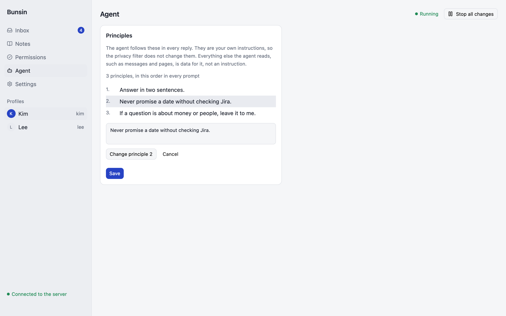
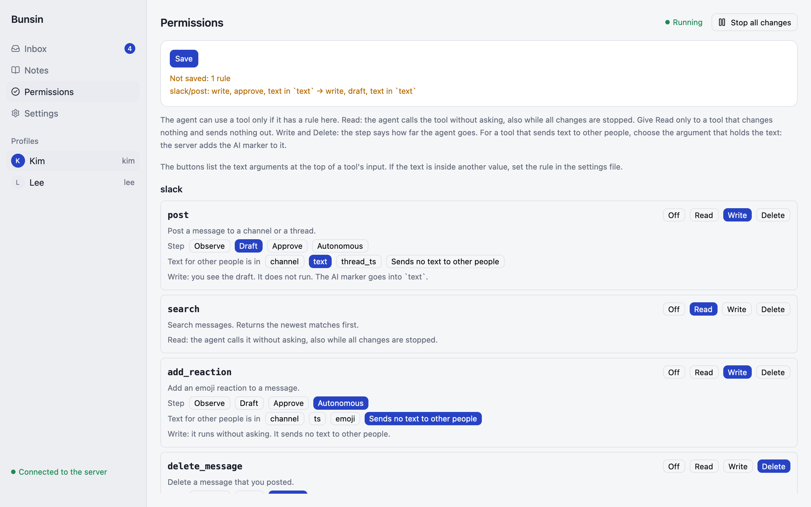
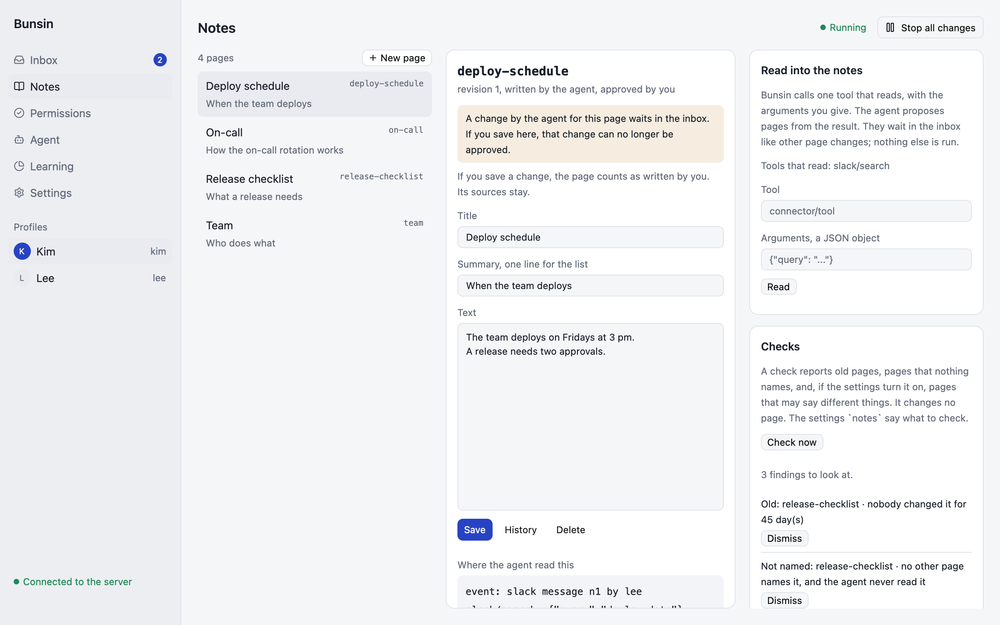

# Bunsin (분신)

[English](README.md)

Bunsin은 페르소나 AI agent를 실행하는 서버와 관리 도구입니다. agent 하나는 한 사람의 업무 원칙을 가지고,
MCP 서버를 통해 Slack, Jira, Confluence에서 그 사람을 대신해 일합니다.
서버 하나가 서로 격리된 여러 agent 프로필을 담습니다.

LLM은 제안만 합니다. 무엇을 실행할지는 하네스가 결정합니다.

- 프로필마다 권한 표가 허용된 도구를 정합니다. 표에 없는 도구는 거부됩니다.
- 모든 쓰기는 "소유자가 승인한 뒤 실행"에서 시작합니다. 소유자가 도구별로 단계를 올립니다.
- agent가 다른 사람에게 보내는 모든 글에 하네스가 AI 표시를 붙입니다.
- 프로필마다 정지 스위치가 있고, 켜면 모든 쓰기가 멈춥니다.
- 모든 제안, 초안, 결과를 저장합니다. 수정할 수 없는 감사 로그가 각 단계를 기록합니다.

## 현재 한계

Bunsin은 개발 초기 단계입니다. 사용하기 전에 아래 목록을 읽으십시오.

- **이벤트 수신은 사용하는 MCP 서버에 달려 있습니다.** 서버는 설정에 적힌 검색 도구를 반복 호출합니다
  ([이벤트 찾기](#이벤트-찾기-폴링) 참고). 이 기능은 테스트 서버로만 실행해 보았습니다. webhook 수신은 없습니다.
- **agent는 허용한 도구로만 읽습니다.** 제안하기 전에 `read` 도구(예: 검색)를 최대 5번 호출하고, notes의 페이지를 최대 5번 읽고, 그 결과를 씁니다.
  오래 쓸 사실은 notes에 정리하고, 사용자가 한 쪽씩 승인합니다([Notes](#notes) 참고). 미리 읽어 넣는 기능은 없습니다.
  notes는 agent가 이벤트를 처리하며 읽은 것으로만 채워지고, 검색 품질은 MCP 서버에 달려 있습니다.
- **개인정보 필터는 패턴과 사용자의 단어 목록으로 동작합니다.** 이메일, 전화번호 같은 정해진 형식은 찾습니다.
  사람 이름과 주소는 단어 목록(`terms`)에 적은 것만 찾습니다.
- **구성 마법사가 없습니다.** 연결 설정과 개인정보 필터는 창과 명령줄로 설정합니다. 권한 규칙은 창에서도 설정합니다.
  원칙과 poll도 창에서 정합니다.
- **아직 만들지 않은 것:** ARD 게시와 검색, REST API 커넥터, MCP 서버용 OAuth.
- **로컬 테스트 서버로만 시험했습니다.** 실제 LLM endpoint나 실제 MCP 서버로 실행하는 테스트는 없습니다.
- **데스크톱 창은 헤드리스로만 시험했습니다.** Keychain 저장 코드는 테스트가 없습니다.
- **서버 운영자는 프로필 데이터를 읽을 수 있습니다.** 프로필은 서로에게서 격리되어 있지만,
  서버 파일에 접근할 수 있는 사람에게서는 격리되어 있지 않습니다.

구현된 항목의 전체 목록은 [docs/ARCHITECTURE.md](docs/ARCHITECTURE.md)에, 계획은 [docs/PLAN.md](docs/PLAN.md)에 있습니다.

## 구성 요소

| 구성 요소 | 설명 | 실행 환경 |
|---|---|---|
| `bunsind serve` | 서버. agent를 실행하고 데이터를 저장합니다. | Linux, macOS |
| `bunsind <명령>` | 운영자와 프로필 소유자가 쓰는 명령줄 도구 | Linux, macOS |
| `bunsin-app` | 데스크톱 창: 승인함, 감사 로그, 정지 스위치, notes, 설정 | macOS |

## 빌드와 테스트

```sh
cargo build --release -p bunsin-daemon     # 서버와 명령줄 도구: target/release/bunsind
cargo build --release -p bunsin-app        # 데스크톱 창 (macOS): target/release/bunsin-app
cargo test --workspace
```

`rust-toolchain.toml`이 Rust 버전을 고정합니다. rustup이 처음 사용할 때 그 버전을 설치합니다.
Linux에서는 창을 빼고 빌드와 테스트를 합니다: `cargo test --workspace --exclude bunsin-app`.
창은 `gpui-kit` crate를 통해 GPUI를 씁니다.

### 명령줄 도구 설치

빌드하면 `bunsind`가 `target/release/`에 생깁니다. 이 폴더는 `PATH`에 없습니다.
그래서 이 README에서 `bunsind`로 시작하는 명령은 아직 실행되지 않습니다. 다음 둘 중 하나를 하십시오.

- `~/.cargo/bin`에 설치합니다. rustup이 이 폴더를 `PATH`에 넣어 둡니다.

  ```sh
  cargo install --path crates/daemon --locked
  bunsind --help
  ```

- 또는 경로를 붙여 실행합니다: `./target/release/bunsind --help`.

`bunsind --help`는 모든 명령을 보여 줍니다. `bunsind <명령> --help`는 그 명령의 옵션을 보여 줍니다.

## 한 컴퓨터에서 처음 실행해 보기

이 절차는 내 컴퓨터에 서버를 띄우고, 두 번째 터미널에서 그 서버를 씁니다.
LLM과 MCP 서버가 없어도 됩니다. 아래처럼 시험용 폴더를 쓰고, 실제 데이터 폴더는 쓰지 마십시오.

**터미널 1: 운영자.** 이 명령들은 데이터 폴더를 직접 읽고 씁니다.

```sh
export BUNSIN_DATA_DIR=/tmp/bunsin-data        # 운영자 명령은 모두 이 폴더가 필요합니다
bunsind profile-add kim --owner "Kim"          # 출력: created profile kim for Kim
bunsind token-add kim --label "Kim's laptop"   # 접속 token을 한 번만 출력합니다: bsn_...
bunsind serve --listen 127.0.0.1:8787 --key-store file   # 출력: listening on http://127.0.0.1:8787
```

`--key-store file`은 이 시험용 폴더의 키를 폴더 안에 둡니다. 이 옵션이 없으면 맥북의 서버는 Keychain에 항목을 만들고,
그 항목은 폴더를 지워도 남습니다.

token을 복사해 두십시오. 서버에는 해시만 저장되므로 token을 다시 볼 수 없습니다.
서버는 Ctrl-C를 누를 때까지 실행됩니다.

**터미널 2: 프로필 소유자.** 이 명령들은 네트워크로 서버에 접속합니다.

```sh
export BUNSIN_SERVER=http://127.0.0.1:8787
export BUNSIN_TOKEN=bsn_...                    # 터미널 1에서 받은 token
bunsind profile-list                           # kim	Kim
bunsind status kim                             # kill switch: off, inbox: 0 item(s)
bunsind connections kim                        # llm	not set
```

notes는 LLM 없이도 동작합니다.

```sh
printf 'Kim leads.\n' > team.md
bunsind wiki-set kim team --title "Team" --summary "Who does what" --body-file team.md
bunsind wiki-list kim                          # team	Team	Who does what
```

agent 자체는 아직 동작하지 않습니다. 프로필에 LLM을 설정하기 전에는 이벤트가 거부됩니다.

```sh
bunsind ingest kim --source slack --event-id 1 --author lee --text "When do we deploy?"
# error: the event was not handled: the LLM cannot be used: the profile has no `llm` settings
```

다음에 할 일:

1. 프로필에 LLM endpoint와 커넥터를 설정합니다: [LLM endpoint와 커넥터](#llm-endpoint와-커넥터).
2. 각 커넥터의 도구를 승인하고 agent가 할 수 있는 일을 정합니다: [권한 규칙](#권한-규칙).
3. 원칙을 적습니다: [원칙](#원칙).
4. 서버가 이벤트를 찾게 합니다: [이벤트 찾기](#이벤트-찾기-폴링).
5. 같은 주소와 token으로 창을 엽니다: [데스크톱 창](#데스크톱-창-macos).

다른 컴퓨터에서 접속하는 서버를 띄우려면 먼저 [서버 설정](#서버-설정-운영자)을 읽으십시오. TLS가 필요합니다.

## 서버 설정 (운영자)

```sh
export BUNSIN_DATA_DIR=/var/lib/bunsin
bunsind profile-add kim --owner "Kim"
bunsind token-add kim --label "Kim's laptop"   # 접속 token을 한 번만 출력합니다
bunsind serve --listen 0.0.0.0:8787 --tls-cert cert.pem --tls-key key.pem
```

- **접속 token.** token 하나는 프로필 하나에만 통합니다. 서버에는 해시만 저장되므로 다시 볼 수 없습니다.
  `bunsind token-list`와 `bunsind token-revoke <id>`로 관리합니다.
  프로필 생성과 token 발급은 서버에서만 할 수 있고, 네트워크로는 할 수 없습니다.
- **TLS.** 서버는 외부 주소에 TLS 없이 뜨지 않습니다. TLS 프록시 뒤에 둘 때는 `127.0.0.1`에 띄웁니다.
  한 컴퓨터에서 시험할 때는 `bunsind serve --listen 127.0.0.1:8787`로 띄우고 주소로 `http://127.0.0.1:8787`을 씁니다.
- **LLM과 MCP 서버의 token.** 프로필 소유자가 창이나 명령줄에서 입력하고, 서버가 암호화해 그 프로필의 DB에 보관합니다.
  이 암호화는 DB만 복사되거나 백업이 유출된 경우를 막습니다. 키를 잃었으면 서버를 한 번 `--accept-new-key`로 띄우십시오.
  notes와 설정은 그대로 남고, 저장된 token은 모두 읽을 수 없게 되어 소유자가 다시 입력해야 합니다.
  이 옵션이 없으면 서버는 키를 찾을 수 없는 암호화된 token 위에서 시작하지 않습니다.
- **키의 위치.** `--key-store`로 정합니다. 어느 쪽이든 저장된 token은 DB 안의 같은 암호문입니다.
  - **macOS의 기본값은 `keychain`입니다.** 키는 로그인 Keychain의 항목 1개입니다(Keychain Access에 `Bunsin server`라는 이름으로 보입니다).
    그러면 데이터 폴더를 복사해도 키가 들어 있지 않습니다. 항목의 계정은 데이터 폴더의 `keychain-id` 파일에 있는 ID입니다.
    이 파일을 보관하십시오. 없으면 서버가 자기 항목을 찾지 못합니다. 파일을 잃었으면 Keychain Access에 보이는 그 항목의 계정을 파일에 다시 적으십시오.
  - **다른 시스템의 기본값은 `file`입니다.** 키는 데이터 폴더의 `master.key` 파일, 또는 `--master-key-file`로 지정한 파일입니다.
    키 파일은 데이터 폴더의 백업에 넣지 마십시오. 키 파일을 읽을 수 있는 사람은 막지 못합니다.
  - **키 파일은 자동으로 옮겨집니다.** 맥북의 서버가 `master.key`를 찾았고 Keychain 항목이 없으면, 키를 Keychain에 쓰고,
    다시 읽어 확인한 뒤 파일을 지웁니다. 저장된 token은 그대로입니다.
  - **Keychain은 로그인 세션이 필요합니다.** 로그인한 사용자 없이 SSH나 부팅 시에 띄운 서버는 Keychain을 읽지 못해 시작하지 않습니다.
    그 경우 `--key-store file`을 쓰십시오. `bunsind`를 다시 빌드하면 프로그램이 바뀌었으므로 macOS가 접근 허용을 다시 물을 수 있습니다.
  - **키는 데이터 폴더와 함께 이동하지 않습니다.** 다른 컴퓨터의 Keychain에는 그 항목이 없어서 서버가 시작하지 않습니다.
    서버는 암호화된 token 위에 새 키를 만들지 않습니다. 키 파일로 시작하거나, 한 번 `--accept-new-key`로 띄운 뒤 token을 다시 입력하십시오.
  - 항목을 보거나 지우려면: `security find-generic-password -s "Bunsin server" -a "$(cat <데이터 폴더>/keychain-id)"`,
    그리고 같은 옵션으로 `security delete-generic-password`. 항목을 지우면 저장된 token을 읽을 수 없게 됩니다.
- **운영자가 넣는 token.** 프로필에 저장된 token이 없으면 서버는 환경 변수 `BUNSIN_SECRET_<프로필>__<KEY>`를 읽습니다
  (예: `BUNSIN_SECRET_KIM__LLM`). 한 프로필은 다른 프로필의 비밀 값을 가리킬 수 없습니다.
- **접속 대상 주소.** LLM과 MCP 주소는 프로필 소유자가 정하고, 요청은 서버가 보냅니다.
  기본 규칙은 `localhost`와 내부 IP 주소를 뺀 모든 `https://` 주소를 받습니다.
  내부 주소로 풀리는 host 이름은 통과합니다. 여러 사람이 쓰는 서버나 사외에 노출된 서버는
  `--allow-upstream-host <host>`(여러 번 지정 가능)로 띄우십시오. 그러면 목록의 host만 허용되고,
  `http://`를 쓰는 사내 gateway도 목록에 넣을 수 있습니다.
- **로컬 MCP 명령.** 서버에서 명령으로 실행하는 MCP 서버는 `--allow-stdio-connectors`가 있어야 합니다.
  이 옵션을 켜면 모든 프로필 소유자가 창이나 설정 파일로 서버에서 아무 프로그램이나 실행하게 할 수 있습니다.
  프로그램은 서버 사용자의 권한으로 실행되므로, 다른 프로필의 데이터와 키 파일을 읽을 수 있습니다.
  모든 프로필 소유자를 신뢰하는 서버(예: 혼자 쓰는 서버)에서만 이 옵션을 켜십시오.
- **종료.** 서버는 SIGTERM을 받으면 새 요청을 받지 않고, 실행 중인 요청을 최대 300초 기다립니다.

## agent 설정 (프로필 소유자)

```sh
export BUNSIN_SERVER=https://bunsin.example.com:8787
export BUNSIN_TOKEN=bsn_...                    # 운영자에게 받은 token
bunsind config-show kim > kim.json
# kim.json을 편집한 뒤:
bunsind config-set kim kim.json
```

사설 CA를 쓰는 서버에는 `BUNSIN_CA_CERT`에 CA 인증서 파일의 경로를 넣습니다.

새 프로필은 아무것도 할 수 없습니다. 설정에 LLM endpoint, 커넥터, 승인한 도구, 권한 규칙을 넣어야 합니다.

### LLM endpoint와 커넥터

데스크톱 창의 "Connections" 화면에서 입력하거나, 명령줄로 입력합니다.

```sh
bunsind llm-set kim --token-stdin               # Claude API. key를 입력하거나 파이프로 넘긴 뒤 Enter
bunsind llm-set kim --wire openai-chat --base-url https://llm.example.com/v1 \
    --model your-model-id --token-stdin          # 다른 endpoint
bunsind connector-set kim slack --url https://mcp.example.com/slack --token-stdin
bunsind connector-set kim jira --url https://mcp.example.com/jira --token-stdin
bunsind connector-set kim wiki --url https://mcp.example.com/wiki     # token이 필요 없는 MCP 서버
bunsind connector-set kim crm --url https://mcp.example.com/crm \
    --token-header X-API-Key --token-stdin       # token을 `X-API-Key: <token>`으로 보냅니다
bunsind llm-test kim                             # 저장된 LLM endpoint로 테스트 요청 1건
bunsind llm-usage kim                            # 지난 90일의 LLM 호출과 token
bunsind connections kim                          # 주소와 각 token의 출처
bunsind tools kim slack                          # 접속해서 도구 목록을 봅니다. 동작 확인 방법입니다
bunsind connector-remove kim jira                # 커넥터와 그 token을 지웁니다
```

- 옵션이 없으면 `llm-set`은 Claude API를 씁니다: `--wire anthropic-messages`,
  `--base-url https://api.anthropic.com`, `--model claude-opus-5-5`. 창도 같은 값을 미리 채웁니다.
  `--wire`는 `anthropic-messages`, `openai-chat`(Chat Completions), `openai-responses`(Responses) 중 하나입니다.
  LLM token의 헤더는 형식이 정합니다: Claude는 `x-api-key`, OpenAI 두 형식은 `Authorization: Bearer`입니다.
- `llm-test`와 창의 **Test**는 저장된 endpoint로 짧은 요청 1건을 보냅니다. 이 요청은 실제 요청과 같은 응답 형식과
  출력 한도를 쓰고, 프로필의 데이터는 담지 않습니다. endpoint에서 token 비용이 발생합니다.
  응답이 agent에게 필요한 형식이면 테스트가 통과합니다.
- `llm-usage`는 지난 90일의 LLM 호출을 UTC 날짜와 용도(`event`, `replay`, `llm_test`)별로 합칩니다.
  호출 수, 실패한 호출 수, 입력과 출력 token, 평균 시간을 보여 줍니다.
  서버는 모든 호출의 시각, token, 끝난 방식을 기록합니다. 요청과 응답의 글, 오류 문구는 저장하지 않습니다.
- 커넥터에는 token이 없어도 됩니다. token을 빼고 저장하면 됩니다. token은 `Authorization: Bearer <token>`으로 갑니다.
  MCP 서버가 다른 헤더를 읽으면 `--token-header`나 창에서 헤더 이름을 지정합니다. 그 헤더가 token을 그대로 담습니다.
  그 커넥터에 `connector-set`을 실행할 때마다 `--token-header`를 주십시오. 빼면 `Authorization: Bearer`로 돌아갑니다.
- 창의 **Copy the token from the Keychain**은 Mac의 로그인 Keychain에 이미 있는 항목에서 LLM token이나 주소 커넥터의 token을 읽습니다.
  항목의 서비스(Keychain Access에서는 *Where*로 표시)와 계정을 입력하고, **Read from Keychain**, **Save**를 차례로 누릅니다.
  token은 서버로 한 번 복사됩니다. 이후 Keychain에서 값을 바꿔도 서버에는 반영되지 않습니다.
  다른 앱이 만든 항목이면 macOS가 접근 허용 여부를 물을 수 있습니다. macOS가 묻는 동안 창은 반응하지 않습니다.
  읽을 수 있는 것은 로그인 Keychain의 "응용 프로그램 암호"뿐입니다. "인터넷 암호" 항목, iCloud Keychain, 암호 앱의 항목은 찾지 못합니다.
  Keychain 입력란은 한 번에 한 곳에만 열리고, 채울 token 칸 아래에 있습니다.
  읽기가 실패하면 그 token 칸을 비웁니다. 그래서 Save가 앞서 읽은 token을 보내지 않습니다.
- `--wire openai-chat`이나 `openai-responses`에서는 `llm-set`에 `--base-url`과 `--model`이 필요합니다.
  기본값은 Claude 형식에만 있습니다.
- 한 workspace에 묶이지 않은 Claude API key는 workspace ID도 필요합니다. 설정 파일의 `llm` 항목에 `"workspace_id"`를 넣으십시오.
- 서버는 token을 암호화해 저장하고, 다시 돌려주지 않습니다. `connections`는 "서버에 저장됨",
  "서버 환경 변수", "없음" 중 하나만 보여 줍니다.
- `--token-stdin`이 없으면 저장된 token을 유지합니다. `--clear-token`은 token을 지웁니다.
- 창이 설정을 읽은 뒤에 다른 사람이 같은 설정을 바꿨으면, 창은 덮어쓰기 전에 경고합니다.
  명령줄과 `config-set`은 이 검사를 하지 않습니다. 권한 규칙 명령(`rule-set`, `rule-remove`)만 검사합니다.
- token은 입력한 주소에 묶입니다. 연결을 다른 host나 port로 옮기면 token을 다시 입력해야 합니다.
  서버는 그 경우 token 유지를 거부합니다.
- 커넥터 이름은 a-z, 0-9, `-`로 된 1~32자입니다. 이름은 모든 도구 ID의 앞부분이 됩니다(예: `slack/post_message`).
- 커넥터 하나가 접속하지 못해도 다른 커넥터는 멈추지 않습니다.
- 커넥터는 서버가 실행하는 프로그램일 수도 있습니다(MCP의 stdio 방식). `npx ...`나 `uvx ...` 같은 명령으로 제공되는 MCP 서버에 씁니다.
  창의 커넥터 입력란에서 **Command on the server**를 고릅니다. 프로그램의 절대 경로만 적고, 인자는 따옴표 없이 한 줄에 하나씩,
  환경 변수는 `이름=값`으로 한 줄에 하나씩 적습니다. 설정 파일에서는 `"transport": "stdio"`와 `command`, `args`, `env`로 같은 내용을 적습니다.
  - 서버는 운영자가 `--allow-stdio-connectors`로 띄운 경우에만 이런 커넥터를 저장합니다. 이 옵션이 없으면 저장을 거부합니다.
    그 경우 옵션을 붙여 서버를 다시 띄워야 합니다.
  - 프로그램은 서버 컴퓨터에서 서버의 권한으로 실행됩니다. 프로필 소유자를 신뢰하는 서버에서만 쓰십시오.
  - API token 같은 비밀 값은 **비밀 변수**로 넣으십시오: 이름과 가려진 칸의 값을 입력하고 **Add**를 누릅니다.
    서버는 값을 token처럼 암호화하고, 프로그램의 환경 변수로 넘기고, 다시 보여 주지 않습니다. 설정에는 이름만 남습니다.
    값을 바꾸려면 같은 이름으로 다시 추가합니다. 지우려면 그 행의 **Remove**를 누른 뒤 저장합니다.
  - 인자와 그 밖의 환경 변수는 설정에 평문으로 저장됩니다. `config-show`와 **Edit** 후의 입력란이 이를 보여 줍니다.
    커넥터 목록은 프로그램 경로와 인자, 환경 변수의 개수만 보여 줍니다.
  - 비밀 값은 창에서만 입력합니다. 설정 파일은 비밀 변수의 이름(`"secret_env": ["API_TOKEN"]`)만 적을 수 있고, 값은 적을 수 없습니다.
    그 경우 입력란이 그 변수에 저장된 값이 없다고 알려 줍니다.
    이름이 빠진 설정 파일을 적용하면 저장된 값이 완전히 지워집니다. 따라서 예전 파일로 `config-set`을 하면 그 파일에 이름이 없는 값이 지워집니다.
    이미 설정에 평문으로 들어 있는 값은 자동으로 옮겨지지 않습니다. 비밀 변수로 다시 입력하고 평문 줄을 지우십시오.
  - 암호화는 저장된 값을 보호합니다. 프로그램이 실행되는 동안에는 값이 서버에서 그 프로그램의 환경에 있습니다.
  - 이름은 종류를 유지합니다. 주소 커넥터를 명령 커넥터로(또는 반대로) 바꾸려면 먼저 커넥터를 지우십시오.

### 원칙

```json
{
  "principles": [
    "Answer in two sentences.",
    "Never promise a date without checking Jira."
  ]
}
```

`principles`는 모든 프롬프트에 지시로 들어갑니다. agent가 읽는 그 밖의 글(메시지, 문서, 도구 설명)은
인용된 데이터로 들어갑니다.

창의 **Agent** 화면이 원칙 목록을 보여 줍니다. 원칙을 더하고, 고치고, 위아래로 옮기고, 지운 뒤 Save를 누르면 목록이 저장됩니다.
그 사이에 다른 사람이 원칙을 저장했으면 화면이 경고하고 "Load the server's version"과 "Save anyway"를 보여 줍니다.



- 원칙은 최대 50개이고, 하나는 1자에서 1,000자입니다. 원칙 앞뒤의 공백은 지웁니다.
- 원칙은 소유자의 지시이므로 개인정보 필터가 바꾸지 않습니다.
- 감사 로그에는 변경의 개수만 남고, 원칙의 글은 남지 않습니다.

#### 지난 글에서 찾은 원칙 후보

서버는 사용자의 지난 글이 따르는 규칙을 LLM에 물을 수 있습니다. LLM은 후보만 제안합니다.
사용자가 채택하기 전에는 어떤 후보도 원칙이 되지 않습니다.

```sh
bunsind extract-principles kim --from corrections     # 초안을 고친 기록과 이유
bunsind extract-principles kim --from replay-cases    # 재현 사례의 실제 답
bunsind extract-principles kim --from read --tool slack/search --args '{"query":"from:me"}'
bunsind principle-candidates kim
bunsind adopt-principle kim 4                          # 4번 후보를 원칙 목록 끝에 더함
bunsind adopt-principle kim 5 --text "Answer in one line."   # 고친 글을 대신 더함
bunsind dismiss-principle kim 6
```

- 글은 개인정보 필터를 거친 뒤 인용 데이터로 LLM에 갑니다. `read` 출처는 `read` 규칙이 있는 도구 하나를 poll과 같은 검사를 거쳐 한 번 부릅니다.
- 서버는 요청마다 후보를 최대 10개 남깁니다. 300자를 넘거나, `[REDACTED:...]` 자리표시자를 담거나, 근거로 인용한 글이 사용자의 글에 없는 후보는 버립니다.
  이미 원칙이거나 후보인 글도 버립니다. 그래서 기각한 후보는 다시 나오지 않습니다.
- 채택은 원칙 저장과 같은 경로로 글 하나를 더하고, 한도도 같습니다. 원칙을 읽은 뒤에 원칙이 바뀌었으면 채택은 거부됩니다(HTTP 412).

### 권한 규칙

창의 **Permissions** 화면은 승인된 도구를 하나씩 보여 주고, 버튼으로 규칙을 정하게 합니다.
먼저 Off, Read, Write, Delete 중 하나를 고르고, 그다음 단계와 다른 사람에게 보내는 글이 든 인자를 고릅니다.
창은 도구의 이름이나 설명을 보고 값을 미리 고르지 않습니다.
write 또는 delete 규칙은 글이 든 인자를 고르거나 "글을 보내지 않음"을 고르기 전에는 저장되지 않습니다.
Save는 표 전체를 보내고, 화면은 저장 전에 바뀌는 규칙을 하나씩 보여 줍니다.



- 버튼은 도구 입력의 최상위에 있는 글 인자만 보여 줍니다. 인자를 누르면 그 인자가 더해지거나 빠집니다. 그래서 여러 인자를 고를 수 있습니다.
- 글이 다른 값 안에 들어 있으면 `bunsind rule-set`이나 설정 파일로 규칙을 정하십시오.
  화면은 그런 규칙을 있는 그대로 보여 주고, 저장할 때 유지하고, 선택지 하나로 남겨 둡니다.
- 규칙을 바꾸면 승인함에서 이미 기다리는 항목에도 적용됩니다. 서버는 승인하는 시점의 규칙에 따라 AI 표시를 붙입니다.
- poll이 쓰는 규칙은 지울 수 없습니다. 화면이 서버의 거부 이유를 보여 줍니다.

#### 근거를 보고 단계를 올리고, 문제가 난 도구는 보류하기

서버는 write와 delete 도구마다 사용자의 결정을 셉니다. 고치지 않고 승인한 호출, 고쳐서 승인한 호출, 거부한 호출,
묻지 않고 실행된 호출(그중 실패한 호출)입니다. Permissions 화면은 도구마다 그 개수를 보여 줍니다.

- **제안.** 설정 파일에 기준을 적으십시오. 기준이 없으면 아무것도 제안하지 않습니다.

  ```json
  { "autonomy": { "min_reviewed": 20, "min_unchanged_percent": 90, "window_days": 30 } }
  ```

  `approve` 단계의 write 도구가 최근 `window_days`일 동안 결정을 `min_reviewed`개 이상 받고,
  그중 `min_unchanged_percent`% 이상을 고치지 않고 승인받았으면 "Suggested: Autonomous" 표시가 붙습니다.
  서버는 단계를 올리지 않습니다. 사용자가 단계를 올리고 Save를 누릅니다.
  delete 도구는 제안하지 않습니다. 코딩 도구도 제안하지 않습니다.
- **보류.** `autonomous` 단계 도구의 대기 호출을 거부하거나, 묻지 않고 실행된 호출에서 "Report a problem"을 누르면
  서버가 그 도구를 승인 단계로 보류합니다. 그러면 단계와 상관없이 그 도구의 호출마다 사용자를 기다립니다.
  서버가 스스로 승인했지만 멈추기 전에 실행하지 못한 호출도 기다립니다.
  보류는 설정과 따로 저장됩니다. 그래서 설정 파일이나 "Save anyway"로는 풀리지 않습니다.
  Permissions 화면의 "Clear the hold"나 `bunsind clear-autonomy-hold`만 보류를 풉니다. 보류가 시작되면 그 도구의 개수를 처음부터 다시 셉니다.

```sh
bunsind autonomy kim                          # 도구마다 한 줄: 개수, 보류, 제안
bunsind report-autonomous kim 42              # 묻지 않고 실행된 승인함 항목 42를 신고
bunsind clear-autonomy-hold kim slack/post_message
```

명령줄에서는 규칙을 하나씩 바꿉니다.

```sh
bunsind rules kim                                   # 규칙마다 한 줄. 규칙 없는 승인된 도구는 "off"
bunsind rule-set kim slack/search --class read
bunsind rule-set kim slack/post --class write --text text --text 'blocks.*.text.text'
bunsind rule-set kim slack/delete --class delete --tier approve --no-text
bunsind rule-remove kim slack/search
```

- write 또는 delete 규칙에는 `--text <자리>`(자리가 여럿이면 반복)나 `--no-text`가 반드시 있어야 합니다.
  `--tier`를 빼면 `approve`입니다. delete는 `autonomous`가 될 수 없습니다.
- 명령은 표를 읽고, 규칙 하나를 바꾸고, 읽은 표와 함께 보냅니다.
  그 사이에 다른 사람이 규칙을 바꿨으면 서버가 거부하고, 아무것도 저장되지 않습니다.

같은 규칙을 설정 파일로 적으면 다음과 같습니다.

```json
{
  "approved_tools": {
    "slack": [
      {
        "name": "search_messages",
        "description": "Search messages",
        "input_schema": { "type": "object", "properties": { "query": { "type": "string" } } }
      },
      {
        "name": "post_message",
        "description": "Post a message",
        "input_schema": {
          "type": "object",
          "properties": { "channel": { "type": "string" }, "text": { "type": "string" } }
        }
      }
    ]
  },
  "policy": {
    "rules": {
      "slack/search_messages": { "class": "read", "tier": "autonomous", "outgoing_text": "none" },
      "slack/post_message": { "class": "write", "tier": "approve", "outgoing_text": { "arg": "text" } }
    }
  }
}
```

- **`approved_tools`** 에는 각 도구가 MCP 서버가 알려 주는 그대로 들어갑니다: 이름, 설명, 입력 스키마.
  직접 입력하지 않습니다. `bunsind tools kim slack`은 커넥터 `slack`의 도구를 보여 주고 각각을
  `new`, `changed`, `approved`, `gone`으로 표시합니다. `bunsind tools kim slack --approve`는 화면에 보인 목록을 그대로 승인합니다.
  서버는 호출할 때마다 승인된 목록을 현재 목록과 비교합니다. 도구가 바뀌었거나 없어졌으면,
  목록을 다시 승인할 때까지 호출을 거부합니다.
- **`policy.rules`** 가 권한 표입니다. key는 `<커넥터>/<도구>`입니다. agent는 규칙과 승인 항목이 모두 있는 도구만 제안할 수 있습니다.
- **`class`** 는 `read`, `write`, `delete` 중 하나입니다. `read`는 아무것도 바꾸지 않고, 자기 서비스 밖으로 아무것도 보내지 않는 도구에만 주십시오.
  agent는 `read` 도구를 묻지 않고 호출하고, 뒤의 읽기는 앞에서 읽은 글을 인자에 담을 수 있습니다.
  통제할 수 없는 URL을 가져오는 도구는 `read`가 아닙니다. 읽기는 바로 실행되고, 정지 스위치가 켜져 있어도 실행됩니다.
- **`tier`** 는 쓰기를 어디까지 허용할지 정합니다.

  | 단계 | 제안된 쓰기의 처리 |
  |---|---|
  | `observe` | 제안을 저장합니다. 보여 주지 않고 실행하지 않습니다. |
  | `draft` | 초안이 승인함에 나타납니다. agent는 실행하지 않습니다. |
  | `approve` | 사용자가 승인하면 실행합니다. 여기서 시작하십시오. |
  | `autonomous` | 묻지 않고 실행합니다. `delete`는 이 단계에서도 승인이 필요합니다. |

- **`outgoing_text`** 는 모든 규칙에 반드시 있어야 합니다. `{ "arg": "text" }`는 다른 사람이 읽을 글이 든 인자를 가리키고,
  서버가 그 인자에 `ai_marker`를 붙입니다. `"none"`은 그 도구가 다른 사람에게 글을 보내지 않는다는 뜻입니다.
  `{ "paths": ["text", "blocks.*.text.text"] }`는 여러 자리를 가리킵니다. 경로는 인자 이름을 `.`로 잇고, `*`는 목록의 모든 항목입니다.
  서버는 자리마다 AI 표시를 붙입니다.
  호출에 자리 하나가 없거나, 목록의 항목 하나에 나머지 경로가 없으면 서버는 호출을 만들지 않습니다.
  그래서 위 규칙에서는 divider block이 든 Slack 메시지가 거부됩니다.

### 이벤트 찾기 (폴링)

```json
{
  "polls": [
    {
      "connector": "slack",
      "tool": "search_messages",
      "args": { "query": "to:me" },
      "every_secs": 60,
      "mapping": { "items": "messages", "id": "ts", "text": "text", "author": "user", "thread": "thread_ts" },
      "skip_authors": ["U012AB3CD"]
    }
  ]
}
```

서버는 `every_secs`초(최소 30초)마다 도구를 호출하고, 새 항목을 agent에게 넘깁니다.

창의 **Agent** 화면이 poll 목록과 각 poll의 마지막 실행 결과를 보여 줍니다.
입력란에서 poll을 더하고, 고치고, 지운 뒤 Save를 누르면 목록이 저장됩니다.
인자는 JSON 객체로, mapping은 dot 경로로, 건너뛸 작성자는 한 줄에 하나씩 적습니다.
서버가 실행하지 않을 poll은 저장을 거부하고, 화면이 그 이유를 보여 줍니다.
**Test**는 저장된 poll을 한 번 실행하고, agent에게 넘길 이벤트를 개인정보 필터를 거친 모습으로 보여 줍니다. `bunsind poll-test`와 같습니다.

- 도구는 `read` 규칙이 있어야 하고, 승인된 목록에 있어야 합니다. 창의 저장은 둘 다 검사합니다.
  설정 파일은 규칙만 검사합니다. 승인되지 않은 도구는 실행할 때마다 실패합니다.
- 위 예시는 설명용입니다. `args`와 `mapping`은 사용하는 MCP 서버의 검색 도구가 받는 인자와 돌려주는 결과에 맞추십시오.
- `mapping`은 도구 결과에서 각 필드의 위치를 `user.id` 같은 dot 경로로 적습니다.
  `items`는 항목 목록의 경로입니다. 결과 자체가 목록이면 비워 둡니다.
  ID는 같은 메시지에 대해 항상 같아야 합니다. `thread`는 `null`로 둘 수 있습니다.
- `bunsind poll-test kim 0`은 0번 poll을 한 번 실행해, agent에게 넘길 이벤트를 출력합니다.
  mapping을 맞출 때 쓰십시오. 아무것도 저장하지 않습니다.
- 검색의 첫 실행은 찾은 항목을 "이미 본 것"으로만 기록합니다. 그 뒤에 생긴 항목만 이벤트가 됩니다.
  검색을 바꾸면(`connector`, `tool`, `args`) 같은 방식으로 다시 시작합니다.
- `skip_authors`에는 자신의 계정 이름이나 ID를 적습니다. 자신의 메시지와 AI 표시가 든 글은 이벤트가 아닙니다.
- 처리에 실패한 이벤트는 다음 실행에서 다시 시도합니다. 모두 3번 시도한 뒤에는 승인함의 항목으로 알려 줍니다.
- 한 ID는 한 번만 이벤트가 됩니다. 같은 ID로 내용이 바뀌는 Jira 이슈나 문서의 변경은 다시 보지 못합니다.
  자기 ID를 가진 댓글이나 변경 이력을 검색하십시오.
- 정지 스위치가 켜져 있는 동안 폴링은 쉽니다.
- `bunsind status kim`은 각 poll의 마지막 결과를 보여 줍니다. "none usable"은 mapping이 결과와 맞지 않는다는 뜻입니다.

### 개인정보 필터

```json
{
  "privacy": {
    "email": true,
    "phone": true,
    "resident_number": true,
    "card_number": true,
    "custom": [{ "label": "employee id", "pattern": "\\bEMP-\\d{6}\\b" }],
    "terms": ["Park Jiwon", "박지원", "12 Teheran-ro"]
  }
}
```

서버는 이벤트를 저장하기 전에, 그리고 인용하는 글을 LLM에 보내기 전에, 일치하는 부분을
`[REDACTED:EMAIL]` 같은 자리표시자로 바꿉니다. 지워진 글은 DB, 파일, 로그 어디에도 없습니다. 감사 로그에는 개수만 남습니다.

- 새 프로필은 기본 4종이 모두 켜져 있습니다. `resident_number`는 주민등록번호입니다.
  카드번호는 검증 숫자가 맞는 것만 지웁니다.
- `custom` 패턴은 Rust [`regex`](https://docs.rs/regex) crate의 문법을 씁니다.
  서버는 컴파일되지 않는 패턴과 빈 문자열에 일치하는 패턴을 거부합니다.
- `terms`는 글자 그대로의 단어입니다. 예를 들어 동료 이름이나 주소를 적습니다. 일치하는 부분은 `[REDACTED:TERM]`이 됩니다.
  단어는 대소문자를 가리지 않고 글 어디에서나 일치합니다. 그래서 `Kim`은 `Kimball`의 앞부분도 지우고, `박지원`은 `박지원님`에서도 일치합니다.
  단어 앞뒤의 공백은 무시합니다. 단어는 200개까지, 한 단어는 2자에서 100자까지입니다.
- 단어 자체는 서버의 프로필 설정에 저장됩니다. 오류 문구는 단어를 내용이 아닌 순서로 가리킵니다.
- 데스크톱 창에 이 설정을 편집하는 화면이 있습니다.
- 사용자가 직접 쓴 `principles`와 사용자가 직접 고친 글은 거르지 않습니다.

### Notes

agent는 오래 쓸 사실을 notes에 정리합니다. notes는 제목, 한 줄 요약, 본문, 출처를 가진 페이지들입니다.
agent가 쓰는 작은 wiki입니다.

- agent가 도구로 무언가를 읽고 그 사실(일정, 담당자, 결정)을 남기려 하면 페이지를 제안합니다.
  제안은 승인함에 `note <페이지> (new page)` 또는 `(change)`로 나타나고, 새 본문, 출처, 바뀌는 이전 본문을 보여 줍니다.
  승인하기 전에는 아무것도 저장되지 않습니다.
- 다음 이벤트부터 agent는 페이지 목록을 보고, 다시 검색하기 전에 필요한 페이지를 읽습니다.
  목록은 메시지와 드문 낱말을 함께 쓰는 페이지를 먼저, 그다음 최근 페이지를 보여 주고, 최대 60줄입니다.
  agent는 낱말로 notes를 검색할 수도 있습니다(`bunsin.wiki/search`). 검색은 최대 10쪽의 제목과 요약을 돌려줍니다.
  검색은 notes 읽기 5번에 들고, 새 사실의 출처가 되지 않습니다.
- 페이지는 참고 자료입니다. 페이지에 무엇이 적혀 있어도 agent의 권한은 권한 표가 결정합니다.
- agent는 그 이벤트에서 실제로 읽은 것에서만 페이지를 제안합니다. 있는 페이지는 먼저 읽은 뒤에만 고치고, 지울 수는 없습니다.
- 사용자가 직접 페이지를 읽고, 쓰고, 지울 수 있습니다. 창의 **Notes** 화면이 페이지 목록을 보여 줍니다.
  페이지를 선택하면 읽고 고칠 수 있고, 새 페이지를 만들 수 있습니다.
  그 사이에 서버의 페이지가 바뀌었으면 Save가 경고합니다. Delete는 삭제 전에 한 번 묻습니다.
- **History**는 열린 페이지의 revision을 최신 것부터 보여 줍니다. 하나를 고르면 그 본문을 읽을 수 있고, 고칠 수는 없습니다.
  "Put this text into the fields"는 옛 본문을 입력란에 넣습니다. Save는 그 본문을 평소처럼 revision을 확인하고 새 revision으로 저장합니다.
  저장하지 않은 입력 내용이 있으면 덮어쓰지 않습니다.


- 명령줄에서도 같은 일을 할 수 있습니다.

```sh
bunsind wiki-list kim
bunsind wiki-show kim deploy-schedule
bunsind wiki-set kim team --title "Team" --summary "Who does what" --body-file team.md
bunsind wiki-delete kim team
bunsind wiki-history kim team          # 모든 변경. --revision N은 옛 본문을 출력
bunsind wiki-export kim ./notes        # index.md와 pages/*.md
```

#### notes 점검

점검은 살펴볼 페이지를 알려 줍니다. 점검은 페이지를 고치지 않습니다.
설정 `notes`가 무엇을 볼지 정하고, 기본값은 모두 꺼져 있습니다.

```json
"notes": {"stale_days": 30, "lint_every_hours": 24, "lint_conflicts": true}
```

- `stale_days`: 이 날수보다 오래 아무도 고치지 않은 페이지는 **오래됨**입니다.
  다른 페이지가 이름을 낱말로 적지 않고, agent가 이 날수보다 오래 읽지 않은 페이지는 **이름 없음**입니다.
  agent가 한 번도 읽지 않은 페이지는 마지막 변경부터 셉니다.
- `lint_conflicts`: 점검이 드문 낱말을 2개 이상 함께 쓰는 페이지 쌍을 최대 10개 골라 LLM에 한 번 묻습니다.
  페이지는 개인정보 필터를 거친 인용 데이터로 갑니다. 보내지 않은 쌍에 대한 결과는 버립니다.
  이 설정이 없으면 점검은 LLM을 부르지 않습니다.
- `lint_every_hours`: 서버가 이 간격으로 점검합니다. 없으면 사용자가 시작할 때만 점검합니다.
- 점검 결과는 지난 결과를 바꿉니다. 결과를 기각하면 다음 점검은 같은 페이지의 같은 종류를 다시 알리지 않습니다.
  모순 점검이 실패하면 지난 결과가 남습니다.
- 창의 Notes 화면에 있는 **Checks** 카드에서 **Check now**를 누르고, 결과마다 **Dismiss**를 누릅니다. 명령줄은 아래와 같습니다.

```sh
bunsind lint-notes kim         # 지금 점검
bunsind lint-findings kim      # 기각하지 않은 결과
bunsind dismiss-finding kim 3
```



#### 승인 없는 반영

`"notes": {"auto_apply": true}`(기본은 꺼짐)이면 서버는 agent의 페이지 변경안을 승인 없이 바로 저장합니다.
단, 아래 조건을 모두 만족할 때만 저장합니다.

- 새 페이지이거나, 마지막으로 agent가 쓴 페이지입니다. 사용자가 쓰거나 고친 페이지는 언제나 사용자를 기다립니다.
- 정지 스위치가 꺼져 있습니다.
- 이벤트가 사용자 자신의 경로(poll, 사용자가 access token으로 넣은 이벤트)로 왔습니다. 이 표시는 서버가 직접 붙입니다.
  그 밖의 이벤트는 모두 `outside`입니다. webhook, 인바운드 호출자, 요청이나 저장소에서 읽은 표시가 해당합니다.
  그 변경안은 언제나 사용자를 기다립니다. 다른 사람이 그런 이벤트로 agent를 조종할 수 있기 때문입니다.

변경안은 여전히 출처가 필요하고, 승인함에 완료 상태로 남습니다. 감사 `wiki_change_applied`에 `"auto": true`가 붙습니다.
저장할 수 없는 변경안은 대기 상태로 남습니다.

아직 없는 것: Confluence 스페이스의 사전 수집.

### agent와 일하기

```sh
bunsind ingest kim --source slack --event-id 1700000000.000100 \
    --author lee --text "When do we deploy?"
bunsind status kim                 # 정지 스위치, poll 상태, 승인함
bunsind approve kim 1              # 대기 중인 1번 항목을 실행
bunsind approve kim 1 --args '{"channel":"C1","text":"At 3 pm."}' --reason "shorter"
bunsind reject kim 1 --reason "not needed"
bunsind resolve-unknown kim 1 drop # 멈춤으로 끊긴 항목: done, drop, retry 중 하나
bunsind corrections kim            # agent의 초안을 고친 기록
bunsind retire-correction kim 3    # 3번 교정을 남기되 agent에게 더는 주지 않음
bunsind stop kim on                # 정지 스위치: 이 프로필의 모든 쓰기를 멈춤
```

대기 중인 호출을 고치면 교정 기록이 저장됩니다. 기록은 AI 표시를 뗀 초안과 수정본, 이유, 호출이 답한 메시지를 담습니다.
모든 글은 저장하기 전에 개인정보 필터를 거칩니다.
새 메시지가 오면 agent는 비슷한 지난 메시지의 교정 기록을 최대 5개 받습니다.
서버는 함께 쓰인 낱말로 기록을 찾고, 드문 낱말에 더 큰 무게를 줍니다. 임베딩은 쓰지 않습니다.
재현 평가는 교정 기록을 받지 않습니다. 기록 하나가 실제 답을 담을 수 있기 때문입니다.
폐기한 교정 기록은 저장된 채로 남고, 어떤 프롬프트에도 들어가지 않습니다.

승인된 호출이 실행되는 중에 서버가 멈추면, 다음 시작은 그 호출을 다시 실행하지 않습니다.
호출이 이미 도구에 닿았을 수 있기 때문입니다. `status`는 그 항목을 `unknown`으로 보여 줍니다.
대상 시스템을 확인한 뒤 `resolve-unknown`이나 창에서 처리합니다.
호출이 도구에 닿았으면 `done`, 닿지 않았으면 `drop`을 고릅니다. `retry`는 사본을 새 항목으로 지금 실행합니다.
retry는 권한 규칙을 다시 확인합니다. 첫 호출이 도구에 닿았다면 retry는 같은 호출을 두 번 보냅니다.
승인되었지만 시작하지 않은 호출은 다음 시작에서 실행됩니다. 단, 권한 규칙과 정지 스위치가 그때도 허용해야 합니다.
허용하지 않으면 그 항목은 `failed`가 되고, 같은 내용의 대기 사본이 승인을 기다립니다.

### 지난 사례로 agent 평가하기

지난 메시지와 그때 실제로 한 답을 모읍니다. agent는 실제 답을 보지 않고 그 메시지에 다시 답합니다. 서버가 두 답을 비교합니다.
재현은 도구를 실행하지 않고, notes와 교정 기록도 받지 않습니다. 그 기록들은 메시지 뒤의 사실을 담고, 교정 기록은 실제 답을 담을 수 있기 때문입니다.

```sh
bunsind add-replay-cases kim cases.json   # 사례 저장. 개인정보를 먼저 거름
bunsind replay-cases kim                  # 저장된 사례 목록
bunsind start-eval kim                    # 모든 사례를 백그라운드에서 재현
bunsind eval-report kim                   # 비율, 통과 기준, 사례마다 한 줄
bunsind delete-replay-case kim 3          # 이전 실행의 결과는 남음
```

`cases.json`은 목록입니다. 사례마다 `event`(`source`, `external_id`, `thread`, `author`, `text`), `actual_reply`, `expect`가 있습니다.
`expect`는 `reply`(기본값), `escalate`(agent가 사용자에게 넘겨야 함), `ignore` 중 하나입니다.

서버는 LLM 없이 초안마다 점수를 냅니다.

- **종류**: 초안이 사례가 기대하는 일을 했는지. 답은 쓰기 도구의 호출입니다.
  읽기 도구에서 멈춘 초안은 틀린 것으로 세고, 보고서는 그 비율을 `read`로 따로 보여 줍니다.
- **겹침**: `reply` 사례에서 초안의 글이 실제 답과 얼마나 겹치는지(문자 3-gram의 Dice 계수, AI 표시 제외). 답이 아닌 초안은 0입니다.
- **경계**: `escalate` 사례 중 agent가 넘긴 비율.
- **과잉 넘김**: `reply` 사례 중 agent가 넘긴 비율.

서버는 약 5초마다 사례 3개를 재현합니다. 재현은 아무것도 보내지 않으므로 정지 스위치가 켜져 있어도 진행합니다. 실행은 한 번에 하나입니다.
통과 기준은 사용자가 설정 파일에서 정합니다.

```json
{ "eval": { "pass": { "kind_percent": 80, "overlap_percent": 40, "boundary_percent": 90 } } }
```

끝난 실행은 모든 비율이 기준 이상이고 실패한 사례가 없을 때만 통과합니다.
사례가 없는 비율(예: `escalate` 사례가 없음)은 기준을 넘지 못합니다. 통과 기준이 없으면 보고서는 비율만 보여 줍니다.

LLM 심판은 기본으로 꺼져 있습니다. `"eval": {"judge": true}`로 켜면, agent가 답을 낸 `reply` 사례마다 서버가 LLM에 한 번 묻습니다.
초안이 실제 답과 같은지, 일부만 같은지, 다른지를 묻습니다. 두 글은 개인정보 필터를 거친 뒤 인용 데이터로 LLM에 갑니다.
보고서는 판정을 점수 옆에 보여 줍니다. 어떤 비율, 통과 기준, Permissions 화면의 제안도 이 판정을 쓰지 않습니다.

## 데스크톱 창 (macOS)

```sh
cargo run --release -p bunsin-app
```

처음 실행하면 창이 서버 주소, 접속 token, 그리고 사설 CA를 쓰는 경우 CA 인증서 파일을 묻습니다.
창은 서버에 접속해 값을 확인한 뒤, 주소를 `~/Library/Application Support/Bunsin/connection.json`에,
token을 macOS Keychain에 저장합니다.


창에는 여섯 화면이 있습니다. **Inbox**는 승인함(각 호출의 모든 인자 포함), 감사 로그, 정지 스위치를 보여 줍니다.
**Notes**는 notes의 페이지 목록을 보여 주고, 페이지를 읽고, 고치고, 만들고, 지울 수 있게 합니다.
**Permissions**는 승인된 도구마다 agent가 할 수 있는 일을 정합니다([권한 규칙](#권한-규칙)).
**Agent**에는 원칙과 poll이 있습니다([원칙](#원칙), [이벤트 찾기](#이벤트-찾기-폴링)).
**Learning**은 agent가 사용자에게서 배우는 것과 그것을 확인하는 방법을 보여 줍니다(아래).
**Settings**에는 연결 설정(LLM endpoint, 커넥터, token, 커넥터의 도구 목록으로 하는 연결 확인)과 개인정보 필터가 있습니다.
5초마다 서버에서 상태를 다시 읽습니다.

**승인 전 수정.** 규칙이 글의 자리를 정한 대기 호출에는 "Edit the text" 버튼이 있습니다.
버튼을 누르면 자리마다 입력란이 하나씩 열립니다. `{ "arg": "text" }`는 하나, `blocks.*.text`는 목록의 항목마다 하나입니다.
나머지 인자는 카드에 보이는 그대로 갑니다.
"Approve and run with this text"는 새 글과 선택 사항인 이유를 보내고, 호출이 실행됩니다.
AI 표시는 서버가 수정 뒤에 붙입니다. 그래서 입력란에는 표시 없는 글이 있고, 표시는 입력란 아래에 고정된 글로 보입니다.
글을 바꾸지 않으면 그냥 승인합니다. 글을 보내지 않는 규칙의 호출에는 Edit 버튼이 없습니다.

**묻지 않고 실행된 호출**에는 "Report a problem" 버튼이 있습니다. 신고하면 그 도구가 승인 단계로 보류됩니다([권한 규칙](#권한-규칙)).

**멈춤으로 끊긴 호출.** `unknown` 항목에는 버튼이 세 개 있습니다: "It ran: mark done", "It did not run: drop", "Run again".
버튼 아래의 안내문은 다시 실행하면 호출이 두 번 갈 수 있다고 알립니다.
"Run again"은 먼저 묻습니다. 한 번 누르면 버튼이 "Yes, run it again"으로 바뀌고, 같은 항목에서 한 번 더 눌러야 실행합니다.


**Learning.** 카드가 네 개 있습니다.

- **Corrections**: 초안을 고친 기록, 최신순. "Retire"를 누르면 그 기록을 agent에게 더는 주지 않습니다.
- **Principle candidates**: "Find in my corrections"와 "Find in my replay cases"가 LLM에 묻습니다.
  새 후보마다 근거 인용과 "Adopt", "Edit, then adopt", "Dismiss" 버튼이 있습니다.
  채택은 창이 보여 주는 원칙 목록을 기대합니다. 그 사이에 서버의 원칙이 바뀌었으면 아무것도 더하지 않고, 창이 거부를 보여 줍니다.
- **Evaluation**: 재현 사례(`bunsind add-replay-cases`로 더함), "Run the evaluation", 실행 상태, 비율, 통과 기준, 사례마다 한 줄.
- **Autonomy suggestions**: Permissions 화면의 제안 기준. 이것만 따로, 충돌 검사와 함께 저장합니다.
  세 칸을 비우거나 "Turn suggestions off"를 누르면 제안이 꺼집니다.


창은 시스템의 라이트 또는 다크 설정에 맞는 색을 씁니다. 다른 그림은 [`docs/screens`](docs/screens)에 있습니다:
다크 모드의 Inbox, Notes, Settings. 그림은 창을 띄우지 않고 테스트 데이터로 그립니다:
`cargo test -p bunsin-app --test screens -- <출력 폴더>`.

개발할 때는 환경 변수 `BUNSIN_SERVER`와 `BUNSIN_TOKEN`이 저장된 접속을 대신합니다.

## 라이선스

Apache-2.0. [LICENSE](LICENSE)를 보십시오.
