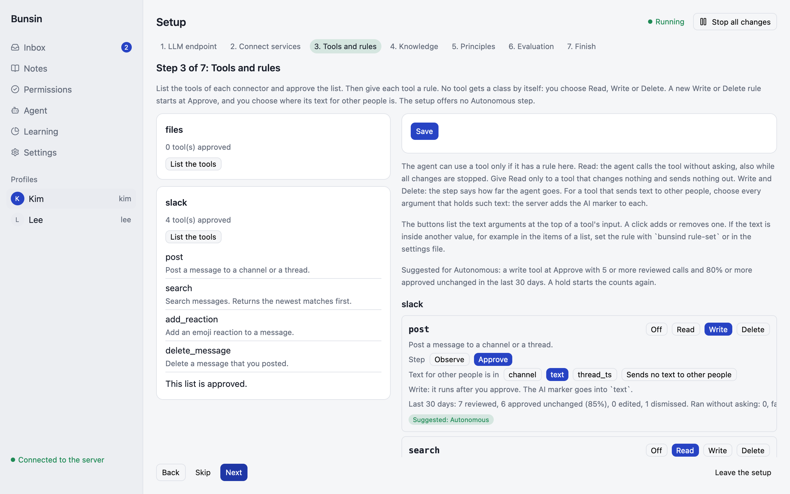
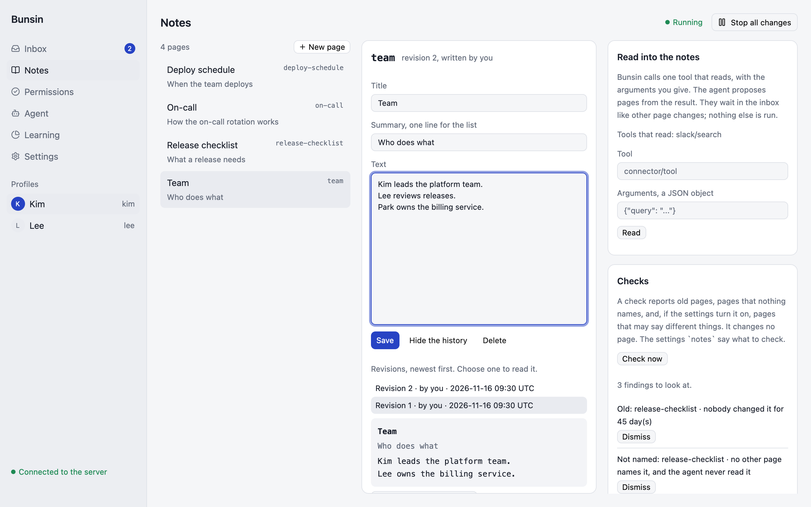
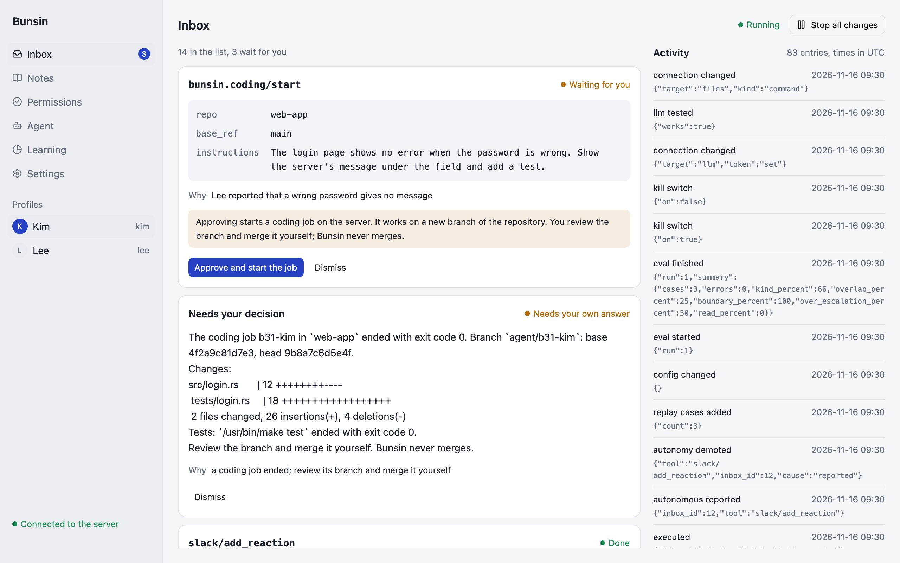
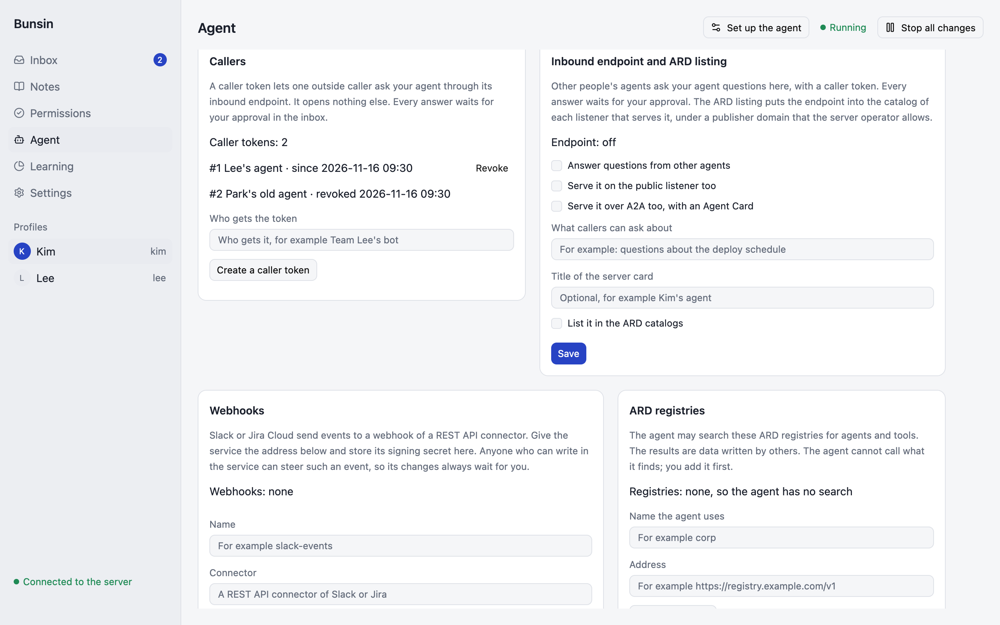
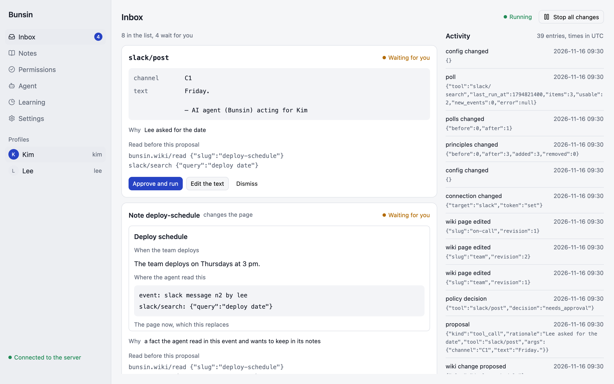
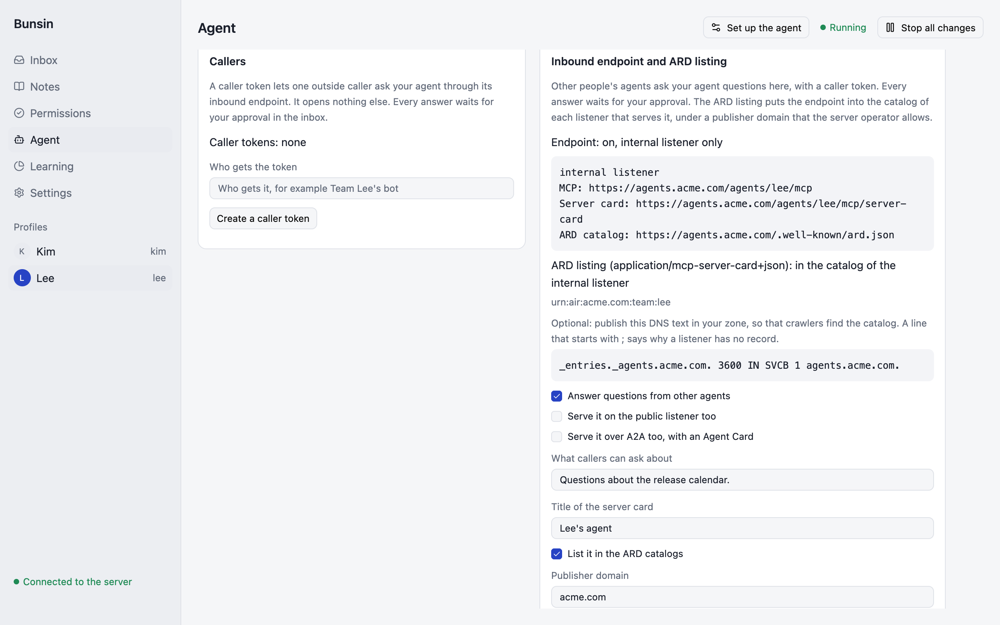
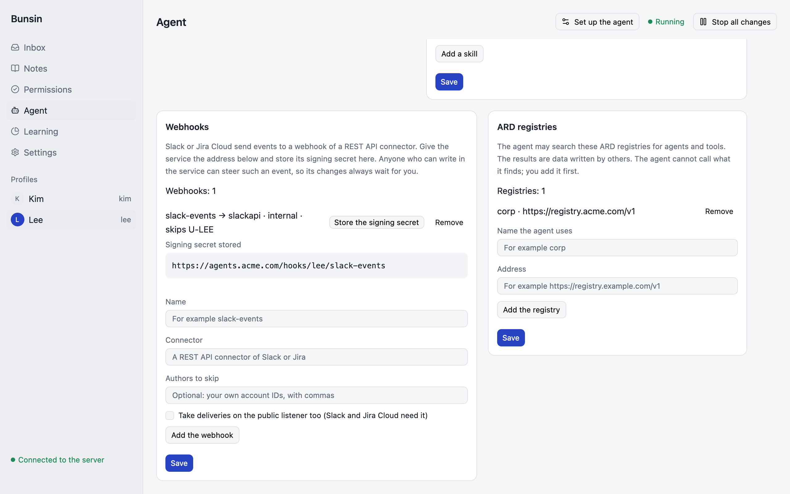
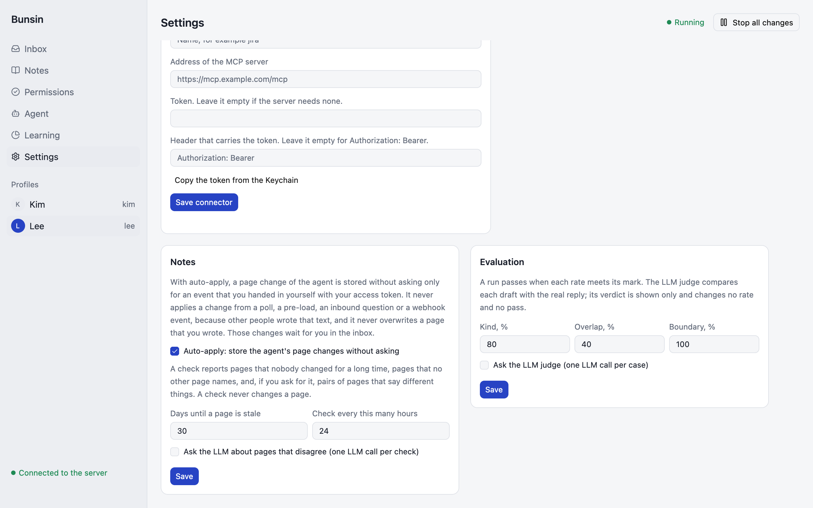
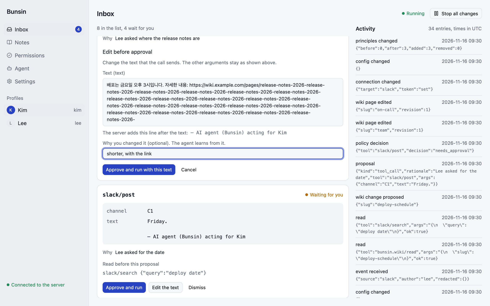
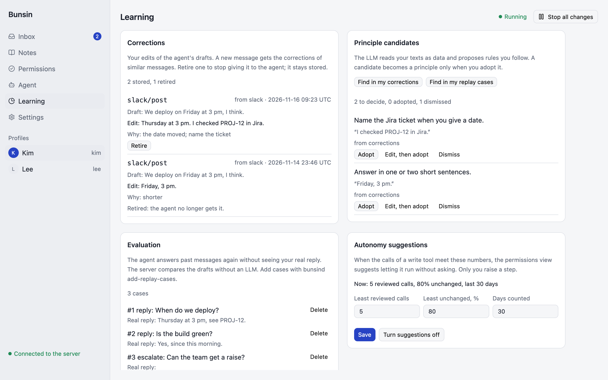

# Bunsin (분신)

[English](README.md)

Bunsin은 페르소나 AI agent를 실행하는 서버와 관리 도구입니다. agent 하나는 한 사람의 업무 원칙을 가지고,
MCP 서버나 각 서비스의 REST API를 통해 Slack, Jira, Confluence에서 그 사람을 대신해 일합니다.
서버 하나가 서로 격리된 여러 agent 프로필을 담습니다.

LLM은 제안만 합니다. 무엇을 실행할지는 하네스가 결정합니다.

- 프로필마다 권한 표가 허용된 도구를 정합니다. 표에 없는 도구는 거부됩니다.
- 모든 쓰기는 "소유자가 승인한 뒤 실행"에서 시작합니다. 소유자가 도구별로 단계를 올립니다.
- agent가 다른 사람에게 보내는 모든 글에 하네스가 AI 표시를 붙입니다.
- 프로필마다 정지 스위치가 있고, 켜면 모든 쓰기가 멈춥니다.
- 모든 제안, 초안, 결과를 저장합니다. 수정할 수 없는 감사 로그가 각 단계를 기록합니다.

## 현재 한계

Bunsin은 개발 초기 단계입니다. 사용하기 전에 아래 목록을 읽으십시오.

- **이벤트 수신은 사용하는 MCP 서버에 달려 있습니다.** 서버는 설정에 적힌 검색 도구를 반복 호출합니다
  ([이벤트 찾기](#이벤트-찾기-폴링) 참고). Slack과 Jira Cloud는 webhook으로 이벤트를 보낼 수도 있습니다([Webhook](#webhook) 참고).
  두 방식 모두 테스트 서버로만 실행해 보았습니다.
- **agent는 허용한 도구로만 읽습니다.** 제안하기 전에 `read` 도구(예: 검색)를 최대 5번 호출하고, notes의 페이지를 최대 5번 읽고, 그 결과를 씁니다.
  ARD registry 검색은 도구 읽기로 셉니다.
  오래 쓸 사실은 notes에 정리하고, 사용자가 한 쪽씩 승인합니다([Notes](#notes) 참고).
  notes는 agent가 이벤트를 처리하며 읽은 것과 사용자가 시작한 읽기로 채워집니다. 검색 품질은 MCP 서버에 달려 있습니다.
- **개인정보 필터는 패턴과 사용자의 단어 목록으로 동작합니다.** 이메일, 전화번호 같은 정해진 형식은 찾습니다.
  사람 이름과 주소는 단어 목록(`terms`)에 적은 것만 찾습니다.
- **구성 마법사는 창에만 있습니다.** 마법사는 다른 화면과 같은 호출을 쓰고, 자기 상태를 저장하지 않습니다.
  명령줄에는 마법사가 없습니다. [agent 설정](#agent-설정-프로필-소유자)에 같은 순서의 명령이 있습니다.
- **MCP 서버용 OAuth는 설정 파일로만 켭니다.** 켠 뒤의 로그인은 창과 명령줄에서 합니다([LLM endpoint와 커넥터](#llm-endpoint와-커넥터) 참고).
- **로컬 테스트 서버로만 시험했습니다.** 실제 LLM endpoint, 실제 MCP 서버, 실제 OAuth 제공자, 실제 ARD registry, 실제 Slack·Jira·Confluence API로 실행하는 테스트는 없습니다.
  실제 코딩 CLI(Claude Code, Codex)를 실행하는 테스트도 없습니다. 코딩 테스트는 `/bin/sh`와 임시 git 저장소를 씁니다.
- **데스크톱 창은 헤드리스로만 시험했습니다.** 테스트는 화면 없이 각 화면을 조작하고, `docs/screens`의 그림은 화면 밖에서 그립니다.
  실제 창을 열어 써 본 적은 없습니다. Keychain 저장 코드는 테스트가 없습니다. `Bunsin.app`은 서명하지 않았습니다.
- **Linux는 CI에서만 실행합니다.** CI가 Ubuntu에서 서버를 빌드하고 테스트하고, 서버 패키지를 만듭니다.
  Linux 컴퓨터에서 서버를 실행하거나 systemd unit을 시작해 본 적은 없습니다.
- **아직 만들지 않은 것:** 인바운드 호출자의 OAuth(호출자는 호출자 token을 씁니다), 창의 LLM 사용량 화면(`bunsind llm-usage`만 있습니다),
  명령줄 구성 마법사, 설정 파일 밖에서 MCP 서버용 OAuth를 켜는 방법, 출처의 열람 권한을 잃었을 때 notes 페이지를 다시 확인하는 기능.
- **서버 운영자는 프로필 데이터를 읽을 수 있습니다.** 프로필은 서로에게서 격리되어 있지만,
  서버 파일에 접근할 수 있는 사람에게서는 격리되어 있지 않습니다.

구현된 항목의 전체 목록은 [docs/ARCHITECTURE.md](docs/ARCHITECTURE.md)에, 계획은 [docs/PLAN.md](docs/PLAN.md)에 있습니다.

## 구성 요소

| 구성 요소 | 설명 | 실행 환경 |
|---|---|---|
| `bunsind serve` | 서버. agent를 실행하고 데이터를 저장합니다. | Linux, macOS |
| `bunsind <명령>` | 운영자와 프로필 소유자가 쓰는 명령줄 도구 | Linux, macOS |
| `bunsin-app` | 데스크톱 창: 승인함, 감사 로그, 정지 스위치, notes, 권한, agent 설정, 학습, 설정, 구성 마법사 | macOS |

## 빌드와 테스트

```sh
cargo build --release -p bunsin-daemon     # 서버와 명령줄 도구: target/release/bunsind
cargo build --release -p bunsin-app        # 데스크톱 창 (macOS): target/release/bunsin-app
cargo test --workspace
```

`rust-toolchain.toml`이 Rust 버전을 고정합니다. rustup이 처음 사용할 때 그 버전을 설치합니다.

### 배포 패키지

```sh
packaging/linux/build-tarball.sh   # target/package/bunsin-server-<버전>-<target>.tar.gz와 .sha256
packaging/macos/build-app.sh       # target/package/Bunsin.app (macOS에서만)
```

- 서버 tarball에는 `bunsind`, systemd unit, sysusers 파일, 비밀 값이 없는 환경 파일 견본, `INSTALL.md`, LICENSE, README가 들어 있습니다.
  설치 방법과 `--allow-stdio-connectors`, `--allow-coding`을 쓸 때 바꿀 보안 옵션은 [`packaging/linux/INSTALL.md`](packaging/linux/INSTALL.md)(영어)에 있습니다.
  unit은 멈출 때 330초를 기다립니다. 그래서 서버가 실행 중인 요청을 기다리는 300초가 끊기지 않습니다.
  CI가 Ubuntu에서 tarball을 만들고 실행 결과물로 보관합니다. 배포(release)는 하지 않습니다. 실제 Linux 서버에 설치해 보지는 않았습니다.
- `Bunsin.app`은 Developer ID로 서명하지 않았고 아이콘이 없습니다(저장소에 아이콘이 없습니다).
  서명과 공증은 손으로 합니다. 순서는 [`packaging/macos/README.md`](packaging/macos/README.md)(영어)에 있습니다.
Linux에서는 창을 빼고 빌드와 테스트를 합니다: `cargo test --workspace --exclude bunsin-app`.
창은 `gpui-kit` crate를 통해 GPUI를 씁니다.

### 명령줄 도구 설치

빌드하면 `bunsind`가 `target/release/`에 생깁니다. 이 폴더는 `PATH`에 없습니다.
그래서 이 README에서 `bunsind`로 시작하는 명령은 아직 실행되지 않습니다. 다음 둘 중 하나를 하십시오.

- `~/.cargo/bin`에 설치합니다. rustup이 이 폴더를 `PATH`에 넣어 둡니다.

  ```sh
  cargo install --path crates/daemon --locked
  bunsind --help
  ```

- 또는 경로를 붙여 실행합니다: `./target/release/bunsind --help`.

`bunsind --help`는 모든 명령을 보여 줍니다. `bunsind <명령> --help`는 그 명령의 옵션을 보여 줍니다.

## 한 컴퓨터에서 처음 실행해 보기

이 절차는 내 컴퓨터에 서버를 띄우고, 두 번째 터미널에서 그 서버를 씁니다.
LLM과 MCP 서버가 없어도 됩니다. 아래처럼 시험용 폴더를 쓰고, 실제 데이터 폴더는 쓰지 마십시오.

**터미널 1: 운영자.** 이 명령들은 데이터 폴더를 직접 읽고 씁니다.

```sh
export BUNSIN_DATA_DIR=/tmp/bunsin-data        # 운영자 명령은 모두 이 폴더가 필요합니다
bunsind profile-add kim --owner "Kim"          # 출력: created profile kim for Kim
bunsind token-add kim --label "Kim's laptop"   # 접속 token을 한 번만 출력합니다: bsn_...
bunsind serve --listen 127.0.0.1:8787 --key-store file   # 출력: listening on http://127.0.0.1:8787
```

`--key-store file`은 이 시험용 폴더의 키를 폴더 안에 둡니다. 이 옵션이 없으면 맥북의 서버는 Keychain에 항목을 만들고,
그 항목은 폴더를 지워도 남습니다.

token을 복사해 두십시오. 서버에는 해시만 저장되므로 token을 다시 볼 수 없습니다.
서버는 Ctrl-C를 누를 때까지 실행됩니다.

**터미널 2: 프로필 소유자.** 이 명령들은 네트워크로 서버에 접속합니다.

```sh
export BUNSIN_SERVER=http://127.0.0.1:8787
export BUNSIN_TOKEN=bsn_...                    # 터미널 1에서 받은 token
bunsind profile-list                           # kim	Kim
bunsind status kim                             # kill switch: off, inbox: 0 item(s)
bunsind connections kim                        # llm	not set
```

notes는 LLM 없이도 동작합니다.

```sh
printf 'Kim leads.\n' > team.md
bunsind wiki-set kim team --title "Team" --summary "Who does what" --body-file team.md
bunsind wiki-list kim                          # team	Team	Who does what
```

agent 자체는 아직 동작하지 않습니다. 프로필에 LLM을 설정하기 전에는 이벤트가 거부됩니다.

```sh
bunsind ingest kim --source slack --event-id 1 --author lee --text "When do we deploy?"
# error: the event was not handled: the LLM cannot be used: the profile has no `llm` settings
```

다음에 할 일:

1. 프로필에 LLM endpoint와 커넥터를 설정합니다: [LLM endpoint와 커넥터](#llm-endpoint와-커넥터).
2. 각 커넥터의 도구를 승인하고 agent가 할 수 있는 일을 정합니다: [권한 규칙](#권한-규칙).
3. 원칙을 적습니다: [원칙](#원칙).
4. 서버가 이벤트를 찾게 합니다: [이벤트 찾기](#이벤트-찾기-폴링).
5. 같은 주소와 token으로 창을 엽니다: [데스크톱 창](#데스크톱-창-macos).

다른 컴퓨터에서 접속하는 서버를 띄우려면 먼저 [서버 설정](#서버-설정-운영자)을 읽으십시오. TLS가 필요합니다.

## 서버 설정 (운영자)

```sh
export BUNSIN_DATA_DIR=/var/lib/bunsin
bunsind profile-add kim --owner "Kim"
bunsind token-add kim --label "Kim's laptop"   # 접속 token을 한 번만 출력합니다
bunsind serve --listen 0.0.0.0:8787 --tls-cert cert.pem --tls-key key.pem
```

- **접속 token.** token 하나는 프로필 하나에만 통합니다. 서버에는 해시만 저장되므로 다시 볼 수 없습니다.
  `bunsind token-list`와 `bunsind token-revoke <id>`로 관리합니다.
  프로필 생성과 token 발급은 서버에서만 할 수 있고, 네트워크로는 할 수 없습니다.
- **TLS.** 서버는 외부 주소에 TLS 없이 뜨지 않습니다. TLS 프록시 뒤에 둘 때는 `127.0.0.1`에 띄웁니다.
  한 컴퓨터에서 시험할 때는 `bunsind serve --listen 127.0.0.1:8787`로 띄우고 주소로 `http://127.0.0.1:8787`을 씁니다.
- **LLM과 MCP 서버의 token.** 프로필 소유자가 창이나 명령줄에서 입력하고, 서버가 암호화해 그 프로필의 DB에 보관합니다.
  이 암호화는 DB만 복사되거나 백업이 유출된 경우를 막습니다. 키를 잃었으면 서버를 한 번 `--accept-new-key`로 띄우십시오.
  notes와 설정은 그대로 남고, 저장된 token은 모두 읽을 수 없게 되어 소유자가 다시 입력해야 합니다.
  이 옵션이 없으면 서버는 키를 찾을 수 없는 암호화된 token 위에서 시작하지 않습니다.
- **키의 위치.** `--key-store`로 정합니다. 어느 쪽이든 저장된 token은 DB 안의 같은 암호문입니다.
  - **macOS의 기본값은 `keychain`입니다.** 키는 로그인 Keychain의 항목 1개입니다(Keychain Access에 `Bunsin server`라는 이름으로 보입니다).
    그러면 데이터 폴더를 복사해도 키가 들어 있지 않습니다. 항목의 계정은 데이터 폴더의 `keychain-id` 파일에 있는 ID입니다.
    이 파일을 보관하십시오. 없으면 서버가 자기 항목을 찾지 못합니다. 파일을 잃었으면 Keychain Access에 보이는 그 항목의 계정을 파일에 다시 적으십시오.
  - **다른 시스템의 기본값은 `file`입니다.** 키는 데이터 폴더의 `master.key` 파일, 또는 `--master-key-file`로 지정한 파일입니다.
    키 파일은 데이터 폴더의 백업에 넣지 마십시오. 키 파일을 읽을 수 있는 사람은 막지 못합니다.
  - **키 파일은 자동으로 옮겨집니다.** 맥북의 서버가 `master.key`를 찾았고 Keychain 항목이 없으면, 키를 Keychain에 쓰고,
    다시 읽어 확인한 뒤 파일을 지웁니다. 저장된 token은 그대로입니다.
  - **Keychain은 로그인 세션이 필요합니다.** 로그인한 사용자 없이 SSH나 부팅 시에 띄운 서버는 Keychain을 읽지 못해 시작하지 않습니다.
    그 경우 `--key-store file`을 쓰십시오. `bunsind`를 다시 빌드하면 프로그램이 바뀌었으므로 macOS가 접근 허용을 다시 물을 수 있습니다.
  - **키는 데이터 폴더와 함께 이동하지 않습니다.** 다른 컴퓨터의 Keychain에는 그 항목이 없어서 서버가 시작하지 않습니다.
    서버는 암호화된 token 위에 새 키를 만들지 않습니다. 키 파일로 시작하거나, 한 번 `--accept-new-key`로 띄운 뒤 token을 다시 입력하십시오.
  - 항목을 보거나 지우려면: `security find-generic-password -s "Bunsin server" -a "$(cat <데이터 폴더>/keychain-id)"`,
    그리고 같은 옵션으로 `security delete-generic-password`. 항목을 지우면 저장된 token을 읽을 수 없게 됩니다.
- **운영자가 넣는 token.** 프로필에 저장된 token이 없으면 서버는 환경 변수 `BUNSIN_SECRET_<프로필>__<KEY>`를 읽습니다
  (예: `BUNSIN_SECRET_KIM__LLM`). 한 프로필은 다른 프로필의 비밀 값을 가리킬 수 없습니다.
- **접속 대상 주소.** LLM과 MCP 주소는 프로필 소유자가 정하고, 요청은 서버가 보냅니다.
  기본 규칙은 `localhost`와 내부 IP 주소를 뺀 모든 `https://` 주소를 받습니다.
  내부 주소로 풀리는 host 이름은 통과합니다. 여러 사람이 쓰는 서버나 사외에 노출된 서버는
  `--allow-upstream-host <host>`(여러 번 지정 가능)로 띄우십시오. 그러면 목록의 host만 허용되고,
  `http://`를 쓰는 사내 gateway도 목록에 넣을 수 있습니다.
- **로컬 MCP 명령.** 서버에서 명령으로 실행하는 MCP 서버는 `--allow-stdio-connectors`가 있어야 합니다.
  이 옵션을 켜면 모든 프로필 소유자가 창이나 설정 파일로 서버에서 아무 프로그램이나 실행하게 할 수 있습니다.
  프로그램은 서버 사용자의 권한으로 실행되므로, 다른 프로필의 데이터와 키 파일을 읽을 수 있습니다.
  모든 프로필 소유자를 신뢰하는 서버(예: 혼자 쓰는 서버)에서만 이 옵션을 켜십시오.
- **코딩 작업.** 서버가 `--allow-coding --coding-repo-root <dir>`로 떠 있을 때만 프로필이 코딩 작업을 시작할 수 있습니다([코딩 위임](#코딩-위임) 참고).
  프로그램은 운영자가 정합니다: `--coding-program claude-code=<절대 경로>`, `--coding-program codex=<절대 경로>`.
  프로필은 백엔드 종류와 저장소만 고릅니다. 저장소는 root 아래의 git 저장소여야 합니다.
  서버는 링크를 따라간 뒤, 설정을 저장할 때와 작업을 시작할 때 다시 확인합니다. 아래의 검사도 모두 같습니다.
- **코딩 명령.** 프로필이 지정한 프로그램(백엔드 `command`)과 테스트 명령은 `--allow-coding-commands`가 있어야 실행됩니다.
  이 옵션은 `--allow-stdio-connectors`와 같은 권한을 줍니다. 모든 프로필 소유자가 서버 사용자의 권한으로 아무 프로그램이나 실행할 수 있고,
  그 프로그램은 다른 프로필의 데이터와 키 파일을 읽을 수 있습니다. 모든 프로필 소유자를 신뢰하는 서버에서만 켜십시오.
- **sandbox 없음.** 코딩 작업은 서버 사용자로 실행됩니다. 코딩 CLI는 자기 권한 설정을 따릅니다.
  Bunsin은 확인 질문이나 sandbox를 끄는 플래그를 넘기지 않고, 자체 sandbox도 두지 않습니다.
  작업의 worktree와 기록 파일은 `<data dir>/coding/<프로필>/`에 남습니다. 서버는 worktree를 지우지 않습니다.
- **다른 호출자를 위한 리스너.** `--internal-listen <주소> --internal-url <주소>`는 사내 호출자를 위한 두 번째 리스너를 엽니다.
  `--public-listen <주소> --public-url <주소>`는 인터넷 호출자를 위한 세 번째 리스너를 엽니다.
  URL은 호출자가 쓰는 주소입니다(예: `https://agents.example.com`). 프록시 뒤에서는 listen 주소와 다를 수 있습니다.
  이 리스너에는 제어 API가 없습니다. 접속 token은 여기서 아무것도 하지 못하고, 이 리스너로 제어 API에 닿을 수 없습니다.
  외부 주소에 뜨는 리스너는 TLS가 필요합니다(`--internal-tls-cert`/`--internal-tls-key`, `--public-tls-cert`/`--public-tls-key`).
  두 리스너는 같은 주소를 쓸 수 없습니다. 서버는 키를 읽기 전에 이것을 모두 검사합니다.
  이 리스너는 endpoint를 켠 프로필의 인바운드 endpoint를 제공합니다([다른 사람이 내 agent에게 묻게 하기](#다른-사람이-내-agent에게-묻게-하기) 참고).
  내부 리스너는 범위 `internal`과 `public`을, 공개 리스너는 `public`만 제공합니다.
- **ARD 게시.** `--ard-publisher-domain acme.com`(여러 번 줄 수 있음)은 프로필이 endpoint를 게시할 수 있는 도메인을 정합니다.
  이 옵션이 없으면 어떤 프로필도 게시되지 않고, 서버는 `inbound.ard`가 있는 설정을 거부합니다.
  호출자용 리스너는 자기가 제공하는 프로필의 ARD catalog `/.well-known/ard.json`을 제공합니다.
- **ARD registry.** `--ard-registry internal`은 내부 리스너를, `--ard-registry public`은 두 리스너를 ARD registry로 만듭니다.
  이 옵션이 없으면 registry 경로가 없습니다(404). registry 리스너는 루트에서 `POST /search`, `POST /explore`, `GET /agents`에 답합니다.
  그래서 base URL은 그 리스너의 `--*-url`입니다. registry에는 token이 필요 없습니다.
  - **넣는 것.** 지금은 이 서버 자신의 catalog만 넣습니다. 60초마다 `<data dir>/registry.db`의 내용을 바꿉니다.
    다른 도메인의 crawl은 phase 2이고, 아직 없습니다.
  - **리스너마다 보는 것.** 공개 리스너는 공개 항목만 봅니다. 순위와 개수도 그 항목으로만 셉니다.
    그래서 공개 리스너의 답은 내부 항목에 대해 아무것도 알려 주지 않습니다.
  - **한도.** 리스너마다 1분에 600 요청까지 답하고, 넘으면 429입니다. 요청 본문은 64 KiB까지입니다.
    한 쪽은 결과 100개까지이고, page token은 1,000번째 결과까지 갑니다.
    `federation`의 모든 값은 이 index만 찾고, 답에 `referrals`는 없습니다.
  - **자기 항목.** registry 리스너는 자기 `ard.json`에 registry를 `urn:air:<domain>:registry:bunsin`으로 싣습니다.
    `<domain>`은 `--ard-publisher-domain` 중 리스너 host와 같거나 host의 끝부분인 가장 긴 도메인입니다(예: `agents.acme.com`이면 `acme.com`).
    그런 도메인이 없으면 registry 항목을 싣지 않습니다.
  - **DNS.** 서버는 시작할 때 그런 리스너마다 stderr에 한 줄을 씁니다(예: `_search._agents.acme.com. 3600 IN SVCB 1 agents.acme.com.`).
    이 줄을 DNS zone에 넣으십시오. 서버는 DNS 레코드를 쓰지 않습니다.
  - **상태.** `bunsind registry-status`는 이 컴퓨터의 `registry.db`를 읽습니다. 서버가 도는 동안에도 됩니다.
    source마다 항목 수, 마지막 성공, 실패 수, 마지막 오류, 거부한 항목의 이유별 개수를 보입니다.
- **종료.** 서버는 SIGTERM을 받으면 새 요청을 받지 않고, 실행 중인 요청을 최대 300초 기다립니다.

## agent 설정 (프로필 소유자)

```sh
export BUNSIN_SERVER=https://bunsin.example.com:8787
export BUNSIN_TOKEN=bsn_...                    # 운영자에게 받은 token
bunsind config-show kim > kim.json
# kim.json을 편집한 뒤:
bunsind config-set kim kim.json
```

사설 CA를 쓰는 서버에는 `BUNSIN_CA_CERT`에 CA 인증서 파일의 경로를 넣습니다.

새 프로필은 아무것도 할 수 없습니다. 설정에 LLM endpoint, 커넥터, 승인한 도구, 권한 규칙을 넣어야 합니다.

### 단계별 구성 (Setup)

LLM endpoint나 커넥터가 없고 승인한 도구도 없는 프로필이면, 창이 스스로 **setup**을 엽니다.
Agent 화면의 "Set up the agent" 버튼으로 다시 열 수 있습니다. 단계는 일곱 개입니다.
각 단계는 다른 화면에 있는 같은 기능의 컨트롤을 보여 줍니다.

1. **LLM endpoint**: 주소, 모델, token을 저장하고 Test를 누릅니다. Next는 성공한 시험이 있어야 넘어갑니다.
2. **Connect services**: 주소의 MCP 서버, REST API, 또는 운영자가 허용한 경우 서버가 실행하는 명령을 연결합니다.
   Check가 접속하고 도구 목록을 받습니다.
3. **Tools and rules**: 커넥터마다 도구 목록을 받아 이름과 설명을 읽고, 목록을 승인합니다. 이어서 도구마다 규칙을 정합니다.
   창은 도구의 class를 스스로 고르지 않습니다. 새 Write와 Delete 규칙은 Approve에서 시작하고, 다른 사람에게 가는 글의 자리는 사용자가 고릅니다.
   setup은 Observe와 Approve만 보여 줍니다.
4. **Knowledge**(선택): read 규칙이 있는 도구로 한 번 읽어 notes를 채웁니다.
5. **Principles**: 읽기 한 번(예: 내가 보낸 메시지의 검색), 교정 기록, 재현 사례에서 원칙 후보를 찾습니다. 후보마다 채택, 수정, 기각을 고릅니다.
6. **Evaluation**: 재현 사례가 있으면 JSON 배열로 더하고, 첫 평가를 실행합니다. 이 단계가 비율을 보여 줍니다.
7. **Finish**: 요약을 보여 줍니다. 모든 write와 delete 규칙이 Observe나 Approve일 때만 setup이 끝납니다.
   "Set them to Approve"는 나머지 규칙을 Approve로 옮깁니다.

모든 단계에 Skip이 있습니다. "Leave the setup"은 Agent 화면으로 가고, 창은 닫힐 때까지 단계를 기억합니다.
새 창은 서버가 결과를 보여 주지 않는 첫 단계에서 시작합니다. 예를 들어 LLM endpoint만 저장되어 있으면 Connect services에서 시작합니다.



명령줄에서는 같은 단계를 아래 순서의 명령으로 합니다.

```sh
bunsind llm-set kim --token-stdin                 # 1. LLM endpoint
bunsind llm-test kim
bunsind connector-set kim slack --url https://mcp.example.com/slack --token-stdin   # 2.
bunsind tools kim slack                           # 3. 연결 확인과 도구 목록
bunsind tools kim slack --approve
bunsind rule-set kim slack/search --class read
bunsind rule-set kim slack/post --class write --text text
bunsind preload-notes kim --tool slack/search --args '{"query": "deploy"}'           # 4.
bunsind extract-principles kim --from read --tool slack/search --args '{"query":"from:me"}'  # 5.
bunsind principle-candidates kim
bunsind adopt-principle kim 1
bunsind add-replay-cases kim cases.json           # 6.
bunsind start-eval kim
bunsind eval-report kim
bunsind rules kim                                 # 7. approve보다 높은 write 규칙이 없는지 확인
```

### LLM endpoint와 커넥터

데스크톱 창의 "Connections" 화면에서 입력하거나, 명령줄로 입력합니다.

```sh
bunsind llm-set kim --token-stdin               # Claude API. key를 입력하거나 파이프로 넘긴 뒤 Enter
bunsind llm-set kim --wire openai-chat --base-url https://llm.example.com/v1 \
    --model your-model-id --token-stdin          # 다른 endpoint
bunsind connector-set kim slack --url https://mcp.example.com/slack --token-stdin
bunsind connector-set kim jira --url https://mcp.example.com/jira --token-stdin
bunsind connector-set kim wiki --url https://mcp.example.com/wiki     # token이 필요 없는 MCP 서버
bunsind connector-set kim crm --url https://mcp.example.com/crm \
    --token-header X-API-Key --token-stdin       # token을 `X-API-Key: <token>`으로 보냅니다
bunsind connector-set kim slack-api --api slack --url https://slack.com/api --token-stdin
bunsind connector-set kim jira-api --api jira --url https://your-domain.atlassian.net \
    --auth basic --email you@example.com --token-stdin   # Atlassian API token
bunsind llm-test kim                             # 저장된 LLM endpoint로 테스트 요청 1건
bunsind llm-usage kim                            # 지난 90일의 LLM 호출과 token
bunsind connections kim                          # 주소와 각 token의 출처
bunsind tools kim slack                          # 접속해서 도구 목록을 봅니다. 동작 확인 방법입니다
bunsind connector-oauth kim docs                 # OAuth를 쓰는 MCP 서버에 로그인합니다(아래 참고)
bunsind connector-remove kim jira                # 커넥터와 그 token을 지웁니다
```

- 옵션이 없으면 `llm-set`은 Claude API를 씁니다: `--wire anthropic-messages`,
  `--base-url https://api.anthropic.com`, `--model claude-opus-5-5`. 창도 같은 값을 미리 채웁니다.
  `--wire`는 `anthropic-messages`, `openai-chat`(Chat Completions), `openai-responses`(Responses) 중 하나입니다.
  LLM token의 헤더는 형식이 정합니다: Claude는 `x-api-key`, OpenAI 두 형식은 `Authorization: Bearer`입니다.
- `llm-test`와 창의 **Test**는 저장된 endpoint로 짧은 요청 1건을 보냅니다. 이 요청은 실제 요청과 같은 응답 형식과
  출력 한도를 쓰고, 프로필의 데이터는 담지 않습니다. endpoint에서 token 비용이 발생합니다.
  응답이 agent에게 필요한 형식이면 테스트가 통과합니다.
- `llm-usage`는 지난 90일의 LLM 호출을 UTC 날짜와 용도(`event`, `replay`, `llm_test`)별로 합칩니다.
  호출 수, 실패한 호출 수, 입력과 출력 token, 평균 시간을 보여 줍니다.
  서버는 모든 호출의 시각, token, 끝난 방식을 기록합니다. 요청과 응답의 글, 오류 문구는 저장하지 않습니다.
- 커넥터에는 token이 없어도 됩니다. token을 빼고 저장하면 됩니다. token은 `Authorization: Bearer <token>`으로 갑니다.
  MCP 서버가 다른 헤더를 읽으면 `--token-header`나 창에서 헤더 이름을 지정합니다. 그 헤더가 token을 그대로 담습니다.
  그 커넥터에 `connector-set`을 실행할 때마다 `--token-header`를 주십시오. 빼면 `Authorization: Bearer`로 돌아갑니다.
- MCP 커넥터의 도구 호출 하나는 2분 안에 끝나야 합니다. 서버가 호출마다 먼저 받는 도구 목록도 같습니다.
  더 걸리면 호출을 취소합니다.
  다만 MCP 서버가 그 호출을 이미 실행했을 수 있습니다.
  그래서 시간이 지난 승인된 쓰기나 삭제는 `failed`가 아니라 `unknown`이 됩니다(아래 "멈춤으로 끊기거나 답이 없는 호출" 참고).
- **OAuth.** 주소로 접속하는 MCP 서버는 token 대신 OAuth 로그인을 쓸 수 있습니다.
  설정 파일에서 켭니다: 커넥터에 `"oauth": {}`를 넣고 token은 빼고 `config-set`을 실행합니다. 예:
  `"docs": {"mcp": {"transport": "http", "url": "https://mcp.example.com/docs"}, "oauth": {}}`.
  창과 `connector-set`은 저장할 때 커넥터의 `oauth`를 유지하지만, 켜거나 끄지는 못합니다.
  `oauth`의 `"client_id"`는 인가 서버가 Bunsin용으로 발급한 client입니다. 없으면 서버가 client를 직접 등록합니다(dynamic client registration).
  `"scopes"`는 요청할 scope입니다. 없으면 MCP 서버가 알려 주는 scope를 요청합니다.
- 로그인하려면 창에서 그 커넥터 줄의 **Sign in**을 누릅니다. 창이 브라우저로 로그인 페이지를 열고,
  브라우저가 돌아오는 요청을 127.0.0.1의 빈 port에서 받습니다.
  명령줄에서는 `connector-oauth`가 로그인 페이지 주소를 출력합니다. 그 주소를 열어 로그인한 뒤,
  브라우저가 이동한 주소를 붙여 넣습니다. 그 페이지는 열리지 않습니다.
- 로그인 페이지의 주소는 MCP 서버의 metadata가 정합니다. 서버와 창은 `https` 주소와, 127.0.0.1, ::1, localhost의 `http` 주소만 받습니다.
  다른 scheme(예: `smb:`, `file:`)은 거부합니다. 그런 주소를 열면 Mac에서 프로그램이 실행되기 때문입니다.
  `--redirect-uri`로 그 주소를 바꿉니다(기본값 `http://127.0.0.1:8976/callback`). 고정된 주소로 등록한 client ID에는 이 옵션이 필요할 수 있습니다.
  로그인은 10분 동안 기다립니다. 프로필 하나에 3개까지 기다릴 수 있고, 서버를 다시 시작하면 잊습니다.
- 서버는 OAuth token을 봉인하고 MCP 서버 주소의 origin에 묶습니다. access token은 refresh token으로 스스로 갱신합니다.
  `connections`와 창은 `signed in with OAuth` 또는 `OAuth sign-in needed`를 보여 줍니다.
  주소가 다른 origin으로 바뀐 뒤, 인가 서버가 refresh token을 거부한 뒤, 또는 access token이 만료되었고 refresh token이 없을 때는 다시 로그인해야 합니다.
  `oauth`나 커넥터를 지우면 token도 지워집니다. 로그인의 요청은 모두 주소 규칙을 지나고, redirect를 따르지 않으며, 30초 안에 끝나야 합니다.
  로컬 테스트 서버로만 시험했습니다.
- `--api slack|jira|confluence`(창에서는 종류 **REST API**)를 주면 서버가 MCP 서버 대신 그 서비스의 REST API를 직접 부릅니다.
  도구는 코드에 고정되어 있습니다: Slack `search_messages`, `get_thread`, `post_message`, Jira `search_issues`, `get_issue`, `add_comment`,
  Confluence `search_pages`, `get_page`, `create_page`. 지우는 도구는 없습니다.
  `--url`은 base URL입니다: `https://slack.com/api` 또는 Atlassian 사이트 주소입니다.
  Slack은 bearer token만 받습니다. Jira와 Confluence는 bearer token이나, `--auth basic --email <계정>`과 Atlassian API token을 받습니다.
  REST API 커넥터에는 token이 있어야 하고, `--token-header`는 받지 않습니다.
  도구 승인과 도구별 규칙은 MCP 서버와 같습니다. AI 표시는 규칙이 글 자리로 정한 곳(예: `{"arg": "text"}`)에 붙습니다.
  주소 규칙과 token의 origin 결합은 base URL에 적용됩니다. 요청 모양은 공식 API 문서를 따랐고, 실제 서비스로는 시험하지 않았습니다.
  요청 하나는 30초 안에 끝나야 합니다. 그 안에 답하지 않으면 오류가 됩니다.
  요청이 서비스에 닿은 뒤의 오류이면, 승인된 쓰기나 삭제는 `unknown`이 됩니다.
  쓰기가 HTTP 2xx와 JSON이 아닌 본문(예: 로그인 페이지)을 받아도 `unknown`이 됩니다. 서비스가 요청을 받았기 때문입니다.
  읽기가 그런 본문을 받으면 실패합니다.
  연결하지 못한 요청과 HTTP 4xx 같은 분명한 거절은 `failed`가 됩니다.
- 창의 **Copy the token from the Keychain**은 Mac의 로그인 Keychain에 이미 있는 항목에서 LLM token이나 주소 커넥터의 token을 읽습니다.
  항목의 서비스(Keychain Access에서는 *Where*로 표시)와 계정을 입력하고, **Read from Keychain**, **Save**를 차례로 누릅니다.
  token은 서버로 한 번 복사됩니다. 이후 Keychain에서 값을 바꿔도 서버에는 반영되지 않습니다.
  다른 앱이 만든 항목이면 macOS가 접근 허용 여부를 물을 수 있습니다. macOS가 묻는 동안 창은 반응하지 않습니다.
  읽을 수 있는 것은 로그인 Keychain의 "응용 프로그램 암호"뿐입니다. "인터넷 암호" 항목, iCloud Keychain, 암호 앱의 항목은 찾지 못합니다.
  Keychain 입력란은 한 번에 한 곳에만 열리고, 채울 token 칸 아래에 있습니다.
  읽기가 실패하면 그 token 칸을 비웁니다. 그래서 Save가 앞서 읽은 token을 보내지 않습니다.
- `--wire openai-chat`이나 `openai-responses`에서는 `llm-set`에 `--base-url`과 `--model`이 필요합니다.
  기본값은 Claude 형식에만 있습니다.
- 한 workspace에 묶이지 않은 Claude API key는 workspace ID도 필요합니다. 설정 파일의 `llm` 항목에 `"workspace_id"`를 넣으십시오.
- 서버는 token을 암호화해 저장하고, 다시 돌려주지 않습니다. `connections`는 "서버에 저장됨",
  "서버 환경 변수", "없음" 중 하나만 보여 줍니다.
- `--token-stdin`이 없으면 저장된 token을 유지합니다. `--clear-token`은 token을 지웁니다.
- 창이 설정을 읽은 뒤에 다른 사람이 같은 설정을 바꿨으면, 창은 덮어쓰기 전에 경고합니다.
  명령줄과 `config-set`은 이 검사를 하지 않습니다. 권한 규칙 명령(`rule-set`, `rule-remove`)만 검사합니다.
- token은 입력한 주소에 묶입니다. 연결을 다른 host나 port로 옮기면 token을 다시 입력해야 합니다.
  서버는 그 경우 token 유지를 거부합니다.
- 커넥터 이름은 a-z, 0-9, `-`로 된 1~32자입니다. 이름은 모든 도구 ID의 앞부분이 됩니다(예: `slack/post_message`).
- 커넥터 하나가 접속하지 못해도 다른 커넥터는 멈추지 않습니다.
- 커넥터는 서버가 실행하는 프로그램일 수도 있습니다(MCP의 stdio 방식). `npx ...`나 `uvx ...` 같은 명령으로 제공되는 MCP 서버에 씁니다.
  창의 커넥터 입력란에서 **Command on the server**를 고릅니다. 프로그램의 절대 경로만 적고, 인자는 따옴표 없이 한 줄에 하나씩,
  환경 변수는 `이름=값`으로 한 줄에 하나씩 적습니다. 설정 파일에서는 `"transport": "stdio"`와 `command`, `args`, `env`로 같은 내용을 적습니다.
  - 서버는 운영자가 `--allow-stdio-connectors`로 띄운 경우에만 이런 커넥터를 저장합니다. 이 옵션이 없으면 저장을 거부합니다.
    그 경우 옵션을 붙여 서버를 다시 띄워야 합니다.
  - 프로그램은 서버 컴퓨터에서 서버의 권한으로 실행됩니다. 프로필 소유자를 신뢰하는 서버에서만 쓰십시오.
  - API token 같은 비밀 값은 **비밀 변수**로 넣으십시오: 이름과 가려진 칸의 값을 입력하고 **Add**를 누릅니다.
    서버는 값을 token처럼 암호화하고, 프로그램의 환경 변수로 넘기고, 다시 보여 주지 않습니다. 설정에는 이름만 남습니다.
    값을 바꾸려면 같은 이름으로 다시 추가합니다. 지우려면 그 행의 **Remove**를 누른 뒤 저장합니다.
  - 인자와 그 밖의 환경 변수는 설정에 평문으로 저장됩니다. `config-show`와 **Edit** 후의 입력란이 이를 보여 줍니다.
    커넥터 목록은 프로그램 경로와 인자, 환경 변수의 개수만 보여 줍니다.
  - 비밀 값은 창에서만 입력합니다. 설정 파일은 비밀 변수의 이름(`"secret_env": ["API_TOKEN"]`)만 적을 수 있고, 값은 적을 수 없습니다.
    그 경우 입력란이 그 변수에 저장된 값이 없다고 알려 줍니다.
    이름이 빠진 설정 파일을 적용하면 저장된 값이 완전히 지워집니다. 따라서 예전 파일로 `config-set`을 하면 그 파일에 이름이 없는 값이 지워집니다.
    이미 설정에 평문으로 들어 있는 값은 자동으로 옮겨지지 않습니다. 비밀 변수로 다시 입력하고 평문 줄을 지우십시오.
  - 암호화는 저장된 값을 보호합니다. 프로그램이 실행되는 동안에는 값이 서버에서 그 프로그램의 환경에 있습니다.
  - 이름은 종류를 유지합니다. 주소 커넥터를 명령 커넥터로(또는 반대로) 바꾸려면 먼저 커넥터를 지우십시오.

### 원칙

```json
{
  "principles": [
    "Answer in two sentences.",
    "Never promise a date without checking Jira."
  ]
}
```

`principles`는 모든 프롬프트에 지시로 들어갑니다. agent가 읽는 그 밖의 글(메시지, 문서, 도구 설명)은
인용된 데이터로 들어갑니다.

창의 **Agent** 화면이 원칙 목록을 보여 줍니다. 원칙을 더하고, 고치고, 위아래로 옮기고, 지운 뒤 Save를 누르면 목록이 저장됩니다.
그 사이에 다른 사람이 원칙을 저장했으면 화면이 경고하고 "Load the server's version"과 "Save anyway"를 보여 줍니다.


- 원칙은 최대 50개이고, 하나는 1자에서 1,000자입니다. 원칙 앞뒤의 공백은 지웁니다.
- 원칙은 소유자의 지시이므로 개인정보 필터가 바꾸지 않습니다.
- 감사 로그에는 변경의 개수만 남고, 원칙의 글은 남지 않습니다.

#### 지난 글에서 찾은 원칙 후보

서버는 사용자의 지난 글이 따르는 규칙을 LLM에 물을 수 있습니다. LLM은 후보만 제안합니다.
사용자가 채택하기 전에는 어떤 후보도 원칙이 되지 않습니다.

```sh
bunsind extract-principles kim --from corrections     # 초안을 고친 기록과 이유
bunsind extract-principles kim --from replay-cases    # 재현 사례의 실제 답
bunsind extract-principles kim --from read --tool slack/search --args '{"query":"from:me"}'
bunsind principle-candidates kim
bunsind adopt-principle kim 4                          # 4번 후보를 원칙 목록 끝에 더함
bunsind adopt-principle kim 5 --text "Answer in one line."   # 고친 글을 대신 더함
bunsind dismiss-principle kim 6
```

- 글은 개인정보 필터를 거친 뒤 인용 데이터로 LLM에 갑니다. `read` 출처는 `read` 규칙이 있는 도구 하나를 poll과 같은 검사를 거쳐 한 번 부릅니다.
- 서버는 요청마다 후보를 최대 10개 남깁니다. 300자를 넘거나, `[REDACTED:...]` 자리표시자를 담거나, 근거로 인용한 글이 사용자의 글에 없는 후보는 버립니다.
  이미 원칙이거나 후보인 글도 버립니다. 그래서 기각한 후보는 다시 나오지 않습니다.
- 채택은 원칙 저장과 같은 경로로 글 하나를 더하고, 한도도 같습니다. 원칙을 읽은 뒤에 원칙이 바뀌었으면 채택은 거부됩니다(HTTP 412).

### 권한 규칙

창의 **Permissions** 화면은 승인된 도구를 하나씩 보여 주고, 버튼으로 규칙을 정하게 합니다.
먼저 Off, Read, Write, Delete 중 하나를 고르고, 그다음 단계와 다른 사람에게 보내는 글이 든 인자를 고릅니다.
창은 도구의 이름이나 설명을 보고 값을 미리 고르지 않습니다.
write 또는 delete 규칙은 글이 든 인자를 고르거나 "글을 보내지 않음"을 고르기 전에는 저장되지 않습니다.
Save는 표 전체를 보내고, 화면은 저장 전에 바뀌는 규칙을 하나씩 보여 줍니다.


- 버튼은 도구 입력의 최상위에 있는 글 인자만 보여 줍니다. 인자를 누르면 그 인자가 더해지거나 빠집니다. 그래서 여러 인자를 고를 수 있습니다.
- 글이 다른 값 안에 들어 있으면 `bunsind rule-set`이나 설정 파일로 규칙을 정하십시오.
  화면은 그런 규칙을 있는 그대로 보여 주고, 저장할 때 유지하고, 선택지 하나로 남겨 둡니다.
- 규칙을 바꾸면 승인함에서 이미 기다리는 항목에도 적용됩니다. 서버는 승인하는 시점의 규칙에 따라 AI 표시를 붙입니다.
- poll이 쓰는 규칙은 지울 수 없습니다. 화면이 서버의 거부 이유를 보여 줍니다.

#### 근거를 보고 단계를 올리고, 문제가 난 도구는 보류하기

서버는 write와 delete 도구마다 사용자의 결정을 셉니다. 고치지 않고 승인한 호출, 고쳐서 승인한 호출, 거부한 호출,
묻지 않고 실행된 호출(그중 실패한 호출)입니다. Permissions 화면은 도구마다 그 개수를 보여 줍니다.

- **제안.** 설정 파일이나 Learning 화면의 **Autonomy suggestions** 카드에서 기준을 정하십시오. 기준이 없으면 아무것도 제안하지 않습니다.

  ```json
  { "autonomy": { "min_reviewed": 20, "min_unchanged_percent": 90, "window_days": 30 } }
  ```

  `approve` 단계의 write 도구가 최근 `window_days`일 동안 결정을 `min_reviewed`개 이상 받고,
  그중 `min_unchanged_percent`% 이상을 고치지 않고 승인받았으면 "Suggested: Autonomous" 표시가 붙습니다.
  서버는 단계를 올리지 않습니다. 사용자가 단계를 올리고 Save를 누릅니다.
  delete 도구는 제안하지 않습니다. 코딩 도구도 제안하지 않습니다.
- **보류.** `autonomous` 단계 도구의 대기 호출을 거부하거나, 묻지 않고 실행된 호출에서 "Report a problem"을 누르면
  서버가 그 도구를 승인 단계로 보류합니다. 그러면 단계와 상관없이 그 도구의 호출마다 사용자를 기다립니다.
  서버가 스스로 승인했지만 멈추기 전에 실행하지 못한 호출도 기다립니다.
  보류는 설정과 따로 저장됩니다. 그래서 설정 파일이나 "Save anyway"로는 풀리지 않습니다.
  Permissions 화면의 "Clear the hold"나 `bunsind clear-autonomy-hold`만 보류를 풉니다. 보류가 시작되면 그 도구의 개수를 처음부터 다시 셉니다.

```sh
bunsind autonomy kim                          # 도구마다 한 줄: 개수, 보류, 제안
bunsind report-autonomous kim 42              # 묻지 않고 실행된 승인함 항목 42를 신고
bunsind clear-autonomy-hold kim slack/post_message
```

명령줄에서는 규칙을 하나씩 바꿉니다.

```sh
bunsind rules kim                                   # 규칙마다 한 줄. 규칙 없는 승인된 도구는 "off"
bunsind rule-set kim slack/search --class read
bunsind rule-set kim slack/post --class write --text text --text 'blocks.*.text.text'
bunsind rule-set kim slack/delete --class delete --tier approve --no-text
bunsind rule-remove kim slack/search
```

- write 또는 delete 규칙에는 `--text <자리>`(자리가 여럿이면 반복)나 `--no-text`가 반드시 있어야 합니다.
  `--tier`를 빼면 `approve`입니다. delete는 `autonomous`가 될 수 없습니다.
- 명령은 표를 읽고, 규칙 하나를 바꾸고, 읽은 표와 함께 보냅니다.
  그 사이에 다른 사람이 규칙을 바꿨으면 서버가 거부하고, 아무것도 저장되지 않습니다.

같은 규칙을 설정 파일로 적으면 다음과 같습니다.

```json
{
  "approved_tools": {
    "slack": [
      {
        "name": "search_messages",
        "description": "Search messages",
        "input_schema": { "type": "object", "properties": { "query": { "type": "string" } } }
      },
      {
        "name": "post_message",
        "description": "Post a message",
        "input_schema": {
          "type": "object",
          "properties": { "channel": { "type": "string" }, "text": { "type": "string" } }
        }
      }
    ]
  },
  "policy": {
    "rules": {
      "slack/search_messages": { "class": "read", "tier": "autonomous", "outgoing_text": "none" },
      "slack/post_message": { "class": "write", "tier": "approve", "outgoing_text": { "arg": "text" } }
    }
  }
}
```

- **`approved_tools`** 에는 각 도구가 MCP 서버가 알려 주는 그대로 들어갑니다: 이름, 설명, 입력 스키마.
  직접 입력하지 않습니다. `bunsind tools kim slack`은 커넥터 `slack`의 도구를 보여 주고 각각을
  `new`, `changed`, `approved`, `gone`으로 표시합니다. `bunsind tools kim slack --approve`는 화면에 보인 목록을 그대로 승인합니다.
  서버는 호출할 때마다 승인된 목록을 현재 목록과 비교합니다. 도구가 바뀌었거나 없어졌으면,
  목록을 다시 승인할 때까지 호출을 거부합니다.
- **`policy.rules`** 가 권한 표입니다. key는 `<커넥터>/<도구>`입니다. agent는 규칙과 승인 항목이 모두 있는 도구만 제안할 수 있습니다.
- **`class`** 는 `read`, `write`, `delete` 중 하나입니다. `read`는 아무것도 바꾸지 않고, 자기 서비스 밖으로 아무것도 보내지 않는 도구에만 주십시오.
  agent는 `read` 도구를 묻지 않고 호출하고, 뒤의 읽기는 앞에서 읽은 글을 인자에 담을 수 있습니다.
  통제할 수 없는 URL을 가져오는 도구는 `read`가 아닙니다. 읽기는 바로 실행되고, 정지 스위치가 켜져 있어도 실행됩니다.
- **`tier`** 는 쓰기를 어디까지 허용할지 정합니다.

  | 단계 | 제안된 쓰기의 처리 |
  |---|---|
  | `observe` | 제안을 저장합니다. 보여 주지 않고 실행하지 않습니다. |
  | `draft` | 초안이 승인함에 나타납니다. agent는 실행하지 않습니다. |
  | `approve` | 사용자가 승인하면 실행합니다. 여기서 시작하십시오. |
  | `autonomous` | 묻지 않고 실행합니다. `delete`는 이 단계에서도 승인이 필요합니다. |

- **`outgoing_text`** 는 모든 규칙에 반드시 있어야 합니다. `{ "arg": "text" }`는 다른 사람이 읽을 글이 든 인자를 가리키고,
  서버가 그 인자에 `ai_marker`를 붙입니다. `"none"`은 그 도구가 다른 사람에게 글을 보내지 않는다는 뜻입니다.
  `{ "paths": ["text", "blocks.*.text.text"] }`는 여러 자리를 가리킵니다. 경로는 인자 이름을 `.`로 잇고, `*`는 목록의 모든 항목입니다.
  서버는 자리마다 AI 표시를 붙입니다.
  호출에 자리 하나가 없거나, 목록의 항목 하나에 나머지 경로가 없으면 서버는 호출을 만들지 않습니다.
  그래서 위 규칙에서는 divider block이 든 Slack 메시지가 거부됩니다.

### 이벤트 찾기 (폴링)

```json
{
  "polls": [
    {
      "connector": "slack",
      "tool": "search_messages",
      "args": { "query": "to:me" },
      "every_secs": 60,
      "mapping": { "items": "messages", "id": "ts", "text": "text", "author": "user", "thread": "thread_ts" },
      "skip_authors": ["U012AB3CD"]
    }
  ]
}
```

서버는 `every_secs`초(최소 30초)마다 도구를 호출하고, 새 항목을 agent에게 넘깁니다.

창의 **Agent** 화면이 poll 목록과 각 poll의 마지막 실행 결과를 보여 줍니다.
입력란에서 poll을 더하고, 고치고, 지운 뒤 Save를 누르면 목록이 저장됩니다.
인자는 JSON 객체로, mapping은 dot 경로로, 건너뛸 작성자는 한 줄에 하나씩 적습니다.
서버가 실행하지 않을 poll은 저장을 거부하고, 화면이 그 이유를 보여 줍니다.
**Test**는 저장된 poll을 한 번 실행하고, agent에게 넘길 이벤트를 개인정보 필터를 거친 모습으로 보여 줍니다. `bunsind poll-test`와 같습니다.

- 도구는 `read` 규칙이 있어야 하고, 승인된 목록에 있어야 합니다. 창의 저장은 둘 다 검사합니다.
  설정 파일은 규칙만 검사합니다. 승인되지 않은 도구는 실행할 때마다 실패합니다.
- 위 예시는 설명용입니다. `args`와 `mapping`은 사용하는 MCP 서버의 검색 도구가 받는 인자와 돌려주는 결과에 맞추십시오.
- `mapping`은 도구 결과에서 각 필드의 위치를 `user.id` 같은 dot 경로로 적습니다.
  `items`는 항목 목록의 경로입니다. 결과 자체가 목록이면 비워 둡니다.
  ID는 같은 메시지에 대해 항상 같아야 합니다. `thread`는 `null`로 둘 수 있습니다.
- `bunsind poll-test kim 0`은 0번 poll을 한 번 실행해, agent에게 넘길 이벤트를 출력합니다.
  mapping을 맞출 때 쓰십시오. 아무것도 저장하지 않습니다.
- 검색의 첫 실행은 찾은 항목을 "이미 본 것"으로만 기록합니다. 그 뒤에 생긴 항목만 이벤트가 됩니다.
  검색을 바꾸면(`connector`, `tool`, `args`) 같은 방식으로 다시 시작합니다.
- `skip_authors`에는 자신의 계정 이름이나 ID를 적습니다. 자신의 메시지와 AI 표시가 든 글은 이벤트가 아닙니다.
- 처리에 실패한 이벤트는 다음 실행에서 다시 시도합니다. 모두 3번 시도한 뒤에는 승인함의 항목으로 알려 줍니다.
- 한 ID는 한 번만 이벤트가 됩니다. 같은 ID로 내용이 바뀌는 Jira 이슈나 문서의 변경은 다시 보지 못합니다.
  자기 ID를 가진 댓글이나 변경 이력을 검색하십시오.
- 정지 스위치가 켜져 있는 동안 폴링은 쉽니다.
- `bunsind status kim`은 각 poll의 마지막 결과를 보여 줍니다. "none usable"은 mapping이 결과와 맞지 않는다는 뜻입니다.

### Webhook

Slack(Events API)과 Jira Cloud는 poll 대신 서버로 이벤트를 보낼 수 있습니다.
webhook은 같은 서비스의 REST API 커넥터에 속하고, 이벤트의 source는 그 커넥터입니다.

```json
"webhooks": {
  "slack-events": {"connector": "slack-api", "scope": "public", "skip_authors": ["U012AB3CD"]},
  "jira-events": {"connector": "jira-api", "scope": "public"}
}
```

```sh
bunsind webhook-secret kim slack-events      # 서명 secret을 입력하거나 파이프로 넘긴 뒤 Enter
bunsind inbound kim                          # webhook마다 주소와 secret 저장 여부
```

- 주소는 `<리스너 URL>/hooks/<프로필>/<이름>`입니다. `scope`(기본 `internal`)는 인바운드 endpoint처럼 리스너를 고릅니다.
  내부 리스너는 두 범위를, 공개 리스너는 `public`만 받습니다. Slack과 Jira Cloud에는 공개 리스너가 필요합니다.
- `webhook-secret`으로 Slack 앱의 signing secret이나 Jira webhook의 secret을 넣습니다.
  서버는 암호화해 저장하고 다시 보내지 않습니다. webhook을 지우면 secret도 지워집니다. secret이 없으면 모든 전달을 거부합니다.
- 서버는 먼저 원래 본문의 서명을 확인합니다(Slack `v0`, Jira `X-Hub-Signature: sha256=`).
  Slack의 timestamp는 5분 안이어야 하고, Jira 본문의 `timestamp`는 2시간 안이어야 합니다.
  프로필, webhook, 리스너, 서명의 모든 거부는 같은 `401`입니다. 1 MiB를 넘는 본문은 `413`입니다.
  서명된 Slack `url_verification`에는 challenge를 돌려줍니다.
- Slack은 `message`(새 메시지, 스레드 답글, 파일 공유, bot 메시지)와 `app_mention`을 받습니다.
  Jira는 `comment_created`, `comment_updated`, `jira:issue_created`, `jira:issue_updated`를 받습니다. 다른 이벤트는 `200`을 받고 버려집니다.
- 서버는 바로 `200`을 주고, 이벤트는 나중에 agent에게 넘깁니다(인바운드 질문과 같은 방식).
  전달은 ID(Slack `event_id`, Jira `X-Atlassian-Webhook-Identifier`)로 한 번만 저장합니다. 같은 전달이 다시 오면 `200`만 받습니다.
  처리한 전달은 7일 둡니다. `message`와 `app_mention`으로 두 번 온 Slack 메시지 하나는 한 번만 처리합니다.
- agent 자신의 글(AI 표시가 있는 글)과 `skip_authors`의 작성자가 쓴 글은 버립니다.
- webhook 이벤트는 외부에서 온 것입니다. 채널이나 프로젝트에 글을 쓰는 누구나 agent를 움직일 수 있습니다.
  그래서 그 이벤트에서 나온 notes 변경은 `notes.auto_apply`가 켜져 있어도 소유자를 기다립니다.
- 한 커넥터에 poll과 webhook을 함께 둘 수 없습니다. 이벤트 ID가 달라 메시지 하나가 두 번 처리되기 때문입니다. 서버가 그런 설정을 거부합니다.
- 창에서는 Agent 화면의 **Webhooks** 카드가 설정 파일과 `webhook-secret`과 같은 일을 합니다([데스크톱 창](#데스크톱-창-macos) 참고).

### 개인정보 필터

```json
{
  "privacy": {
    "email": true,
    "phone": true,
    "resident_number": true,
    "card_number": true,
    "custom": [{ "label": "employee id", "pattern": "\\bEMP-\\d{6}\\b" }],
    "terms": ["Park Jiwon", "박지원", "12 Teheran-ro"]
  }
}
```

서버는 이벤트를 저장하기 전에, 그리고 인용하는 글을 LLM에 보내기 전에, 일치하는 부분을
`[REDACTED:EMAIL]` 같은 자리표시자로 바꿉니다. 지워진 글은 DB, 파일, 로그 어디에도 없습니다. 감사 로그에는 개수만 남습니다.

- 새 프로필은 기본 4종이 모두 켜져 있습니다. `resident_number`는 주민등록번호입니다.
  카드번호는 검증 숫자가 맞는 것만 지웁니다.
- `custom` 패턴은 Rust [`regex`](https://docs.rs/regex) crate의 문법을 씁니다.
  서버는 컴파일되지 않는 패턴과 빈 문자열에 일치하는 패턴을 거부합니다.
- `terms`는 글자 그대로의 단어입니다. 예를 들어 동료 이름이나 주소를 적습니다. 일치하는 부분은 `[REDACTED:TERM]`이 됩니다.
  단어는 대소문자를 가리지 않고 글 어디에서나 일치합니다. 그래서 `Kim`은 `Kimball`의 앞부분도 지우고, `박지원`은 `박지원님`에서도 일치합니다.
  단어 앞뒤의 공백은 무시합니다. 단어는 200개까지, 한 단어는 2자에서 100자까지입니다.
- 단어 자체는 서버의 프로필 설정에 저장됩니다. 오류 문구는 단어를 내용이 아닌 순서로 가리킵니다.
- 데스크톱 창에 이 설정을 편집하는 화면이 있습니다.
- 사용자가 직접 쓴 `principles`와 사용자가 직접 고친 글은 거르지 않습니다.

### Notes

agent는 오래 쓸 사실을 notes에 정리합니다. notes는 제목, 한 줄 요약, 본문, 출처를 가진 페이지들입니다.
agent가 쓰는 작은 wiki입니다.

- agent가 도구로 무언가를 읽고 그 사실(일정, 담당자, 결정)을 남기려 하면 페이지를 제안합니다.
  제안은 승인함에 `note <페이지> (new page)` 또는 `(change)`로 나타나고, 새 본문, 출처, 바뀌는 이전 본문을 보여 줍니다.
  승인하기 전에는 아무것도 저장되지 않습니다.
- 다음 이벤트부터 agent는 페이지 목록을 보고, 다시 검색하기 전에 필요한 페이지를 읽습니다.
  목록은 메시지와 드문 낱말을 함께 쓰는 페이지를 먼저, 그다음 최근 페이지를 보여 주고, 최대 60줄입니다.
  agent는 낱말로 notes를 검색할 수도 있습니다(`bunsin.wiki/search`). 검색은 최대 10쪽의 제목과 요약을 돌려줍니다.
  검색은 notes 읽기 5번에 들고, 새 사실의 출처가 되지 않습니다.
- 페이지는 참고 자료입니다. 페이지에 무엇이 적혀 있어도 agent의 권한은 권한 표가 결정합니다.
- agent는 그 이벤트에서 실제로 읽은 것에서만 페이지를 제안합니다. 있는 페이지는 먼저 읽은 뒤에만 고치고, 지울 수는 없습니다.
- 사용자가 직접 페이지를 읽고, 쓰고, 지울 수 있습니다. 창의 **Notes** 화면이 페이지 목록을 보여 줍니다.
  페이지를 선택하면 읽고 고칠 수 있고, 새 페이지를 만들 수 있습니다.
  그 사이에 서버의 페이지가 바뀌었으면 Save가 경고합니다. Delete는 삭제 전에 한 번 묻습니다.
- 페이지 목록 위의 **Search**는 낱말로 페이지를 찾습니다. 그러면 목록은 맞는 페이지만 잘 맞는 것부터 보여 줍니다.
  순서는 agent의 검색과 같습니다. **Show all**을 누르면 모든 페이지가 다시 보입니다.
  검색은 세 글자(문자나 숫자) 이상인 낱말의 일부와 두 음절 한국어 낱말을 찾습니다.
  더 긴 한국어 낱말은 끝의 조사 하나를 떼고 찾습니다("금요일은"으로 "금요일에"를 찾습니다).
  페이지의 4분의 1보다 많은 페이지(그리고 3쪽 이상)에 있는 낱말은 그 낱말만으로는 아무것도 찾지 못합니다. 그러면 더 드문 낱말을 더하십시오.
  agent는 10쪽까지만 받지만, 사용자는 맞는 페이지를 모두 받습니다.
- **History**는 열린 페이지의 revision을 최신 것부터 보여 줍니다. 하나를 고르면 그 본문을 읽을 수 있고, 고칠 수는 없습니다.
  "Put this text into the fields"는 옛 본문을 입력란에 넣습니다. Save는 그 본문을 평소처럼 revision을 확인하고 새 revision으로 저장합니다.
  저장하지 않은 입력 내용이 있으면 덮어쓰지 않습니다.



- 명령줄에서도 같은 일을 할 수 있습니다.

```sh
bunsind wiki-list kim
bunsind wiki-search kim "deploy friday"   # 맞는 페이지를 잘 맞는 것부터
bunsind wiki-show kim deploy-schedule
bunsind wiki-set kim team --title "Team" --summary "Who does what" --body-file team.md
bunsind wiki-delete kim team
bunsind wiki-history kim team          # 모든 변경. --revision N은 옛 본문을 출력
bunsind wiki-export kim ./notes        # index.md와 pages/*.md
```

#### notes 점검

점검은 살펴볼 페이지를 알려 줍니다. 점검은 페이지를 고치지 않습니다.
설정 `notes`가 무엇을 볼지 정하고, 기본값은 모두 꺼져 있습니다.

```json
"notes": {"stale_days": 30, "lint_every_hours": 24, "lint_conflicts": true}
```

- `stale_days`: 이 날수보다 오래 아무도 고치지 않은 페이지는 **오래됨**입니다.
  다른 페이지가 이름을 낱말로 적지 않고, agent가 이 날수보다 오래 읽지 않은 페이지는 **이름 없음**입니다.
  agent가 한 번도 읽지 않은 페이지는 마지막 변경부터 셉니다.
- `lint_conflicts`: 점검이 드문 낱말을 2개 이상 함께 쓰는 페이지 쌍을 최대 10개 골라 LLM에 한 번 묻습니다.
  페이지는 개인정보 필터를 거친 인용 데이터로 갑니다. 보내지 않은 쌍에 대한 결과는 버립니다.
  이 설정이 없으면 점검은 LLM을 부르지 않습니다.
- `lint_every_hours`: 서버가 이 간격으로 점검합니다. 없으면 사용자가 시작할 때만 점검합니다.
- 점검 결과는 지난 결과를 바꿉니다. 결과를 기각하면 다음 점검은 같은 페이지의 같은 종류를 다시 알리지 않습니다.
  모순 점검이 실패하면 지난 결과가 남습니다.
- 창의 Notes 화면에 있는 **Checks** 카드에서 **Check now**를 누르고, 결과마다 **Dismiss**를 누릅니다. 명령줄은 아래와 같습니다.

```sh
bunsind lint-notes kim         # 지금 점검
bunsind lint-findings kim      # 기각하지 않은 결과
bunsind dismiss-finding kim 3
```


#### 승인 없는 반영

`"notes": {"auto_apply": true}`(기본은 꺼짐)이면 서버는 agent의 페이지 변경안을 승인 없이 바로 저장합니다.
단, 아래 조건을 모두 만족할 때만 저장합니다.

- 새 페이지이거나, 마지막으로 agent가 쓴 페이지입니다. 사용자가 쓰거나 고친 페이지는 언제나 사용자를 기다립니다.
- 정지 스위치가 꺼져 있습니다.
- 이벤트가 사용자 자신의 경로로 왔습니다. 사용자 자신의 경로는 사용자가 access token으로 넣은 이벤트뿐입니다. 이 표시는 서버가 직접 붙입니다.
  그 밖의 이벤트는 모두 `outside`입니다. poll, webhook, 인바운드 호출자, 요청이나 저장소에서 읽은 표시가 해당합니다.
  그 변경안은 언제나 사용자를 기다립니다. 다른 사람이 쓴 글이고, 그 글로 agent를 조종할 수 있기 때문입니다.
  poll도 `outside`입니다. 검색은 사용자가 정했지만, 찾은 메시지는 다른 사람이 썼습니다.

변경안은 여전히 출처가 필요하고, 승인함에 완료 상태로 남습니다. 감사 `wiki_change_applied`에 `"auto": true`가 붙습니다.
저장할 수 없는 변경안은 대기 상태로 남습니다.
창에서는 Settings 화면의 **Notes** 카드가 `auto_apply`와 위의 점검 설정을 정합니다.

#### notes 미리 읽기

사용자가 고른 읽기 한 번으로 notes를 채울 수 있습니다. 예를 들어 Confluence 스페이스를 검색합니다.

```sh
bunsind preload-notes kim --tool confluence/search --args '{"cql": "space = OPS"}'
```

- 도구는 `read` 등급의 규칙이 있어야 하고, 도구 목록이 승인된 것과 같아야 합니다(poll과 같은 검사).
  Bunsin은 사용자의 인자로 그 도구를 한 번 부릅니다.
- agent는 개인정보 필터를 거친 결과를 인용 데이터로 받고 페이지를 제안합니다. 평소의 한도 안에서 다른 도구와 페이지를 더 읽을 수 있습니다.
  변경안은 다른 변경안처럼 승인함에 들어가고, 그 읽기가 출처입니다. `notes.auto_apply`가 켜져 있어도 언제나 사용자를 기다립니다.
  읽기는 사용자가 시작했지만, 읽은 글은 다른 사람이 썼기 때문입니다.
- agent가 그 밖에 제안한 것(답글, 넘김)은 실행하지 않습니다. 감사 로그에 남습니다.
- 창의 Notes 화면에 있는 **Read into the notes** 카드도 같은 일을 합니다.

아직 없는 것: 출처의 열람 권한을 잃었을 때 페이지를 다시 확인하는 기능.

### ARD registry 검색

agent는 설정에 적은 ARD registry(Agentic Resource Discovery)에서 다른 agent와 도구를 찾을 수 있습니다.

```json
"ard_registries": [{"name": "corp", "url": "https://registry.corp.example/v1"}]
```

- 그러면 agent는 내장 읽기 도구 `bunsin.ard/search {text, registry?}`를 봅니다.
  이 도구는 지정한 registry(없으면 첫 registry)에 `POST <url>/search`로 `query.text`, `federation: "none"`, `pageSize: 5`를 보냅니다.
  권한 규칙이 필요 없고, 이벤트 하나의 읽기 5번에 포함됩니다.
- referral은 따라가지 않습니다. referral은 소유자가 아니라 registry가 고른 registry이기 때문입니다. redirect도 따라가지 않습니다.
- registry 주소는 LLM과 커넥터 주소와 같은 주소 규칙을 지납니다. 이름은 a-z, 0-9, `-` 1~32자입니다.
- 결과는 다른 사람이 쓴 글입니다. 개인정보 필터를 거쳐 인용 데이터로 LLM에 갑니다.
  agent는 결과마다 identifier, 이름, type, URL, 설명, capabilities, score, source만 받습니다.
  `score`는 LLM이 읽는 글일 뿐이고, 서버의 어떤 결정에도 쓰이지 않습니다.
- agent는 찾은 것을 호출할 수 없습니다. 소유자가 커넥터로 더하고, 도구를 승인하고, 규칙을 주어야 합니다.
- 창에서는 Agent 화면의 **ARD registries** 카드가 목록을 고칩니다.

### 코딩 위임

agent는 코드 변경을 코딩 agent CLI(Claude Code, Codex, 사용자가 지정한 명령)에 맡길 수 있습니다.
agent는 코드를 직접 쓰지 않고, 병합하지 않습니다. 설정 파일에서 켭니다.

```json
"coding": {
  "backend": "claude_code",
  "timeout_secs": 1800,
  "repos": {"web-app": {"path": "/srv/code/web-app"}}
},
"policy": {"rules": {"bunsin.coding/start": {"class": "write", "tier": "approve", "outgoing_text": "none"}}}
```

- `backend`는 `claude_code`나 `codex`입니다. 각 프로그램은 서버 운영자가 정하고(`--coding-program`), 프로필은 정할 수 없습니다.
  서버가 `--allow-coding-commands`로 떠 있으면 `"command": ["/절대/프로그램", "인자", ...]`를 쓰는 백엔드 `command`와
  저장소의 `"test_command": ["/usr/bin/make", "test"]`도 쓸 수 있습니다. 지시문은 stdin으로 프로그램에 갑니다.
- agent는 이 설정과 규칙이 모두 있을 때만 내장 도구 `bunsin.coding/start`를 봅니다.
  agent는 고정된 설명과 저장소 이름만 보고, 경로, 프로그램, 테스트 명령은 보지 않습니다.
  agent는 저장소, base(기본값 `HEAD`), 지시문을 고릅니다.
- **모든 작업은 사용자를 기다립니다.** delete처럼 단계가 `autonomous`여도 그렇습니다.
  규칙은 `"outgoing_text": "none"`인 `write`여야 합니다. 승인함 카드는 "Approve and start the job"을 보여 줍니다.
- 승인하면 서버가 작업을 백그라운드에서 실행합니다. git worktree와 브랜치 `agent/b<항목>-<프로필>`을 만들고,
  코딩 agent를 실행한 뒤 테스트 명령을 실행합니다. 변경 요약, 테스트 출력, 기록 파일은 개인정보 필터를 거쳐 산출물로 남습니다.
- 작업이 끝나면 호출은 완료(코딩 agent가 종료 코드 0으로 끝남)나 실패가 됩니다.
  승인함의 새 항목이 브랜치, 변경, 테스트 결과를 알려 줍니다. **브랜치를 검토하고 직접 병합하세요.**
- 작업 중에 서버가 멈추면 호출은 다른 끊긴 호출처럼 `unknown`이 됩니다.
- 한계: 실제 Claude Code나 Codex CLI로 실행한 테스트는 없습니다. 테스트는 `/bin/sh`를 코딩 agent로 씁니다.
  두 CLI는 기본 모드에서 파일을 고치기 전에 물을 수 있고, 답할 사람이 없으면 아무것도 바꾸지 않습니다. 그러면 작업은 변경 없이 끝납니다.
  Bunsin은 이를 우회하는 플래그를 넣지 않습니다. 편집을 허용하려면 서버에서 CLI 자체의 설정을 바꾸세요.



### 다른 사람이 내 agent에게 묻게 하기

다른 사람의 agent는 내 agent의 인바운드 endpoint로 질문할 수 있습니다. 호출자마다 소유자가 호출자 token을 하나씩 줍니다.

```sh
bunsind caller-add kim --label "Team Lee's bot"   # 호출자 token을 한 번만 출력합니다: bsc_...
bunsind callers kim                                # 1	valid	Team Lee's bot
bunsind caller-revoke kim 1                        # 그 token의 다음 요청부터 거부됩니다
```

- 호출자 token은 내 프로필의 인바운드 endpoint만 엽니다. 제어 API는 열지 못합니다. 접속 token은 인바운드 endpoint를 열지 못합니다.
- 서버는 호출자 token의 해시만 저장합니다. 폐기한 token은 폐기 시각과 함께 목록에 남습니다.
- 창의 Agent 화면이 호출자 token을 보여 줍니다. 거기서 token을 만들고(창이 한 번만 보여 줍니다), 두 번 눌러 폐기합니다.

  
- 설정 파일이나 Agent 화면의 **Inbound endpoint and ARD listing** 카드에서 endpoint를 켭니다. 켜면 답 도구의 규칙이 추가됩니다.

  ```json
  "inbound": {"enabled": true, "scope": "internal", "title": "Kim's agent",
              "description": "Questions about the deploy schedule."}
  ```

  endpoint가 켜져 있으면 `description`(1~100자)이 필요합니다.
- 질문은 서버에서 기다립니다. agent는 질문을 백그라운드에서 처리하고 내장 도구 `bunsin.inbound/reply`로 답합니다.
  **모든 답은 소유자의 승인을 기다립니다.** 이 도구의 `autonomous` 단계는 서버가 거부합니다.
  답에는 AI 표시가 붙고, 소유자의 수정은 교정 기록으로 남습니다. 호출자의 질문만 이 도구를 봅니다.
- **질문은 소유자 없이 아무것도 바꾸지 못합니다.** agent가 질문을 처리하다 다른 쓰기나 삭제를 제안하면,
  규칙이 `autonomous`여도 그 호출은 승인을 기다립니다. 읽기는 규칙대로 실행됩니다.
  읽은 내용은 소유자가 승인한 답으로만 호출자에게 갑니다.
- 프로필마다 한도가 있습니다: 호출자당 시간당 질문 20개, 처리하지 않은 질문 50개, 질문당 4,000자.
  한도는 저장된 질문으로 세므로 재시작해도 초기화되지 않습니다. 질문은 개인정보 필터를 거친 뒤에 저장됩니다.
  정지 스위치가 켜져 있으면 질문은 기다립니다.
- 세 번 실패한 질문은 failed로 끝나고, 승인함에 알림이 하나 생깁니다.
- 질문을 처리하며 agent가 제안한 페이지 변경은 `notes.auto_apply`가 켜져 있어도 언제나 소유자를 기다립니다.
- **endpoint**는 MCP 서버(streamable HTTP, 무상태)이고 주소는 `<리스너 URL>/agents/<프로필>/mcp`입니다. 도구는 둘입니다.
  `ask {question}`은 즉시 `{request_id, pending_approval: true}`를 돌려줍니다.
  `get_request {request_id}`는 `{request_id, status, answer?}`를 돌려줍니다. status는 `working`, `pending_approval`, `answered`, `declined`, `failed` 중 하나입니다.
  호출자는 소유자의 결정만 봅니다. `declined`는 소유자가 항목을 기각했다는 뜻이고, `failed`는 승인한 답을 전하지 못했다는 뜻입니다.
  agent가 답하지 않으면 소유자에게 기각할 항목이 생기고, 호출자는 소유자가 결정할 때까지 `pending_approval`을 봅니다.
  그렇지 않으면 질문이 agent의 선택을 읽은 내용에 따르게 만들어, 호출자가 그 내용을 알아낼 수 있기 때문입니다.
  호출자는 `Authorization: Bearer <호출자 token>`을 보냅니다.
- token, 프로필, 리스너의 모든 거부는 같은 `401`입니다. 리스너 URL과 다른 `Host`는 `403`, 64 KiB를 넘는 본문은 `413`,
  리스너 하나에서 동시에 64개를 넘는 요청은 `503`을 받습니다. 호출자는 `get_request`를 1분에 120번까지 부를 수 있습니다. 이 횟수는 메모리에서만 셉니다.
- **server card**는 `<리스너 URL>/agents/<프로필>/mcp/server-card`에 있습니다(`application/mcp-server-card+json`, token 불필요).
  제목, 설명, endpoint URL을 담고, token과 소유자 이름은 담지 않습니다. 그 프로필을 제공하지 않는 리스너는 `404`를 돌려줍니다.
- **ARD catalog.** `inbound`에 `ard`를 넣으면 endpoint가 catalog `<리스너 URL>/.well-known/ard.json`(Agentic Resource Discovery v0.91)에 실립니다.

  ```json
  "ard": {"publisher": "acme.com", "namespace": "team", "agent_name": "kim",
          "representative_queries": ["When do we deploy?", "Who reviews a release?"],
          "tags": ["deploys", "releases"]}
  ```

  항목의 identifier는 `urn:air:acme.com:team:kim`, type은 `application/mcp-server-card+json`, `url`은 같은 리스너의 server card입니다.
  표시 이름은 `title`(없으면 `agent_name`)이고, 설명은 `description`입니다.
  내부 리스너는 범위 `internal`과 `public`을, 공개 리스너는 `public`만 싣습니다. catalog는 그 리스너가 제공하는 endpoint만 싣습니다.
  publisher는 서버 운영자가 허용한 도메인이어야 합니다. 항목이 ARD의 필수 규칙을 어기면 서버가 설정을 거부합니다.
  ARD는 대표 질문을 2~5개 권합니다. 개수가 다르면 경고와 함께 싣습니다. 두 항목이 같은 identifier를 가지면 어느 catalog도 둘 다 싣지 않습니다.
- **항목의 용어.** 모든 항목에 ARD 기반 context(`"@context": "https://agenticresourcediscovery.org/context/v1"`),
  `capabilities`(호출자가 부를 도구: `["ask", "get_request"]`), `version`(서버 버전)이 있습니다.
  `inbound`를 바꾸어 저장하면 서버가 그 시각을 기록하고, 항목에 `updatedAt`이 생깁니다.
  `tags`는 선택입니다. 0~10개이고, 각각 한 줄에 1~40자입니다.
- **A2A 항목.** `inbound`에 `"a2a": true`를 넣으면 endpoint를 싣는 catalog마다 A2A 항목도 싣습니다.
  identifier는 `urn:air:acme.com:team:a2a:kim`, type은 `application/a2a-agent-card+json`, `url`은 같은 리스너의 Agent Card입니다.
  표시 이름 뒤에는 ` (A2A)`가 붙고, `capabilities`는 `["ask"]`입니다.
- **trust manifest.** `ard`에 `trust_manifest`를 넣으면 두 항목 모두에 ARD `trustManifest`(§4.5)가 실립니다. ARD의 멤버 이름 그대로 씁니다.

  ```json
  "trust_manifest": {"identity": "spiffe://acme.com/ns/agents/kim",
                     "attestations": [{"type": "SOC2-Type2", "uri": "https://acme.com/soc2.pdf"}]}
  ```

  `identity`는 필수이고, 그 도메인은 publisher 도메인이어야 합니다. publisher가 `acme.com`이면 `acme.com`의 `spiffe://`, `https://`, `did:web:` identity입니다.
  서버는 다른 도메인, 도메인이 없는 identity(예: `did:key:`), ARD가 이름 붙인 멤버의 다른 형태(예: `type`과 `uri`가 없는 attestation), 16 KiB 초과를 거부합니다.
  다른 멤버는 그대로 둡니다. Bunsin은 서명을 검사하지 않습니다. ARD는 그 절차를 신뢰 체계에 맡기기 때문입니다(§4.5.2).
  창은 읽은 trust manifest를 그대로 저장하고, 보여 주지는 않습니다. 설정 파일에서 정합니다.
- **catalog를 찾는 다른 길.** 호출자용 리스너는 `/robots.txt`도 제공하고, 그 안에 `Agentmap: <리스너 URL>/.well-known/ard.json` 줄이 있습니다.
  그 리스너의 모든 응답(`404` 포함)에는 `Link: <<리스너 URL>/.well-known/ard.json>; rel="ard"` 헤더가 붙습니다.
- **DNS.** ARD는 catalog를 가리키는 DNS 레코드도 정합니다. 서버는 DNS를 쓰지 않고, zone에 넣을 글을 항목을 싣는 리스너마다 한 줄씩 보여 줍니다.

  ```
  _entries._agents.acme.com. 3600 IN SVCB 1 agents.acme.com.
  ```

  port가 443이 아니면 ` port=<port>`가 붙습니다. SVCB는 host와 port만 담고 경로는 담지 않습니다.
  그래서 리스너 URL에 경로가 있거나 host가 IP 주소이면, `;`로 시작하는 줄이 레코드 대신 이유를 말합니다.
- **적합성 검사.** 테스트가 catalog의 모든 항목을 ARD 스펙의 JSON 스키마로 검사합니다(`crates/ard/tests/schema.rs`).
  스펙 프로젝트에는 공식 conformance 도구도 있습니다. 이 도구는 Python 3만 있으면 되고, 저장한 매니페스트를 네트워크 없이 검사합니다.

  ```sh
  git clone https://github.com/ards-project/ard-spec
  curl -s https://agents.example.com/.well-known/ard.json > ard.json   # --public-url 또는 --internal-url
  python3 ard-spec/conformance/bin/conformance-test manifest ard.json
  ```

  Python 패키지 `jsonschema`가 설치되어 있으면 스키마도 검사합니다. Bunsin은 이 도구를 아직 실행해 보지 않았습니다.
  스펙 본문은 trust envelope를 `trustManifest`라고 쓰고, 스키마 파일은 `TrustManifest`라고 씁니다.
  Bunsin은 스펙 본문을 따르고, 테스트가 각 `trustManifest`를 스키마의 `TrustManifest` 정의로 검사합니다.
- `bunsind inbound kim`은 리스너마다 endpoint와 catalog의 주소(A2A가 켜졌으면 A2A 주소도)를 보여 줍니다.
  항목마다 identifier, 항목을 싣는 리스너, catalog가 항목을 빼는 이유(예: 운영자가 더 이상 허용하지 않는 publisher 도메인), 경고도 보여 줍니다.
  `dns` 줄은 DNS 글입니다.
- 아직 만들지 않은 것: 호출자용 OAuth.

### agent와 일하기

```sh
bunsind ingest kim --source slack --event-id 1700000000.000100 \
    --author lee --text "When do we deploy?"
bunsind status kim                 # 정지 스위치, poll 상태, 승인함
bunsind approve kim 1              # 대기 중인 1번 항목을 실행
bunsind approve kim 1 --args '{"channel":"C1","text":"At 3 pm."}' --reason "shorter"
bunsind reject kim 1 --reason "not needed"
bunsind resolve-unknown kim 1 drop # 멈춤으로 끊긴 항목: done, drop, retry 중 하나
bunsind corrections kim            # agent의 초안을 고친 기록
bunsind retire-correction kim 3    # 3번 교정을 남기되 agent에게 더는 주지 않음
bunsind stop kim on                # 정지 스위치: 이 프로필의 모든 쓰기를 멈춤
```

대기 중인 호출을 고치면 교정 기록이 저장됩니다. 기록은 AI 표시를 뗀 초안과 수정본, 이유, 호출이 답한 메시지를 담습니다.
모든 글은 저장하기 전에 개인정보 필터를 거칩니다.
새 메시지가 오면 agent는 비슷한 지난 메시지의 교정 기록을 최대 5개 받습니다.
서버는 함께 쓰인 낱말로 기록을 찾고, 드문 낱말에 더 큰 무게를 줍니다. 임베딩은 쓰지 않습니다.
재현 평가는 교정 기록을 받지 않습니다. 기록 하나가 실제 답을 담을 수 있기 때문입니다.
폐기한 교정 기록은 저장된 채로 남고, 어떤 프롬프트에도 들어가지 않습니다.

승인된 호출이 실행되는 중에 서버가 멈추면, 다음 시작은 그 호출을 다시 실행하지 않습니다.
호출이 이미 도구에 닿았을 수 있기 때문입니다. `status`는 그 항목을 `unknown`으로 보여 줍니다.
승인된 호출이 답을 받지 못해도 같습니다. 커넥터의 시간 한도가 호출을 끝냈거나, 요청을 보낸 뒤에 연결이 끊긴 경우입니다.
Bunsin은 그런 호출을 스스로 다시 보내지 않습니다.
읽기는 다릅니다. 실패한 읽기는 오류가 자료로 agent에게 갑니다.
대상 시스템을 확인한 뒤 `resolve-unknown`이나 창에서 처리합니다.
호출이 도구에 닿았으면 `done`, 닿지 않았으면 `drop`을 고릅니다. `retry`는 사본을 새 항목으로 지금 실행합니다.
retry는 권한 규칙을 다시 확인합니다. 첫 호출이 도구에 닿았다면 retry는 같은 호출을 두 번 보냅니다.
승인되었지만 시작하지 않은 호출은 다음 시작에서 실행됩니다. 단, 권한 규칙과 정지 스위치가 그때도 허용해야 합니다.
허용하지 않으면 그 항목은 `failed`가 되고, 같은 내용의 대기 사본이 승인을 기다립니다.

### 지난 사례로 agent 평가하기

지난 메시지와 그때 실제로 한 답을 모읍니다. agent는 실제 답을 보지 않고 그 메시지에 다시 답합니다. 서버가 두 답을 비교합니다.
재현은 도구를 실행하지 않고, notes와 교정 기록도 받지 않습니다. 그 기록들은 메시지 뒤의 사실을 담고, 교정 기록은 실제 답을 담을 수 있기 때문입니다.

```sh
bunsind add-replay-cases kim cases.json   # 사례 저장. 개인정보를 먼저 거름
bunsind replay-cases kim                  # 저장된 사례 목록
bunsind start-eval kim                    # 모든 사례를 백그라운드에서 재현
bunsind eval-report kim                   # 비율, 통과 기준, 사례마다 한 줄
bunsind delete-replay-case kim 3          # 이전 실행의 결과는 남음
```

`cases.json`은 목록입니다. 사례마다 `event`(`source`, `external_id`, `thread`, `author`, `text`), `actual_reply`, `expect`가 있습니다.
`expect`는 `reply`(기본값), `escalate`(agent가 사용자에게 넘겨야 함), `ignore` 중 하나입니다.

서버는 LLM 없이 초안마다 점수를 냅니다.

- **종류**: 초안이 사례가 기대하는 일을 했는지. 답은 쓰기 도구의 호출입니다.
  읽기 도구에서 멈춘 초안은 틀린 것으로 세고, 보고서는 그 비율을 `read`로 따로 보여 줍니다.
- **겹침**: `reply` 사례에서 초안의 글이 실제 답과 얼마나 겹치는지(문자 3-gram의 Dice 계수, AI 표시 제외). 답이 아닌 초안은 0입니다.
- **경계**: `escalate` 사례 중 agent가 넘긴 비율.
- **과잉 넘김**: `reply` 사례 중 agent가 넘긴 비율.

서버는 약 5초마다 사례 3개를 재현합니다. 재현은 아무것도 보내지 않으므로 정지 스위치가 켜져 있어도 진행합니다. 실행은 한 번에 하나입니다.
통과 기준은 사용자가 설정 파일이나 창의 Settings 화면 **Evaluation** 카드에서 정합니다.

```json
{ "eval": { "pass": { "kind_percent": 80, "overlap_percent": 40, "boundary_percent": 90 } } }
```

끝난 실행은 모든 비율이 기준 이상이고 실패한 사례가 없을 때만 통과합니다.
사례가 없는 비율(예: `escalate` 사례가 없음)은 기준을 넘지 못합니다. 통과 기준이 없으면 보고서는 비율만 보여 줍니다.

LLM 심판은 기본으로 꺼져 있습니다. `"eval": {"judge": true}`로 켜면, agent가 답을 낸 `reply` 사례마다 서버가 LLM에 한 번 묻습니다.
초안이 실제 답과 같은지, 일부만 같은지, 다른지를 묻습니다. 두 글은 개인정보 필터를 거친 뒤 인용 데이터로 LLM에 갑니다.
보고서는 판정을 점수 옆에 보여 줍니다. 어떤 비율, 통과 기준, Permissions 화면의 제안도 이 판정을 쓰지 않습니다.

## 데스크톱 창 (macOS)

```sh
cargo run --release -p bunsin-app
```

처음 실행하면 창이 서버 주소, 접속 token, 그리고 사설 CA를 쓰는 경우 CA 인증서 파일을 묻습니다.
창은 서버에 접속해 값을 확인한 뒤, 주소를 `~/Library/Application Support/Bunsin/connection.json`에,
token을 macOS Keychain에 저장합니다.



창에는 여섯 화면과 setup이 있습니다([단계별 구성](#단계별-구성-setup) 참고). **Inbox**는 승인함(각 호출의 모든 인자 포함), 감사 로그, 정지 스위치를 보여 줍니다.
**Notes**는 notes의 페이지 목록을 보여 주고, 페이지를 읽고, 고치고, 만들고, 지울 수 있게 합니다.
**Permissions**는 승인된 도구마다 agent가 할 수 있는 일을 정합니다([권한 규칙](#권한-규칙)).
**Agent**에는 원칙과 poll이 있습니다([원칙](#원칙), [이벤트 찾기](#이벤트-찾기-폴링)).
호출자 token, ARD 등록을 포함한 인바운드 endpoint, webhook, ARD registry도 Agent에 있습니다(아래).
**Learning**은 agent가 사용자에게서 배우는 것과 그것을 확인하는 방법을 보여 줍니다(아래).
**Settings**에는 연결 설정(LLM endpoint, 커넥터, token, 커넥터의 도구 목록으로 하는 연결 확인, OAuth 로그인)과 개인정보 필터가 있습니다.
notes 설정과 평가 설정도 Settings에 있습니다.
5초마다 서버에서 상태를 다시 읽습니다.

**카드마다 따로 저장하는 설정.** 인바운드 endpoint, webhook, ARD registry, notes, 평가 카드는 각각 설정의 자기 부분만 저장합니다.
저장에는 충돌 확인이 있습니다. 카드가 읽은 뒤에 서버에서 그 부분이 바뀌었으면 아무것도 저장하지 않습니다.
그러면 카드가 "Load the server's version"과 "Save anyway"를 보여 줍니다.
저장은 설정 파일과 같은 검사와 서버 규칙을 지납니다. 예를 들어 운영자의 ARD publisher 도메인 목록과 주소 규칙입니다.
설정 파일과 이 카드들은 같은 설정을 바꿉니다.

- **Inbound endpoint and ARD listing**(Agent 화면): 켜고 끄기, 공개 listener, A2A, server card의 설명과 제목, ARD 등록(publisher 도메인, namespace, agent 이름, 잘 답하는 질문을 한 줄에 하나씩, 쉼표로 나눈 tags)을 정합니다.
  양식 위에는 listener마다 endpoint 주소, 항목마다 identifier, 등록한 catalog, catalog가 빼는 이유, 그리고 DNS 글을 보여 줍니다(`bunsind inbound`와 같습니다).
  카드는 설정 파일의 trust manifest를 그대로 둡니다.
- **Webhooks**(Agent 화면): webhook을 더하고 지웁니다. 각 webhook의 주소와 서명 secret 저장 여부를 보여 줍니다.
  secret은 가린 입력란에 넣어 저장합니다. 창은 저장된 secret을 보여 주지 않고, 입력한 secret은 어떤 label에도 없습니다.
- **ARD registries**(Agent 화면): registry를 더하고 지웁니다.
- **Notes**(Settings 화면): 자동 적용, 페이지가 오래됐다고 보는 날 수, 서버의 점검 간격, 서로 다른 말을 하는 페이지 점검을 정합니다.
  카드는 자동 적용이 하지 않는 일을 적습니다. 자동 적용은 미리 읽기, 인바운드 질문, webhook 이벤트에서 나온 변경을 적용하지 않습니다.
  사용자가 쓴 페이지도 덮어쓰지 않습니다.
- **Evaluation**(Settings 화면): 통과 기준(입력란 세 개, 셋 다 비우면 기준 없음)과 LLM 심판을 정합니다.







**승인 전 수정.** 규칙이 글의 자리를 정한 대기 호출에는 "Edit the text" 버튼이 있습니다.
버튼을 누르면 자리마다 입력란이 하나씩 열립니다. `{ "arg": "text" }`는 하나, `blocks.*.text`는 목록의 항목마다 하나입니다.
나머지 인자는 카드에 보이는 그대로 갑니다.
"Approve and run with this text"는 새 글과 선택 사항인 이유를 보내고, 호출이 실행됩니다.
AI 표시는 서버가 수정 뒤에 붙입니다. 그래서 입력란에는 표시 없는 글이 있고, 표시는 입력란 아래에 고정된 글로 보입니다.
글을 바꾸지 않으면 그냥 승인합니다. 글을 보내지 않는 규칙의 호출에는 Edit 버튼이 없습니다.

**묻지 않고 실행된 호출**에는 "Report a problem" 버튼이 있습니다. 신고하면 그 도구가 승인 단계로 보류됩니다([권한 규칙](#권한-규칙)).

**멈춤으로 끊기거나 답이 없는 호출.** `unknown` 항목에는 버튼이 세 개 있습니다: "It ran: mark done", "It did not run: drop", "Run again".
버튼 아래의 안내문은 다시 실행하면 호출이 두 번 갈 수 있다고 알립니다.
"Run again"은 먼저 묻습니다. 한 번 누르면 버튼이 "Yes, run it again"으로 바뀌고, 같은 항목에서 한 번 더 눌러야 실행합니다.



**Learning.** 카드가 네 개 있습니다.

- **Corrections**: 초안을 고친 기록, 최신순. "Retire"를 누르면 그 기록을 agent에게 더는 주지 않습니다.
- **Principle candidates**: "Find in my corrections"와 "Find in my replay cases"가 LLM에 묻습니다.
  새 후보마다 근거 인용과 "Adopt", "Edit, then adopt", "Dismiss" 버튼이 있습니다.
  채택은 창이 보여 주는 원칙 목록을 기대합니다. 그 사이에 서버의 원칙이 바뀌었으면 아무것도 더하지 않고, 창이 거부를 보여 줍니다.
- **Evaluation**: 재현 사례(`bunsind add-replay-cases`나 setup의 6단계로 더함), "Run the evaluation", 실행 상태, 비율, 통과 기준, 사례마다 한 줄.
- **Autonomy suggestions**: Permissions 화면의 제안 기준. 이것만 따로, 충돌 검사와 함께 저장합니다.
  세 칸을 비우거나 "Turn suggestions off"를 누르면 제안이 꺼집니다.



창은 시스템의 라이트 또는 다크 설정에 맞는 색을 씁니다. 다른 그림은 [`docs/screens`](docs/screens)에 있습니다:
다크 모드의 Inbox, Notes, Settings. 그림은 창을 띄우지 않고 테스트 데이터로 그립니다:
`cargo test -p bunsin-app --test screens -- <출력 폴더>`.

개발할 때는 환경 변수 `BUNSIN_SERVER`와 `BUNSIN_TOKEN`이 저장된 접속을 대신합니다.

## 라이선스

Apache-2.0. [LICENSE](LICENSE)를 보십시오.
