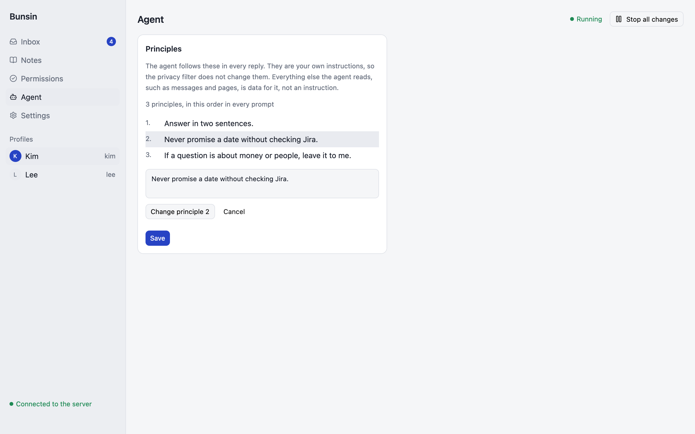
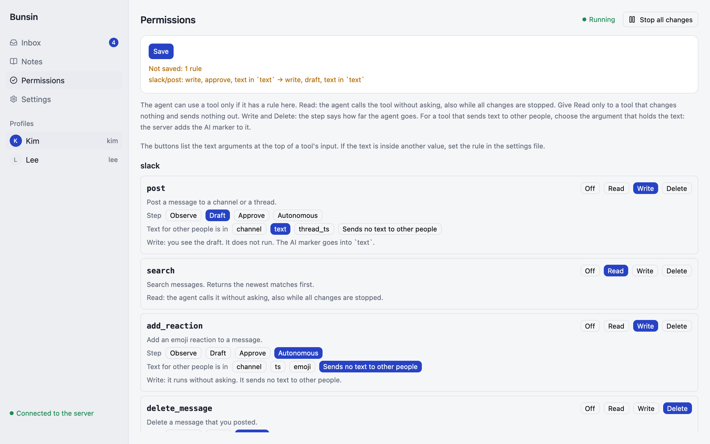
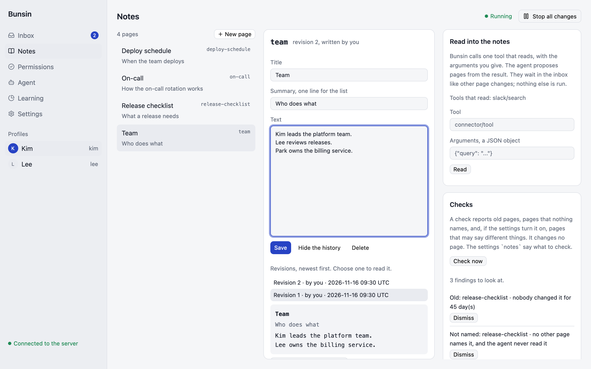
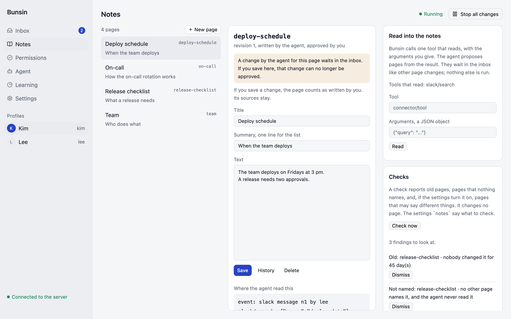
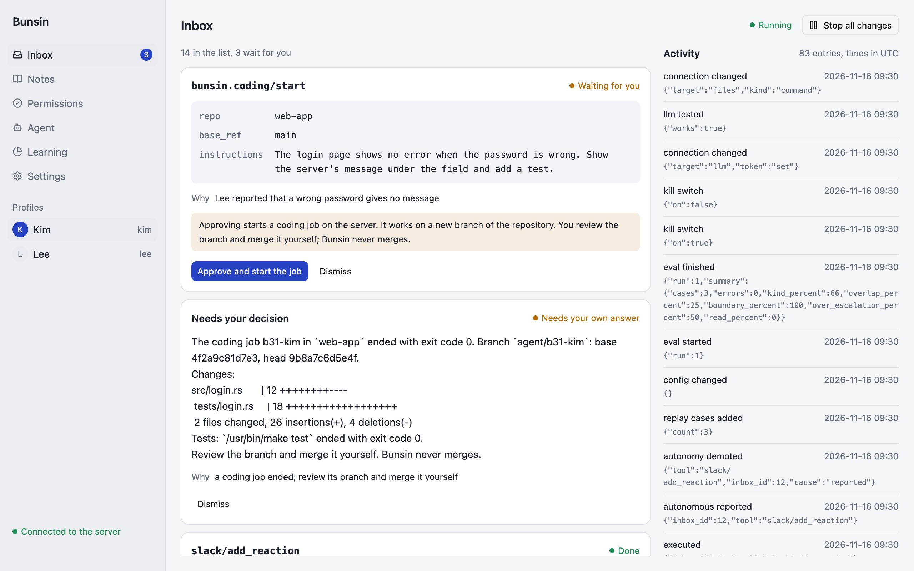
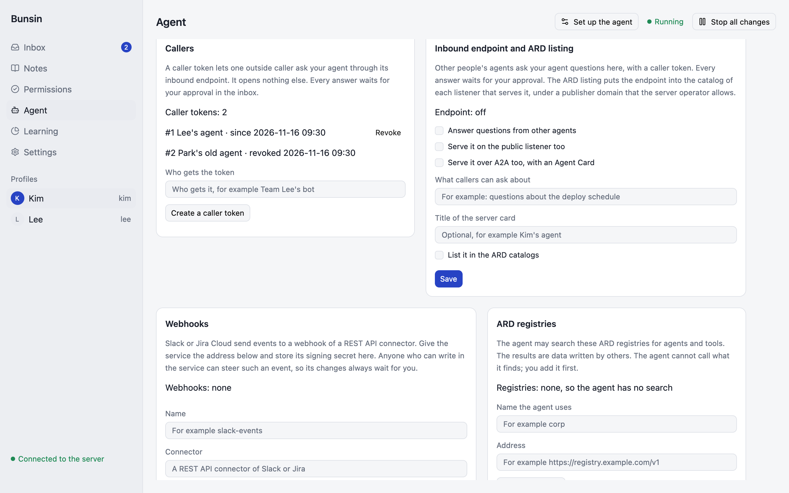
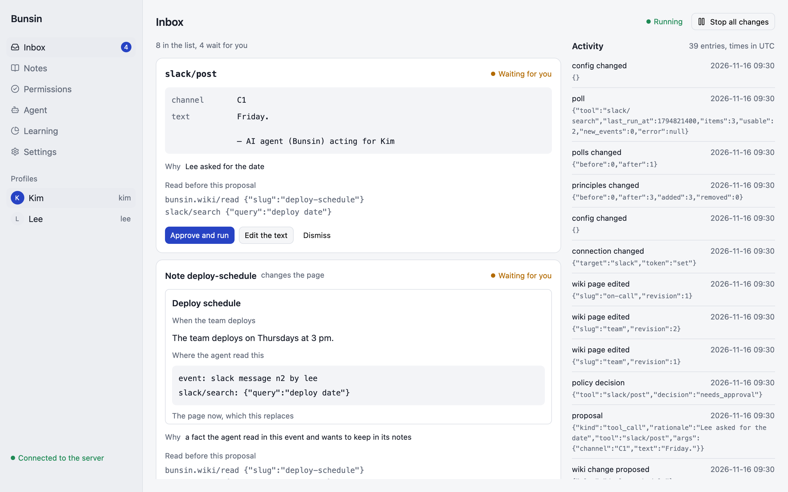
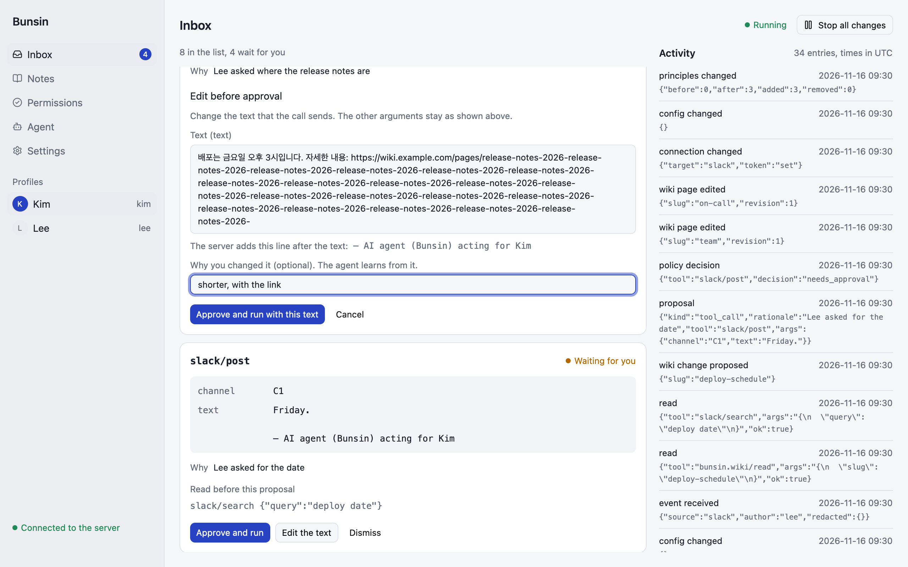
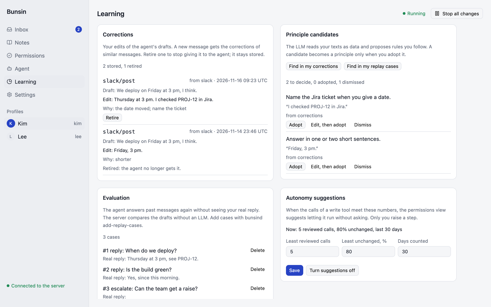

# Bunsin (분신)

[한국어](README.ko.md)

Bunsin hosts persona AI agents. Each agent holds one person's work principles and
acts for that person in Slack, Jira and Confluence through MCP servers or their REST APIs.
One server holds several isolated agent profiles.

The LLM only proposes. The harness decides what runs:

- A permission table per profile lists the allowed tools. A tool outside the table is denied.
- Every write starts at "run after the owner approves". The owner raises the level per tool.
- The harness appends an AI marker to every text the agent sends to other people.
- A kill switch per profile stops all writes.
- Every proposal, draft and result is saved, and an append-only audit log records each step.

## Current limits

Bunsin is in early development. Read this list before you use it.

- **Finding events depends on your connectors.** The server repeats a search tool that
  you name in the settings (see [Find events](#find-events-polling)), or Slack and Jira Cloud
  send events to a webhook (see [Webhooks](#webhooks)). Both have run only against test servers.
- **The agent reads only through the tools you allow.** Before it proposes, it can call
  tools with the class `read` (for example a search) up to five times, and read up to
  five pages of its notes, and use the results. A search of your ARD registries counts as a tool read. Facts it keeps go into its notes, which you approve page by page (see
  [Notes](#notes)). The notes fill with what the agent read while it handled events, and
  with reads that you start yourself. The search quality depends on your MCP servers.
- **The privacy filter works on patterns and on your list of terms.** It finds email
  addresses, phone numbers and the other listed forms. It finds names and postal
  addresses only if you list them as terms.
- **There is no setup wizard.** The window and the command line set the connections and
  the privacy filter. The window also sets the permission rules, the principles and the polls.
- **OAuth for MCP servers is turned on in the settings file only.** The window and the
  command line then sign in (see [LLM endpoint and connectors](#llm-endpoint-and-connectors)).
- **Tested only against local test servers.** No test runs against a real LLM endpoint,
  a real MCP server, a real OAuth provider, or the real Slack, Jira or Confluence API.
- **The desktop window is tested headlessly.** The Keychain storage has no test.
- **The server operator can read profile data.** Profiles are isolated from each other,
  not from a person with access to the server's files.

[docs/ARCHITECTURE.md](docs/ARCHITECTURE.md) has the full list of what is implemented,
and [docs/PLAN.md](docs/PLAN.md) has the plan (both in Korean).

## Parts

| Part | What it is | Runs on |
|---|---|---|
| `bunsind serve` | The server. It runs the agents and stores their data. | Linux or macOS |
| `bunsind <command>` | The command line of an operator or a profile owner. | Linux or macOS |
| `bunsin-app` | The desktop window: approval inbox, audit log, kill switch, notes, settings. | macOS |

## Build and test

```sh
cargo build --release -p bunsin-daemon     # the server and command line: target/release/bunsind
cargo build --release -p bunsin-app        # the desktop window (macOS): target/release/bunsin-app
cargo test --workspace
```

`rust-toolchain.toml` pins the Rust version. rustup installs it on first use.
On Linux, build and test without the window: `cargo test --workspace --exclude bunsin-app`.
The window uses GPUI through the `gpui-kit` crate.

### Install the command line

The build puts `bunsind` into `target/release/`. That folder is not on your `PATH`, so the
commands in this README, which start with `bunsind`, are not found yet. Do one of these:

- Install it into `~/.cargo/bin`, which rustup puts on your `PATH`:

  ```sh
  cargo install --path crates/daemon --locked
  bunsind --help
  ```

- Or run it with its path: `./target/release/bunsind --help`.

`bunsind --help` lists every command. `bunsind <command> --help` shows the options of one.

## Try it on one computer

These steps start a server on your own computer and use it from a second terminal. They
need no LLM and no MCP server. Use a test folder, as shown, not your real data.

**Terminal 1: the operator.** These commands read and write the data folder directly.

```sh
export BUNSIN_DATA_DIR=/tmp/bunsin-data        # every operator command needs this folder
bunsind profile-add kim --owner "Kim"          # prints: created profile kim for Kim
bunsind token-add kim --label "Kim's laptop"   # prints the access token once: bsn_...
bunsind serve --listen 127.0.0.1:8787 --key-store file   # prints: listening on http://127.0.0.1:8787
```

`--key-store file` keeps the key of this test folder in the folder. Without it, a server
on a Mac makes an item in your Keychain, which stays after you delete the folder.

Copy the token. The server keeps only its hash, so it cannot show the token again.
The server runs until you press Ctrl-C.

**Terminal 2: the profile owner.** These commands talk to the server over the network.

```sh
export BUNSIN_SERVER=http://127.0.0.1:8787
export BUNSIN_TOKEN=bsn_...                    # the token from terminal 1
bunsind profile-list                           # kim	Kim
bunsind status kim                             # kill switch: off, inbox: 0 item(s)
bunsind connections kim                        # llm	not set
```

The notes work without an LLM:

```sh
printf 'Kim leads.\n' > team.md
bunsind wiki-set kim team --title "Team" --summary "Who does what" --body-file team.md
bunsind wiki-list kim                          # team	Team	Who does what
```

The agent itself does not work yet. An event is refused until the profile has an LLM:

```sh
bunsind ingest kim --source slack --event-id 1 --author lee --text "When do we deploy?"
# error: the event was not handled: the LLM cannot be used: the profile has no `llm` settings
```

What to do next:

1. Give the profile an LLM endpoint and connectors: [LLM endpoint and connectors](#llm-endpoint-and-connectors).
2. Approve the tools of each connector and set what the agent may do: [Permission rules](#permission-rules).
3. Write your principles: [Principles](#principles).
4. Let the server find events: [Find events](#find-events-polling).
5. Open the window with the same address and token: [Desktop window](#desktop-window-macos).

For a server that other computers reach, read [Set up the server](#set-up-the-server-operator)
first. It needs TLS.

## Set up the server (operator)

```sh
export BUNSIN_DATA_DIR=/var/lib/bunsin
bunsind profile-add kim --owner "Kim"
bunsind token-add kim --label "Kim's laptop"   # prints the access token once
bunsind serve --listen 0.0.0.0:8787 --tls-cert cert.pem --tls-key key.pem
```

- **Access tokens.** A token gives access to one profile. Only its hash is stored, so it
  cannot be shown again. `bunsind token-list` and `bunsind token-revoke <id>` manage tokens.
  Profiles and tokens are created on the server only, never over the network.
- **TLS.** The server refuses to listen on a public address without TLS. Behind a TLS
  proxy, listen on `127.0.0.1`. To try Bunsin on one machine, run
  `bunsind serve --listen 127.0.0.1:8787` and use `http://127.0.0.1:8787` as the address.
- **Tokens of the LLM and of MCP servers.** Each profile owner enters them in the window
  or on the command line, and the server keeps them encrypted in that profile's database.
  This protects a copied database or backup. If the key is lost, start the server once
  with `--accept-new-key`: the notes and the settings stay, every stored token becomes
  unreadable, and the owners enter their tokens again. Without that option the server
  does not start over encrypted tokens whose key it cannot find.
- **Where the key is.** `--key-store` chooses it. The stored tokens are the same
  encrypted values in the database in both cases.
  - **On macOS the default is `keychain`:** the key is one item of your login Keychain
    (Keychain Access shows it with the name `Bunsin server`). A copy of the data
    directory then holds no key. The account of the item is the ID in the file
    `keychain-id` of the data directory. Keep this file: without it the server cannot
    find its item. If the file is lost, write the account that Keychain Access shows
    for the item back into it.
  - **On other systems the default is `file`:** the key is the file `master.key` in the
    data directory, or the file that `--master-key-file` names. Keep the key file out of
    backups of the data directory. It does not protect against a person who can read it.
  - **A key file moves by itself.** If a server on a Mac finds `master.key` and no
    Keychain item, it writes the key into the Keychain, reads it back, and then deletes
    the file. The stored tokens stay as they are.
  - **The Keychain needs your login session.** A server that starts over SSH or at boot,
    without a logged-in user, cannot read the Keychain and does not start. Use
    `--key-store file` there. macOS can ask for access again after `bunsind` is built
    again, because the program changed.
  - **The key does not travel with the data directory.** On another computer the
    Keychain has no item for it, and the server does not start: it makes no new key over
    encrypted tokens. Start with the key file, or start once with `--accept-new-key` and
    enter the tokens again.
  - To look at the item or remove it:
    `security find-generic-password -s "Bunsin server" -a "$(cat <data dir>/keychain-id)"`
    and `security delete-generic-password` with the same options. Removing it makes the
    stored tokens unreadable.
- **Tokens from the operator.** If a profile has no stored token, the server reads the
  environment variable `BUNSIN_SECRET_<PROFILE>__<KEY>`, for example
  `BUNSIN_SECRET_KIM__LLM`. A profile cannot name another profile's secret.
- **Upstream addresses.** Profile owners choose the LLM and MCP addresses, and the server
  sends the requests. By default the server accepts any `https://` address except
  `localhost` and internal IP addresses. A host name that resolves to an internal address
  still passes. On a shared or public server, start it with `--allow-upstream-host <host>`
  (repeatable): then only the listed hosts are allowed, including an internal gateway
  over `http://`.
- **Local MCP commands.** MCP servers that run as a command on the server need
  `--allow-stdio-connectors`. With this flag, every profile owner can make the server
  start any program, in the window or in the settings file. The program runs as the user
  of the server, so it can read the data of the other profiles and the key file. Use the
  flag only on a server whose profile owners you all trust, such as a server for yourself.
- **Coding jobs.** A profile can start coding jobs (see [Delegate coding](#delegate-coding))
  only if the server runs with `--allow-coding --coding-repo-root <dir>`, and only with a
  program that you name: `--coding-program claude-code=<absolute path>` and
  `--coding-program codex=<absolute path>`. A profile picks only the backend and a repository.
  Each repository must be a git repository under the root; the server checks it, after it
  follows links, when the settings are saved and again when a job starts. The same holds for
  every check below.
- **Coding commands.** A profile's own program (the backend `command`) and a test command run
  only with `--allow-coding-commands`. This flag gives every profile owner the same power as
  `--allow-stdio-connectors`: they can run any program as the user of the server, and that
  program can read the data of the other profiles and the key file. Use it only on a server
  whose profile owners you all trust.
- **No sandbox.** A coding job runs as the user of the server. The coding CLI keeps its own
  permission settings: Bunsin passes no flag that turns off its prompts or its sandbox, and
  adds no sandbox of its own. A job keeps its worktree and transcript in
  `<data dir>/coding/<profile>/`; the server does not remove the worktrees.
- **Listeners for other callers.** `--internal-listen <addr> --internal-url <address>` opens
  a second listener for callers in your own network, and `--public-listen <addr> --public-url
  <address>` a third one for callers on the internet. The URL is the address that callers use,
  for example `https://agents.example.com`; it can differ from the listen address behind a
  proxy. These listeners have no control API: an access token does nothing there, and the
  control API is not reachable through them. Each needs TLS on a public address
  (`--internal-tls-cert`/`--internal-tls-key`, `--public-tls-cert`/`--public-tls-key`), and no
  two listeners may share an address. The server checks all of this before it reads the key.
  They serve the inbound endpoints of the profiles that turn them on (see
  [Let others ask your agent](#let-others-ask-your-agent)): the internal listener serves the
  scopes `internal` and `public`, the public listener only `public`.
- **ARD publishing.** `--ard-publisher-domain acme.com` (repeat it for more) names the
  domains that profiles may publish their endpoint under. Without it, no profile is published,
  and the server refuses settings with `inbound.ard`. A listener for callers serves the ARD
  catalog `/.well-known/ard.json` of the profiles it serves.
- **Stopping.** On SIGTERM the server takes no new request and waits up to 300 seconds
  for running ones.

## Set up an agent (profile owner)

```sh
export BUNSIN_SERVER=https://bunsin.example.com:8787
export BUNSIN_TOKEN=bsn_...                    # from the operator
bunsind config-show kim > kim.json
# Edit kim.json, then:
bunsind config-set kim kim.json
```

For a server with a private CA, set `BUNSIN_CA_CERT` to the CA certificate file.

A new profile can do nothing. Its settings must name an LLM endpoint, connectors,
approved tools and permission rules.

### LLM endpoint and connectors

Enter these in the desktop window (section "Connections"), or on the command line:

```sh
bunsind llm-set kim --token-stdin               # the Claude API; type or pipe the key, then Enter
bunsind llm-set kim --wire openai-chat --base-url https://llm.example.com/v1 \
    --model your-model-id --token-stdin          # another endpoint
bunsind connector-set kim slack --url https://mcp.example.com/slack --token-stdin
bunsind connector-set kim jira --url https://mcp.example.com/jira --token-stdin
bunsind connector-set kim wiki --url https://mcp.example.com/wiki     # an MCP server that needs no token
bunsind connector-set kim crm --url https://mcp.example.com/crm \
    --token-header X-API-Key --token-stdin       # the token goes as `X-API-Key: <token>`
bunsind connector-set kim slack-api --api slack --url https://slack.com/api --token-stdin
bunsind connector-set kim jira-api --api jira --url https://your-domain.atlassian.net \
    --auth basic --email you@example.com --token-stdin   # an Atlassian API token
bunsind llm-test kim                             # one test request to the saved LLM endpoint
bunsind llm-usage kim                            # LLM calls and tokens of the last 90 days
bunsind connections kim                          # addresses and where each token comes from
bunsind tools kim slack                          # connects and lists the tools: the check that it works
bunsind connector-oauth kim docs                 # signs in to an MCP server that uses OAuth (see below)
bunsind connector-remove kim jira                # removes the connector and its token
```

- Without options, `llm-set` uses the Claude API: `--wire anthropic-messages`,
  `--base-url https://api.anthropic.com` and `--model claude-opus-5-5`. The window
  prefills the same values. `--wire` is `anthropic-messages`, `openai-chat`
  (Chat Completions) or `openai-responses` (Responses). The format fixes the header of the
  LLM token: `x-api-key` for Claude, `Authorization: Bearer` for the two OpenAI formats.
- `llm-test`, and **Test** in the window, send one short request to the saved endpoint. The
  request has the reply form and the output limit of a real request, and no data of your
  profile. It costs tokens at the endpoint. The test passes if the reply has the form the
  agent needs.
- `llm-usage` adds up the LLM calls of the last 90 days by UTC day and purpose (`event`,
  `replay`, `llm_test`): calls, failed calls, input and output tokens, and the average time.
  The server records every call with its time, tokens and how it ended. It stores no text
  of the request or the reply, and no error message.
- A connector needs no token: leave the token out. A token goes as `Authorization: Bearer
  <token>`. If the MCP server reads another header, name it with `--token-header`, or in the
  window. That header then carries the token as it is. Give `--token-header` with every
  `connector-set` of that connector: a call without it sets `Authorization: Bearer` again.
- A tool call of an MCP connector must end in 2 minutes, and so must the list of its tools
  that the server asks for before each call. A call that runs longer is cancelled, but the
  MCP server may have done it anyway. So an approved write or delete that runs out of time
  becomes `unknown`, not `failed` (see "A call cut by a stop or without an answer" below).
- **OAuth.** An MCP server at an address can take a sign-in with OAuth instead of a token.
  Turn it on in the settings file: give the connector `"oauth": {}` and no token, then
  `config-set`. For example:
  `"docs": {"mcp": {"transport": "http", "url": "https://mcp.example.com/docs"}, "oauth": {}}`.
  The window and `connector-set` keep the `oauth` of a connector they save, but cannot turn
  it on or off. In `oauth`, `"client_id"` names a client that the authorization server gave
  you for Bunsin. Without it, the server registers a client by itself (dynamic client
  registration). `"scopes"` lists the scopes to ask for. Without it, the server asks for the
  scopes that the MCP server names.
- To sign in, click **Sign in** in the row of the connector in the window. The window opens
  the sign-in page in the browser and takes the browser's return on a free port of
  127.0.0.1. On the command line, `connector-oauth` prints the address of the page. Open it,
  sign in, then paste the address that the browser goes to; that page does not load.
  `--redirect-uri` sets that address (default `http://127.0.0.1:8976/callback`). A client ID
  that was registered with one fixed address may need it. A sign-in waits 10 minutes. A
  profile can have 3 sign-ins waiting, and a restart of the server forgets them.
- The server seals the OAuth tokens and binds them to the origin of the MCP server's address.
  It renews the access token with the refresh token by itself. `connections` and the window
  show `signed in with OAuth` or `OAuth sign-in needed`. You must sign in again after the
  address moves to another origin, after the authorization server refuses the refresh
  token, or when the access token has expired and there is no refresh token. Removing
  `oauth` or the connector deletes the tokens. Each request of the sign-in passes the address
  rules, follows no redirect and must end in 30 seconds. The sign-in ran only against a
  local test server.
- With `--api slack|jira|confluence` (in the window: the kind **REST API**), the server calls
  the service's REST API itself instead of an MCP server. The tools are fixed in the code:
  Slack `search_messages`, `get_thread`, `post_message`; Jira `search_issues`, `get_issue`,
  `add_comment`; Confluence `search_pages`, `get_page`, `create_page`. No tool deletes.
  `--url` is the base URL: `https://slack.com/api`, or your Atlassian site. Slack takes a
  bearer token. Jira and Confluence take a bearer token, or `--auth basic --email <account>`
  with an Atlassian API token. A REST API connector needs a token and takes no
  `--token-header`. You approve its tools and give each a rule, as for an MCP server; the
  AI marker goes where the rule names the text, for example `{"arg": "text"}`. The address
  rules and the binding of the token to the origin apply to the base URL. The request
  shapes follow the official API docs; no test ran against the real services. Each request
  must end in 30 seconds; a service that does not answer in time gives an error. If the
  request reached the service before the error, an approved write or delete becomes
  `unknown`. A request that never connected, and a clean refusal such as HTTP 4xx, fail.
- In the window, **Copy the token from the Keychain** reads the LLM token or the token of
  an address connector from an item that exists in the login Keychain of your Mac. Enter the service of the item (Keychain
  Access shows it as *Where*) and its account, then **Read from Keychain** and **Save**.
  The token is copied once to the server: a later change in the Keychain does not reach
  it. macOS can ask you to allow the access if another app made the item. The window
  does not respond while macOS asks. The read finds application passwords of the login
  Keychain only: not "Internet password" items, and not items of iCloud Keychain or the
  Passwords app. One set of Keychain fields is open at a time, under the token it fills.
  A read that fails empties that token field, so Save does not send an earlier token.
- With `--wire openai-chat` or `openai-responses`, `llm-set` needs `--base-url` and `--model`.
  Only the Claude format has defaults.
- A Claude API key that is not scoped to one workspace also needs a workspace ID. Set
  `"workspace_id"` in the `llm` section of the settings file.
- The server stores each token encrypted and never sends it back. `connections` shows
  only "token stored on the server", "token from the server's environment" or "no token".
- Without `--token-stdin` the stored token is kept. `--clear-token` removes it.
- If someone else changed the same settings after the window loaded them, the window
  warns before it overwrites. The command line and `config-set` do not check, except
  the rule commands (`rule-set`, `rule-remove`).
- A token belongs to the address it was entered for. If you move a connection to another
  host or port, enter the token again; the server refuses to keep it.
- A connector name is 1 to 32 of a-z, 0-9 and `-`. It is the first part of every tool ID,
  for example `slack/post_message`.
- One connector that cannot connect does not stop the others.
- A connector can also be a program that the server starts (the MCP stdio transport), for
  an MCP server that is given as a command such as `npx ...` or `uvx ...`. In the window,
  choose **Command on the server** in the connector form. Enter the absolute path of the
  program only, its arguments one in each line without quotes, and its environment
  variables as `NAME=value`, one in each line. The settings file takes the same as
  `"transport": "stdio"` with `command`, `args` and `env`.
  - The server stores such a connector only if its operator started it with
    `--allow-stdio-connectors`. Without the flag the save is refused. The server must be
    started again with the flag.
  - The program runs on the server computer with the rights of the server. Use this only
    on a server whose profile owners you trust.
  - Put a secret, such as an API token, into a **secret variable**: its name, its value
    in the masked field, then **Add**. The server encrypts the value like a token, gives
    it to the program in its environment, and does not show it again. The settings hold
    only the name. To replace a value, add the variable again. To remove it, use
    **Remove** in its row, then save.
  - The arguments and the other environment variables are stored as plain text in the
    settings. `config-show` and the form after **Edit** show them. The connector list
    shows only the program and how many of each there are.
  - Secret values are entered in the window only. The settings file can name a secret
    variable (`"secret_env": ["API_TOKEN"]`), but not give its value: the form then says
    that no value is stored for it. A settings file without the name removes the stored
    value for good, so `config-set` with an older file removes the values that the file
    does not name. A plain value that
    is in the settings already is not moved: enter it as a secret variable and delete its
    plain line.
  - Encryption protects the stored value. While the program runs, the value is in the
    environment of that program on the server.
  - A name keeps its kind. To turn an address into a command or back, remove the
    connector first.

### Principles

```json
{
  "principles": [
    "Answer in two sentences.",
    "Never promise a date without checking Jira."
  ]
}
```

`principles` go into every prompt as instructions. All other text the agent reads
(messages, pages, tool descriptions) is quoted as data.

In the window, the **Agent** view lists the principles. You add, change, move up or down,
and remove them, then Save sends the list. If someone saved other principles meanwhile, the
view warns and offers "Load the server's version" and "Save anyway".



- At most 50 principles, each 1 to 1,000 characters. The space around a principle is removed.
- Principles are your own instructions, so the privacy filter does not change them.
- The audit log records the counts of a change, not the text.

#### Principle candidates from your past texts

The server can ask the LLM which rules your past texts follow. It proposes candidates only.
Nothing becomes a principle until you adopt it.

```sh
bunsind extract-principles kim --from corrections     # your edits of drafts and your reasons
bunsind extract-principles kim --from replay-cases    # the real replies of your replay cases
bunsind extract-principles kim --from read --tool slack/search --args '{"query":"from:me"}'
bunsind principle-candidates kim
bunsind adopt-principle kim 4                          # add candidate 4 to the end of the principles
bunsind adopt-principle kim 5 --text "Answer in one line."   # add your edit of it instead
bunsind dismiss-principle kim 6
```

- The texts reach the LLM as quoted data after the privacy filter. A `read` source calls one
  tool that has a `read` rule, with the same checks as a poll.
- The server keeps at most 10 candidates per request. It drops a candidate that has more than
  300 characters, holds a `[REDACTED:...]` placeholder, or quotes as its evidence something
  that is not in your texts. It also drops a text that is a principle or a candidate already,
  so a dismissed candidate does not come back.
- An adoption appends one text through the same save as the principles, with the same limits.
  If the principles changed since you read them, the adoption is refused (HTTP 412).

### Permission rules

In the window, the **Permissions** view lists each approved tool and sets its rule with
buttons: Off, Read, Write or Delete, then the step and the arguments that hold the text
for other people. A click on an argument adds or removes it, so you can choose several.
Nothing is chosen for you from a tool's name or description. A write or delete rule
cannot be saved until you say where its text is, or that it sends none.
Save sends the whole table, and the view lists each change before you save.



- The buttons offer the text arguments at the top of a tool's input. If the text is
  inside another value, set the rule with `bunsind rule-set` or in the settings file.
  The view shows such a rule as it is, keeps it on save, and keeps it as one of the choices.
- A rule change also applies to items that already wait in the inbox: at approval the
  server adds the AI marker by the rule in force at that time.
- A rule that a poll needs cannot be removed. The view shows the server's reason.

#### Raise a step on evidence, and hold a tool that went wrong

The server counts your decisions about each write or delete tool: calls you approved
unchanged, edited or dismissed, and calls that ran without asking (and how many failed).
The Permissions view shows the counts under each tool.

- **Suggestions.** Set thresholds in the settings file. Without them nothing is suggested.

  ```json
  { "autonomy": { "min_reviewed": 20, "min_unchanged_percent": 90, "window_days": 30 } }
  ```

  A write tool at `approve` with at least `min_reviewed` decisions in the last `window_days`
  days, of which at least `min_unchanged_percent` % were approved unchanged, gets the badge
  "Suggested: Autonomous". The server never raises a step. You raise it and press Save.
  A delete tool and the coding tool are never suggested.
- **Holds.** If you dismiss a waiting call of a tool at `autonomous`, or press "Report a problem"
  on a call that ran without asking, the server holds the tool at approval: each of its calls
  waits for you, whatever its step says. A call that the server approved by itself but did
  not run before a stop waits too. The hold is stored apart from the settings, so a settings file or "Save anyway"
  cannot end it. Only "Clear the hold" in the Permissions view, or `bunsind clear-autonomy-hold`,
  ends it. A hold starts the counts of the tool again.

```sh
bunsind autonomy kim                          # counts, holds and suggestions, one line per tool
bunsind report-autonomous kim 42              # report inbox item 42, which ran without asking
bunsind clear-autonomy-hold kim slack/post_message
```

On the command line, one rule at a time:

```sh
bunsind rules kim                                   # one line per rule; "off" for an approved tool without one
bunsind rule-set kim slack/search --class read
bunsind rule-set kim slack/post --class write --text text --text 'blocks.*.text.text'
bunsind rule-set kim slack/delete --class delete --tier approve --no-text
bunsind rule-remove kim slack/search
```

- A write or delete rule needs `--text <place>` (repeat it for more places) or `--no-text`.
  `--tier` defaults to `approve`. A delete cannot be `autonomous`.
- The command reads the table, changes one rule and sends the table with what it read.
  If someone changed the rules in between, the server refuses and nothing is saved.

The same rules as a settings file:

```json
{
  "approved_tools": {
    "slack": [
      {
        "name": "search_messages",
        "description": "Search messages",
        "input_schema": { "type": "object", "properties": { "query": { "type": "string" } } }
      },
      {
        "name": "post_message",
        "description": "Post a message",
        "input_schema": {
          "type": "object",
          "properties": { "channel": { "type": "string" }, "text": { "type": "string" } }
        }
      }
    ]
  },
  "policy": {
    "rules": {
      "slack/search_messages": { "class": "read", "tier": "autonomous", "outgoing_text": "none" },
      "slack/post_message": { "class": "write", "tier": "approve", "outgoing_text": { "arg": "text" } }
    }
  }
}
```

- **`approved_tools`** holds each tool exactly as the MCP server lists it: name,
  description and input schema. You do not type it. `bunsind tools kim slack` shows the
  tools of connector `slack` and marks each as `new`, `changed`, `approved` or `gone`;
  `bunsind tools kim slack --approve` approves exactly the list it showed. Before every
  call the server compares the approved list with the live one. If a tool was changed or
  removed, the call is denied until you approve the list again.
- **`policy.rules`** is the permission table. A key is `<connector>/<tool>`. The agent can
  propose only tools that have a rule and an approved entry.
- **`class`** is `read`, `write` or `delete`. Give `read` only to a tool that changes
  nothing and sends nothing outside its own service: the agent calls such a tool without
  asking, and a later read can carry text from an earlier one in its arguments. A tool
  that fetches a URL you do not control is not a `read`. A read runs at once, also when the kill
  switch is on.
- **`tier`** says how far a write may go:

  | Tier | What happens to a proposed write |
  |---|---|
  | `observe` | The proposal is saved. Nothing is shown or run. |
  | `draft` | The draft appears in the inbox. The agent never runs it. |
  | `approve` | The call runs after you approve it. Start here. |
  | `autonomous` | The call runs without asking. A `delete` still needs approval. |

- **`outgoing_text`** is required in every rule. `{ "arg": "text" }` names the argument
  that other people will read; the server appends `ai_marker` to it. `"none"` means the
  tool sends no text to other people.
  `{ "paths": ["text", "blocks.*.text.text"] }` names several places. A path joins argument
  names with `.`, and `*` means every item of a list. The server appends the marker to each place.
  If a call lacks one of the places, or one item of a list lacks the rest of the path,
  the server does not make the call. So a Slack message with a divider block is refused
  by the rule above.

### Find events (polling)

```json
{
  "polls": [
    {
      "connector": "slack",
      "tool": "search_messages",
      "args": { "query": "to:me" },
      "every_secs": 60,
      "mapping": { "items": "messages", "id": "ts", "text": "text", "author": "user", "thread": "thread_ts" },
      "skip_authors": ["U012AB3CD"]
    }
  ]
}
```

The server calls the tool every `every_secs` seconds (30 at least) and hands each new
item to the agent.

In the window, the **Agent** view lists the polls with the last run of each. You add,
change and remove a poll in its fields (the arguments as a JSON object, the mapping as dot
paths, the authors to skip one in each line), then Save sends the list. The server refuses a
poll that it would not run and the view shows the reason. **Test** runs a saved poll once and
shows the events it would hand over, after the privacy filter, like `bunsind poll-test`.

- The tool must have a rule with the class `read` and must be in the approved list. The window's
  save checks both. A settings file is checked for the rule; an unapproved tool fails at each run.
- The example above is an illustration. Fit `args` and `mapping` to what your MCP
  server's search tool takes and returns.
- `mapping` says where the fields are in the tool's result, as dot paths such as
  `user.id`. `items` is the path to the list; leave it empty if the result is the list.
  The ID must stay the same for the same message. `thread` may be `null`.
- `bunsind poll-test kim 0` runs poll number 0 once and prints the events it would hand
  over. Use it to get the mapping right. It stores nothing.
- The first run of a search records what it finds as already seen. Only later items
  become events. A changed search (`connector`, `tool` or `args`) starts again that way.
- `skip_authors` lists your own account names or IDs. Your messages and texts that carry
  the AI marker are not events.
- An event whose handling fails is tried again on a later run, three times in all. Then
  an item in the inbox tells you.
- One ID becomes an event once. A Jira issue or a page that changes under the same ID
  is not seen again; search for comments or changes, which have their own IDs.
- Polling pauses while the kill switch is on.
- `bunsind status kim` shows the last result of each poll. "none usable" means the
  mapping does not fit the result.

### Webhooks

Slack (Events API) and Jira Cloud can send events to the server instead of a poll. A webhook
belongs to a REST API connector of the same service (see
[LLM endpoint and connectors](#llm-endpoint-and-connectors)); its events have that connector
as their source.

```json
"webhooks": {
  "slack-events": {"connector": "slack-api", "scope": "public", "skip_authors": ["U012AB3CD"]},
  "jira-events": {"connector": "jira-api", "scope": "public"}
}
```

```sh
bunsind webhook-secret kim slack-events      # type or pipe the signing secret, then Enter
bunsind inbound kim                          # the address of each webhook, and whether its secret is stored
```

- The address is `<listener URL>/hooks/<profile>/<name>`. `scope` (default `internal`) picks
  the listeners as for the inbound endpoint: the internal listener takes both scopes, the public
  listener only `public`. Slack and Jira Cloud need a public listener.
- Give Slack the signing secret of the app, and Jira the secret of the webhook, with
  `webhook-secret`. The server stores it encrypted and never sends it back. A removed webhook
  loses its secret. Without a secret, every delivery is refused.
- The server checks the signature over the raw body first (Slack `v0`, Jira `X-Hub-Signature:
  sha256=`). Slack's timestamp must be within 5 minutes; a Jira body's `timestamp` within 2 hours.
  Every refusal of the profile, the webhook, the listener and the signature is the same `401`.
  A body over 1 MiB gets `413`. A signed Slack `url_verification` gets its challenge back.
- Slack takes `message` (new messages, thread replies, file shares, bot messages) and
  `app_mention`; Jira takes `comment_created`, `comment_updated`, `jira:issue_created` and
  `jira:issue_updated`. Other events get `200` and are dropped.
- The server answers `200` at once and hands the event to the agent later, like a question of
  an inbound caller. A delivery is stored once by its ID (Slack `event_id`, Jira
  `X-Atlassian-Webhook-Identifier`); a repeated delivery gets `200`. Handled deliveries are kept
  for 7 days. One Slack message that arrives as `message` and as `app_mention` is handled once.
- The agent's own posts (with the AI marker) and the authors in `skip_authors` are dropped.
- A webhook event is from outside: anyone who writes in the channel or the project can steer it.
  A page change from it always waits for you, also with `notes.auto_apply`.
- A connector cannot have a poll and a webhook: their event IDs differ, so one message would be
  handled twice. The server refuses such settings.

### Privacy filter

```json
{
  "privacy": {
    "email": true,
    "phone": true,
    "resident_number": true,
    "card_number": true,
    "custom": [{ "label": "employee id", "pattern": "\\bEMP-\\d{6}\\b" }],
    "terms": ["Park Jiwon", "박지원", "12 Teheran-ro"]
  }
}
```

Before the server stores an event or sends any quoted text to the LLM, it replaces each
match with a placeholder such as `[REDACTED:EMAIL]`. The removed text is in no database,
file or log; the audit log holds counts only.

- The four built-in kinds are on in a new profile. `resident_number` is the Korean
  resident registration number. A card number counts only if its check digit is right.
- `custom` patterns use the syntax of the Rust [`regex`](https://docs.rs/regex) crate.
  The server refuses a pattern that does not compile or that matches empty text.
- `terms` are literal texts, for example names of colleagues or addresses. Each match
  becomes `[REDACTED:TERM]`. A term matches anywhere and in any case, so `Kim` also removes
  the start of `Kimball`, and `박지원` also matches in `박지원님`. Spaces around a term do not count.
  At most 200 terms of 2 to 100 characters. The terms themselves are stored in the profile
  settings on the server; an error names a term by its position only.
- The desktop window has a form for these settings.
- Your own `principles` and your own edits are not filtered.

### Notes

The agent keeps durable facts in notes: pages with a title, a one-line summary, a body
and the sources of its facts. It works like a small wiki that the agent writes.

- When the agent has read something with a tool and wants to keep a fact (a schedule, an
  owner, a decision), it proposes a page. The proposal appears in the inbox as
  `note <page> (new page)` or `(change)`, with the new text, its sources and the text it
  replaces. Nothing is kept until you approve it.
- In later events the agent sees the list of pages and reads the ones it needs before it
  searches again. The list shows the pages that share rare words with the message first,
  then the newest pages, and at most 60 lines. The agent can also search its notes by
  words (`bunsin.wiki/search`): it gets up to 10 pages with their titles and summaries.
  A search counts toward the five reads of the notes, and it is never the source of a new
  fact.
- A page is reference material. Whatever a page says, the permission table decides what
  the agent may do.
- The agent proposes a page only from something it read in that event, changes an
  existing page only after it read that page, and cannot delete pages.
- You can read, write and delete pages yourself. In the window, the **Notes** view lists
  the pages. Select a page to read and edit it, or make a new page. Save warns you if the
  page changed on the server meanwhile. Delete asks once before it deletes.
- **History** lists the revisions of the open page, newest first. Choose one to read its
  text; nothing in it can be edited. "Put this text into the fields" copies the old text
  into the fields, and Save stores it as a new revision with the usual check. It does not
  replace text that you typed and did not save.



- The same on the command line:

```sh
bunsind wiki-list kim
bunsind wiki-show kim deploy-schedule
bunsind wiki-set kim team --title "Team" --summary "Who does what" --body-file team.md
bunsind wiki-delete kim team
bunsind wiki-history kim team          # every change; --revision N prints an old text
bunsind wiki-export kim ./notes        # index.md and pages/*.md
```

#### Checks of the notes

A check reports pages to look at. It never changes a page. The settings `notes` say what
it looks for; everything is off by default:

```json
"notes": {"stale_days": 30, "lint_every_hours": 24, "lint_conflicts": true}
```

- `stale_days`: a page that nobody changed for more than this many days is **old**. A page
  that no other page names (its name as a whole word) and that the agent did not read for
  more than this many days is **not named**. A page the agent never read counts from its
  last change.
- `lint_conflicts`: the check also asks the LLM, once, about at most 10 pairs of pages that
  share two or more rare words. The pages go to the LLM as quoted data after the privacy
  filter. A finding about a pair that was not sent is dropped. Without this setting a check
  calls no LLM.
- `lint_every_hours`: the server checks this often. Without it, only you start a check.
- A check replaces the findings of the last one. Dismiss a finding, and later checks do not
  report the same kind for the same pages again. If the conflict check fails, the last
  findings stay.
- In the window, the **Checks** card of the Notes view has **Check now** and a **Dismiss**
  button for each finding. On the command line:

```sh
bunsind lint-notes kim         # check now
bunsind lint-findings kim      # the findings you have not dismissed
bunsind dismiss-finding kim 3
```



#### Changes without approval

With `"notes": {"auto_apply": true}` (off by default) the server stores a page change of the
agent at once, without your approval, but only if all of these hold:

- the page is new, or the agent wrote it last. A page that you wrote or edited always waits for you;
- the kill switch is off;
- the event came through your own channel: your polls, or an event you handed in with your
  access token. The server sets this mark itself. Every other event counts as `outside`: a
  webhook, an inbound caller, and any event whose mark comes from the request or from storage.
  Its changes always wait for you, because other people can write such an event to steer the agent.

The change still needs a source and still shows in the inbox, as done. The audit entry
`wiki_change_applied` says `"auto": true`. A change that cannot be stored stays pending.

#### Read into the notes

You can fill the notes from one read that you choose, for example a search of a Confluence space:

```sh
bunsind preload-notes kim --tool confluence/search --args '{"cql": "space = OPS"}'
```

- The tool needs a rule with the class `read`, and its tool list must be the approved one, as for a poll.
  Bunsin calls it once with your arguments.
- The agent gets the result after the privacy filter, as quoted data, and proposes pages. It may
  read more tools and pages, with the usual limits. The changes go to the inbox like other page
  changes, with the read as their source. They always wait for you, also with `notes.auto_apply`:
  you started the read, but other people wrote what it found.
- Whatever else the agent proposes (a reply, an escalation) is not run. The audit log records it.
- In the window, the **Read into the notes** card of the Notes view does the same.

Not built yet: a check of a page when you lose access to its source.

### Search ARD registries

The agent can look for other agents and tools in ARD registries (Agentic Resource Discovery)
that you name in the settings:

```json
"ard_registries": [{"name": "corp", "url": "https://registry.corp.example/v1"}]
```

- The agent then sees the built-in read tool `bunsin.ard/search {text, registry?}`. It sends
  `POST <url>/search` with `query.text`, `federation: "none"` and `pageSize: 5` to the named
  registry, or to the first one. It needs no permission rule, and it counts toward the five
  reads of an event.
- The search follows no referral: a referral names a registry that the registry chose, not
  you. A redirect is not followed either.
- The registry addresses pass the same address rules as the LLM and connector addresses.
  A name is 1 to 32 of a-z, 0-9 and `-`.
- The results are text written by others. They pass the privacy filter and reach the LLM as
  quoted data. The agent gets the identifier, name, type, URL, description, capabilities,
  score and source of each result; nothing else. The `score` is only text for the LLM: no
  decision of the server uses it.
- The agent cannot call what it found. You add a found agent or tool as a connector, approve
  its tools and give each a rule.

### Delegate coding

The agent can hand a code change to a coding agent CLI (Claude Code, Codex, or a command you
name). It never writes code itself and never merges. Set it up in the settings file:

```json
"coding": {
  "backend": "claude_code",
  "timeout_secs": 1800,
  "repos": {"web-app": {"path": "/srv/code/web-app"}}
},
"policy": {"rules": {"bunsin.coding/start": {"class": "write", "tier": "approve", "outgoing_text": "none"}}}
```

- `backend` is `claude_code` or `codex`; the server operator names the program of each
  (`--coding-program`), and a profile cannot. On a server with `--allow-coding-commands`, the
  backend `command` with `"command": ["/abs/program", "arg", ...]` and a repository's
  `"test_command": ["/usr/bin/make", "test"]` are allowed too. The instructions go to the
  program on stdin.
- The agent sees the built-in tool `bunsin.coding/start` only with these settings and the rule.
  It sees a fixed description and the repository names, never a path, the program or the test
  command. It chooses the repository, a base (default `HEAD`) and the instructions.
- **Every job waits for you**, also with the tier `autonomous`, like a delete. The rule must be
  a `write` with `"outgoing_text": "none"`. The inbox card says "Approve and start the job".
- After approval the server runs the job in the background. It makes a git worktree and the
  branch `agent/b<item>-<profile>`, runs the coding agent and then the test command, and keeps
  the diff summary, the test output and the transcript as artifacts, after the privacy filter.
- When the job ends, the call becomes done (the coding agent ended with exit code 0) or failed,
  and a new item in the inbox names the branch, the changes and the test result. **Review the
  branch and merge it yourself.**
- If the server stops while a job runs, the call becomes `unknown`, like any cut call.
- Limits: no test runs a real Claude Code or Codex CLI; the tests use `/bin/sh` as the coding
  agent. In their default modes both CLIs may ask before they edit a file and, with no one to
  answer, change nothing: the job then ends with no change. Bunsin adds no flag to bypass that;
  set the CLI's own configuration on the server if you want it to edit.



### Let others ask your agent

Other people's agents can ask your agent questions through its inbound endpoint. Each caller
gets its own caller token from you:

```sh
bunsind caller-add kim --label "Team Lee's bot"   # prints the caller token once: bsc_...
bunsind callers kim                                # 1	valid	Team Lee's bot
bunsind caller-revoke kim 1                        # the next request with it is refused
```

- A caller token opens only the inbound endpoint of your profile. It opens nothing of the
  control API, and an access token opens nothing of the inbound endpoint.
- The server keeps only the hash of a caller token. A revoked token stays in the list with
  the time of its revocation.
- The window lists the caller tokens in the Agent view. There you create one (the window
  shows it once) and revoke one with two clicks.

  
- Turn the endpoint on in the settings file. Turning it on adds the rule of the reply tool:

  ```json
  "inbound": {"enabled": true, "scope": "internal", "title": "Kim's agent",
              "description": "Questions about the deploy schedule."}
  ```

  `description` (1 to 100 characters) is required while the endpoint is on.
- A question waits on the server; the agent handles it in the background and answers with the
  built-in tool `bunsin.inbound/reply`. **Every answer waits for your approval**, also with the
  tier `autonomous`, which the server refuses for this tool. The answer gets the AI marker, and
  your edit is kept as a correction. Only questions from callers see this tool.
- Limits per profile: 20 questions an hour per caller, 50 open questions, 4,000 characters per
  question. The counts come from the stored questions, so a restart does not reset them. A
  question is stored after the privacy filter. With the kill switch on, questions wait.
- A question that fails three times ends as failed, with a note in your inbox.
- A page change the agent proposes while it handles a question always waits for you, also with
  `notes.auto_apply`.
- **The endpoint** is an MCP server (streamable HTTP, stateless) at
  `<listener URL>/agents/<profile>/mcp`, with two tools: `ask {question}` returns
  `{request_id, pending_approval: true}` at once, and `get_request {request_id}` returns
  `{request_id, status, answer?}` with the status `working`, `pending_approval`, `answered`,
  `declined` or `failed`. The caller sends `Authorization: Bearer <caller token>`.
- Every refusal of the token, the profile or the listener is the same `401`. A `Host` other than
  the listener's URL gets `403`, a body over 64 KiB `413`, and more than 64 requests at once on a
  listener `503`. A caller may call `get_request` 120 times a minute; this count is in memory.
- **The server card** of the endpoint is at `<listener URL>/agents/<profile>/mcp/server-card`
  (`application/mcp-server-card+json`, no token needed). It holds the title, the description and
  the endpoint URL, never a token or the owner's name. A listener that does not serve the
  profile answers `404`.
- **ARD catalog.** Add `ard` to `inbound` to list the endpoint in the catalog
  `<listener URL>/.well-known/ard.json` (Agentic Resource Discovery, v0.91):

  ```json
  "ard": {"publisher": "acme.com", "namespace": "team", "agent_name": "kim",
          "representative_queries": ["When do we deploy?", "Who reviews a release?"]}
  ```

  The entry's identifier is `urn:air:acme.com:team:kim`, its type
  `application/mcp-server-card+json`, and its `url` the server card on the same listener. Its
  display name is `title` (or `agent_name`), and its description is `description`. The
  internal listener lists the scopes `internal` and `public`, the public listener only
  `public`: a catalog lists exactly the endpoints that its listener serves. The publisher must
  be a domain that the server operator allows. The server refuses settings whose entry breaks a
  rule of ARD that an entry must follow. ARD asks for 2 to 5 representative queries; another
  count is listed with a warning. If two profiles make the same identifier, no catalog lists
  either of them.
- `bunsind inbound kim` shows the addresses of the endpoint and the catalog on each listener,
  the identifier, the listeners whose catalog lists it, and why a catalog leaves it out
  (for example a publisher domain that the operator no longer allows), with the warnings.
- Not built yet: OAuth for callers.

### Work with the agent

```sh
bunsind ingest kim --source slack --event-id 1700000000.000100 \
    --author lee --text "When do we deploy?"
bunsind status kim                 # the kill switch, the polls and the inbox
bunsind approve kim 1              # run pending item 1
bunsind approve kim 1 --args '{"channel":"C1","text":"At 3 pm."}' --reason "shorter"
bunsind reject kim 1 --reason "not needed"
bunsind resolve-unknown kim 1 drop # an item cut by a stop: done, drop or retry
bunsind corrections kim            # your stored edits of the agent's drafts
bunsind retire-correction kim 3    # keep correction 3, but stop giving it to the agent
bunsind stop kim on                # the kill switch: stops all writes of this profile
```

An edit of a pending call is stored as a correction: the text of the draft and of your
edit without the AI marker, your reason, and the message the call answered. All of it
passes the privacy filter before it is stored. When a new message comes in, the agent gets
up to five corrections of similar past messages. The server finds them by the words they
share, and a rare word counts more than a common one. It uses no embeddings. A replay gets
no corrections: one of them can hold the real reply. A retired correction stays stored
and reaches no prompt.

If the server stops while it runs an approved call, the next start does not run that call
again: it may have reached its tool already. `status` shows it as `unknown`. The same
happens when an approved call gets no answer: the connector's time limit ended it, or the
connection broke after the request was sent. Bunsin never sends such a call again by
itself. A failed read is different: the agent gets the error as data. Check the
target system, then resolve it with `resolve-unknown` or in the window: `done` if the call
reached its tool, `drop` if it did not, or `retry` to run a copy now as a new item.
A retry checks the permission rules again. If the first call reached its tool, a retry
sends it twice. A call that
was approved but had not started runs at the next start, but only if the permission rules
and the kill switch still allow it. Otherwise it is marked `failed`, and a pending copy
waits for your approval.

### Evaluate the agent on past cases

Collect past messages together with the reply you really gave. The agent answers them
again without seeing your reply, and the server compares the two. A replay runs no tool
and gets no notes and no corrections: they hold facts from after the message, and a
correction can hold your real reply.

```sh
bunsind add-replay-cases kim cases.json   # store cases; personal data is filtered first
bunsind replay-cases kim                  # list the stored cases
bunsind start-eval kim                    # replay every case in the background
bunsind eval-report kim                   # the rates, your pass mark, one line per case
bunsind delete-replay-case kim 3          # the results of earlier runs stay
```

`cases.json` is a list. Each case has `event` (`source`, `external_id`, `thread`, `author`,
`text`), `actual_reply`, and `expect`: `reply` (the default), `escalate` (the agent must
hand the message to you) or `ignore`.

The server scores each draft without an LLM:

- **kind**: the draft does what the case expects. A reply is a call of a write tool.
  A draft that stops at a tool that reads counts as wrong, and the report shows its share as `read`.
- **overlap**: for a `reply` case, how much the draft's text shares with your reply
  (the Dice coefficient of character 3-grams, without the AI marker). A draft that is no reply shares nothing.
- **boundary**: of the `escalate` cases, the share that the agent escalated.
- **over-escalation**: of the `reply` cases, the share that the agent escalated.

The server replays three cases about every five seconds. It also does this while the kill
switch is on, because a replay sends nothing. One run runs at a time. The pass mark is
yours to set in the settings file:

```json
{ "eval": { "pass": { "kind_percent": 80, "overlap_percent": 40, "boundary_percent": 90 } } }
```

A finished run passes only if every rate meets its mark and no case failed. A rate without
cases, for example with no `escalate` case, does not meet its mark. Without a pass mark,
the report shows the rates only.

An LLM judge is off by default. With `"eval": {"judge": true}` the server asks the LLM once
for each `reply` case that the agent answered with a reply: is the draft the same as your
reply, part of it, or different? Both texts reach the LLM as quoted data after the privacy
filter. The report shows the verdict next to the scores. No rate, no pass mark and no
suggestion of the Permissions view takes it.

## Desktop window (macOS)

```sh
cargo run --release -p bunsin-app
```

On first start the window asks for the server address, the access token and, for a
private CA, the CA certificate file. It checks them against the server, then keeps the
address in `~/Library/Application Support/Bunsin/connection.json` and the token in the
macOS Keychain.



The window has six views. **Inbox** shows the approval inbox with every argument of each
call, the audit log and the kill switch. **Notes** lists the pages of the notes and lets
you read, edit, make and delete a page. **Permissions** sets what the agent may do with
each approved tool (see [Permission rules](#permission-rules)). **Agent** holds your
principles and polls (see [Principles](#principles) and [Find events](#find-events-polling)).
**Learning** shows what the agent learns from you and how you check it (see below). **Settings** has the connections (LLM endpoint,
connectors, tokens, a check that lists a connector's tools, the OAuth sign-in) and the privacy filter. It reloads from the server every 5 seconds.

**Edit before approval.** A waiting call whose rule names places of text has the button
"Edit the text". It opens one text field for each place: one for `{ "arg": "text" }`, one for each
item of a list for `blocks.*.text`. The other arguments stay as the card shows them.
"Approve and run with this text" sends the new text with an optional reason, and the call runs.
The server adds the AI marker after the edit, so the field shows the text without the marker,
and the marker is fixed text below it. An unchanged text is a plain approval. A call whose rule
sends no text has no Edit button.

**A call that ran without asking** has the button "Report a problem". A report holds its
tool at approval (see [Permission rules](#permission-rules)).

**A call cut by a stop or without an answer.** An `unknown` item has three buttons: "It ran: mark done", "It did not
run: drop" and "Run again". A note under them says that a second run can send the call twice.
"Run again" asks first: its label becomes "Yes, run it again", and a second click on the same
item runs the call.



**Learning.** Four cards:

- **Corrections**: your edits of drafts, newest first. "Retire" stops giving one to the agent.
- **Principle candidates**: "Find in my corrections" and "Find in my replay cases" ask the LLM.
  Each new candidate shows its quote and has "Adopt", "Edit, then adopt" and "Dismiss".
  An adoption expects the principles that the window shows. If they changed on the server
  meanwhile, nothing is added and the window shows the refusal.
- **Evaluation**: the replay cases (add them with `bunsind add-replay-cases`), "Run the
  evaluation", the state of the run, the rates, the pass mark and one line per case.
- **Autonomy suggestions**: the thresholds of the suggestions in the permissions view, saved
  alone with a conflict check. Three empty fields, or "Turn suggestions off", turn them off.



The window uses the light or the dark colors of the system. More pictures are in
[`docs/screens`](docs/screens): the inbox in the dark mode, the notes and the settings.
The pictures are drawn without a window from test data:
`cargo test -p bunsin-app --test screens -- <output folder>`.

For development, `BUNSIN_SERVER` and `BUNSIN_TOKEN` in the environment take the place of
the saved connection.

## License

Apache-2.0. See [LICENSE](LICENSE).
